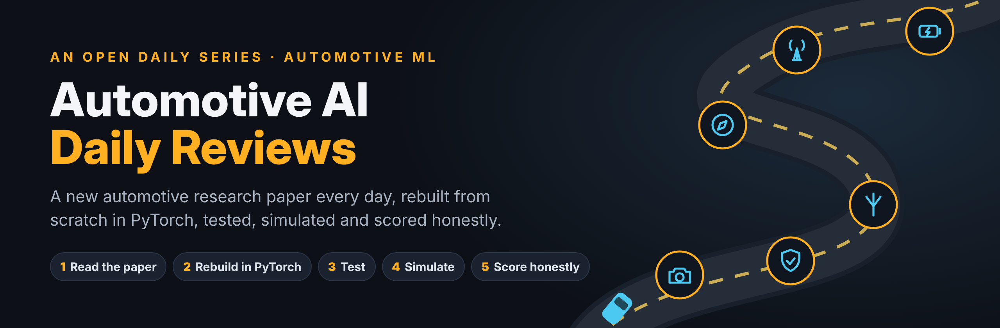
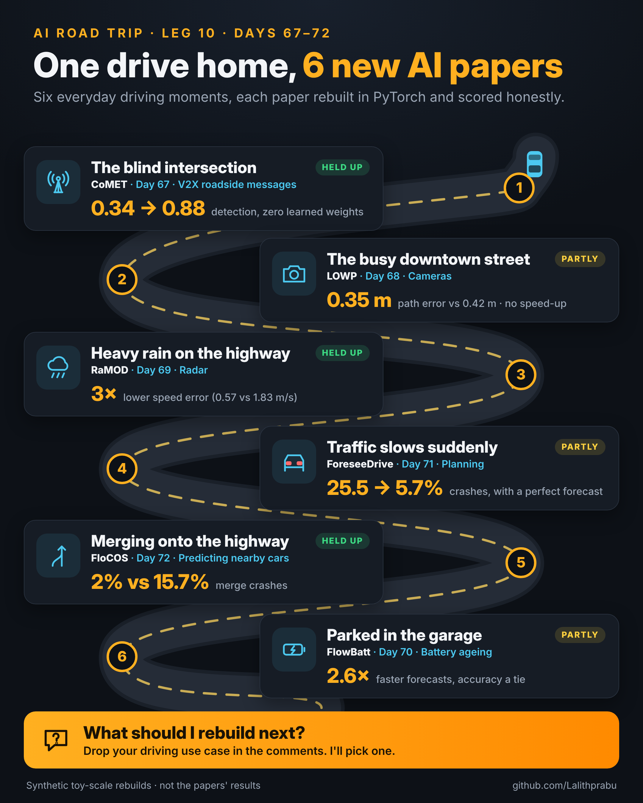
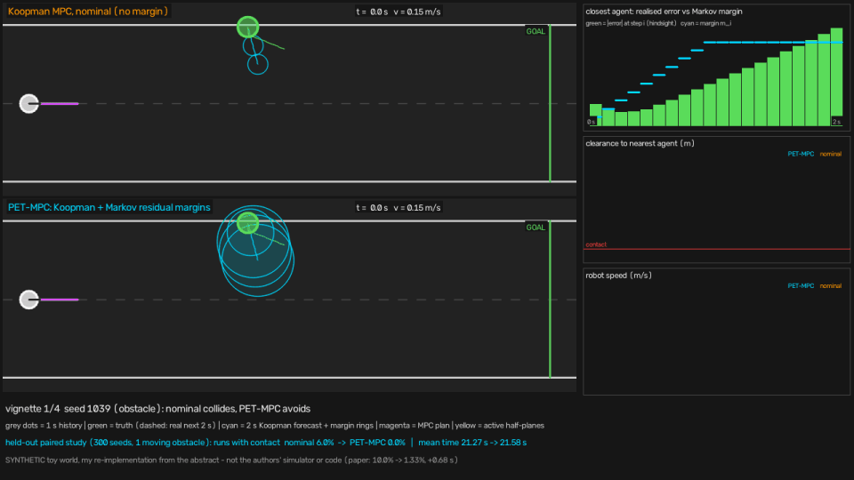
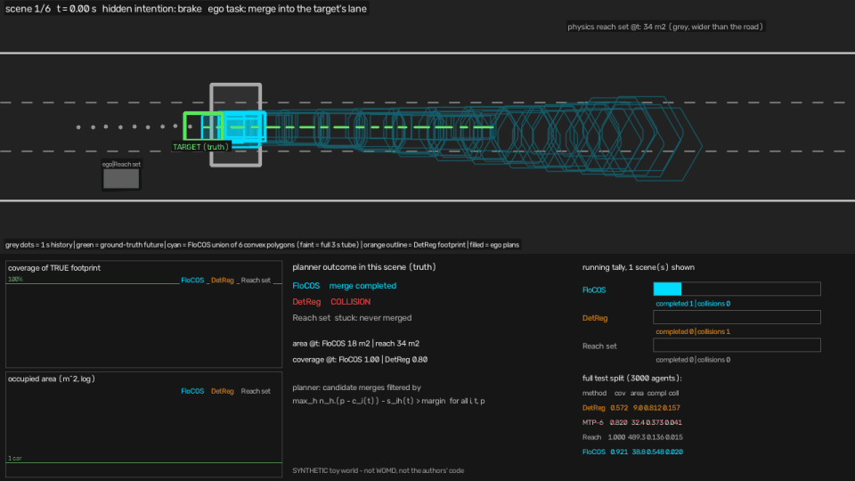
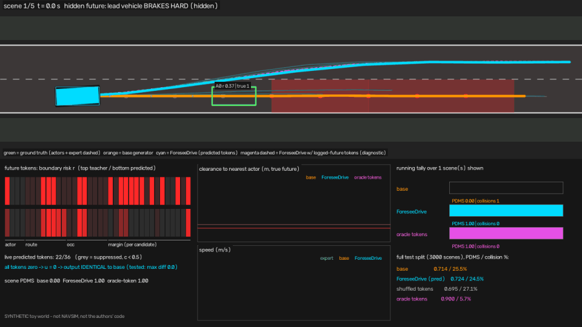
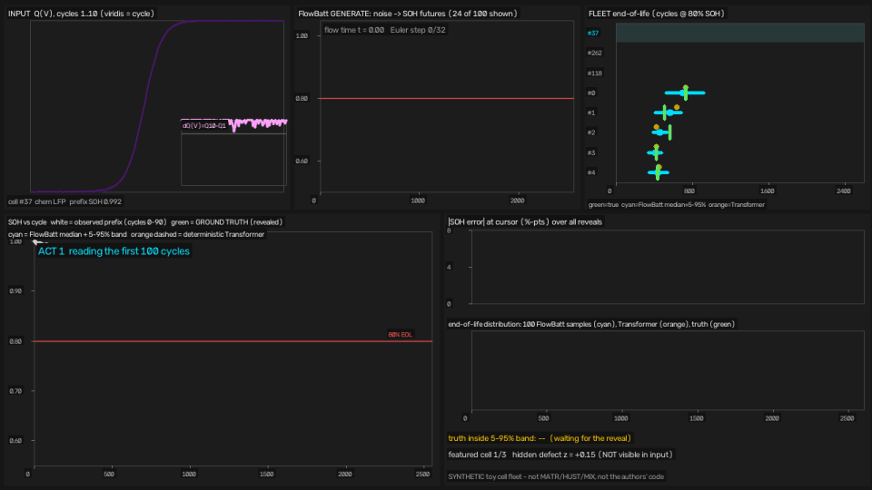
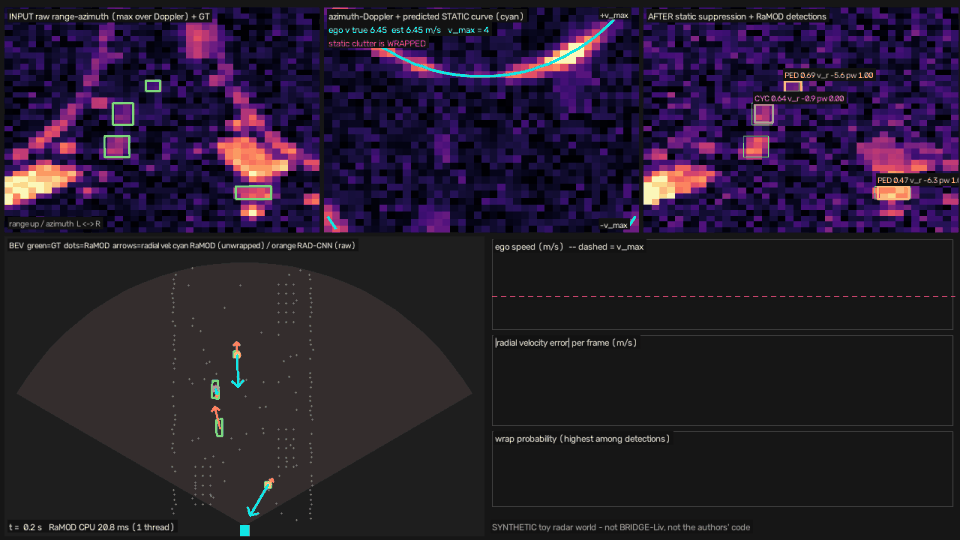
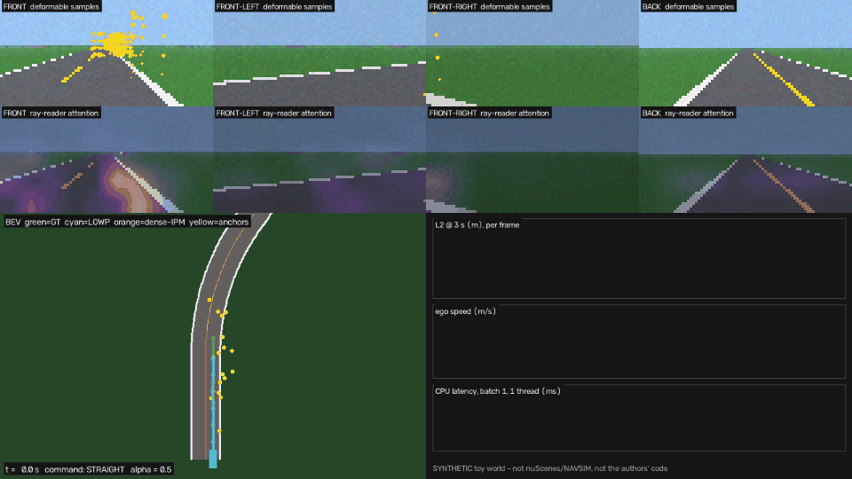

<p align="center"></p>

<p align="center">
  
  
  
  
  
</p>

<p align="center">
  <a href="#-latest-road-trip-leg">Latest leg</a> ·
  <a href="#-latest-simulations">Simulations</a> ·
  <a href="#-explore-by-domain">Explore by domain</a> ·
  <a href="#-the-ai-road-trip-weekly-recaps">Weekly recaps</a> ·
  <a href="#-run-any-day-in-60-seconds">Quick start</a> ·
  <a href="#-suggest-a-use-case">Suggest a use case</a>
</p>

Every day I pick a fresh automotive machine-learning paper (ADAS perception, motion forecasting, planning, V2X, EV batteries), **rebuild its core idea from scratch in PyTorch**, test it, run it in a synthetic simulation, and report honestly whether the idea held up at toy scale. Each day ships as one self-contained folder, plus a LinkedIn post that explains it in plain language.

## 🔥 Latest road-trip leg

**Leg 10 · Days 67–72: One drive home, 6 new AI papers**

<p align="center"></p>

| Real-world moment | Paper | Day | What my rebuild showed | Verdict |
|---|---|---|---|---|
| The blind intersection | [**CoMET**](day-67-comet/) | 67 | detection 0.34 → 0.88, zero learned weights | ✅ Held up |
| The busy downtown street | [**LOWP**](day-68-lowp/) | 68 | path error 0.35 vs 0.42 m, no speed-up | 🟡 Partly |
| Heavy rain on the highway | [**RaMOD**](day-69-ramod/) | 69 | speed error 0.57 vs 1.83 m/s | ✅ Held up |
| Traffic slows suddenly | [**ForeseeDrive**](day-71-foreseedrive/) | 71 | crashes 25.5% → 5.7% with a perfect forecast; +1 pt with its own | 🟡 Partly |
| Merging onto the highway | [**FloCOS**](day-72-flocos/) | 72 | merge crashes 2% vs 15.7% | ✅ Held up |
| Parked in the garage | [**FlowBatt**](day-70-flowbatt/) | 70 | 2.6x faster, accuracy a tie | 🟡 Partly |

<sub>All numbers come from my own small synthetic rebuilds, not the papers' results.</sub>

## 🎬 Latest simulations

<table>
  <tr>
    <td align="center" width="33%"><a href="day-73-petmpc/"></a><br><b>Day 73 · PET-MPC</b><br><sub>Safety margins sized by measured forecast error</sub></td>
    <td align="center" width="33%"><a href="day-72-flocos/"></a><br><b>Day 72 · FloCOS</b><br><sub>Predicts the space a nearby car might take</sub></td>
    <td align="center" width="33%"><a href="day-71-foreseedrive/"></a><br><b>Day 71 · ForeseeDrive</b><br><sub>Gives the planner a forecast so it reacts early</sub></td>
  </tr>
  <tr>
    <td align="center" width="33%"><a href="day-70-flowbatt/"></a><br><b>Day 70 · FlowBatt</b><br><sub>Forecasts a battery's ageing curve with uncertainty</sub></td>
    <td align="center" width="33%"><a href="day-69-ramod/"></a><br><b>Day 69 · RaMOD</b><br><sub>Finds what's moving in raw radar, even in rain</sub></td>
    <td align="center" width="33%"><a href="day-68-lowp/"></a><br><b>Day 68 · LOWP</b><br><sub>Reads the cameras only where the car will drive</sub></td>
  </tr>
</table>

## 🧭 Explore by domain

| Domain | What it covers | Papers |
|---|---|---|
| 👁️ [Perception](#-perception) | Cameras, radar, LiDAR, depth, HD maps and 3D occupancy | 12 |
| 🔮 [Prediction & forecasting](#-prediction--forecasting) | Trajectories, intentions and future occupancy of other road users | 22 |
| 🧭 [Planning & end-to-end driving](#-planning--end-to-end-driving) | World models and planners that decide where the car goes | 17 |
| 📡 [V2X & cooperative driving](#-v2x--cooperative-driving) | Cars and roadside units sharing what they see, despite delay and loss | 11 |
| 🔋 [EV battery & vehicle health](#-ev-battery--vehicle-health) | Degradation, remaining useful life and health monitoring | 3 |
| 🛡️ [Safety, risk & uncertainty](#-safety-risk--uncertainty) | Risk fields, calibrated uncertainty and safety-critical scenarios | 7 |

### 👁️ Perception

<details><summary><b>12 papers</b>: Cameras, radar, LiDAR, depth, HD maps and 3D occupancy</summary>

| Day | Paper | In one line | arXiv | Demo |
|---|---|---|---|---|
| 69 | [**RaMOD**](day-69-ramod/) · Moving-Object Detection from Raw mmWave Radar | Finds what's moving in raw radar, even in rain | [2611.13271](https://arxiv.org/abs/2611.13271) | [▶ GIF](day-69-ramod/assets/ramod_simulation.gif) |
| 62 | [**EvoOcc**](day-62-evoocc/) · Fast-Slow Evolutionary Occupancy Prediction | Fuses a fast-but-weak and a slow-but-late model | [2611.02499](https://arxiv.org/abs/2611.02499) | [▶ GIF](day-62-evoocc/assets/evoocc_sim.gif) |
| 55 | [**FastBEVFusion**](day-55-fastbevfusion/) · Fast LiDAR + Camera BEV Fusion | Faster LiDAR-camera fusion in bird's-eye view | [2610.37153](https://arxiv.org/abs/2610.37153) | [▶ GIF](day-55-fastbevfusion/assets/fastbev_demo.gif) |
| 51 | [**Foundation4D**](day-51-foundation4d/) · One Model for Depth, Detection, Occupancy and Gaussians | One backbone for four perception tasks | [2610.30340](https://arxiv.org/abs/2610.30340) | [▶ GIF](day-51-foundation4d/assets/foundation4d_simulation.gif) |
| 45 | [**Decision-FLIP**](day-45-decision-flip/) · Budget-Free Pruning for Gaussian Occupancy Models | Label-free pruning of occupancy models | [2610.20917](https://arxiv.org/abs/2610.20917) | [▶ GIF](day-45-decision-flip/assets/decision_flip_simulation.gif) |
| 42 | [**RadarGSOcc**](day-42-radargsocc/) · Doppler-Aware 3D Semantic Occupancy from 4D Radar | 3D occupancy from 4D radar alone | [2610.18686](https://arxiv.org/abs/2610.18686) | [▶ GIF](day-42-radargsocc/assets/simulation.gif) |
| 29 | [**MapLightning**](day-29-maplightning/) · Online Vectorized HD Maps with 1D Map Tokens | Builds HD maps on the fly without camera calibration | [2610.01905](https://arxiv.org/abs/2610.01905) | [▶ GIF](day-29-maplightning/assets/maplightning_simulation.gif) |
| 23 | [**PriorMapBEVNet**](day-23-priormapbevnet/) · Vision-Built Map Priors for 3D Detection + HD Mapping | Camera detection boosted by a remembered map of the route | [2609.26325](https://arxiv.org/abs/2609.26325) | [▶ GIF](day-23-priormapbevnet/priormapbevnet_simulation.gif) |
| 21 | [**ChronoFuse**](day-21-chronofuse/) · Predicting Ahead to Beat Event-Camera Latency | Detects where objects will be when the output is ready | [2609.26919](https://arxiv.org/abs/2609.26919) | [▶ GIF](day-21-chronofuse/chronofuse_simulation.gif) |
| 14 | [**Sparse-BEVNet**](day-14-sparse-bevnet/) · Sparse-Attention Multi-View BEV 3D Detection | Cheaper camera-only 3D detection with sparse attention | [2609.14185](https://arxiv.org/abs/2609.14185) | [▶ GIF](day-14-sparse-bevnet/assets/sparse_bevnet_simulation.gif) |
| 8 | [**Marigold**](day-08-marigold/) · Diffusion Models as Monocular Depth Estimators | Turns an image generator into a single-camera depth sensor | [2312.02145](https://arxiv.org/abs/2312.02145) | [▶ GIF](day-08-marigold/trajectory_simulation.gif) |
| 3 | [**PART**](day-03-part/) · Physics-Aware Radar Transformer | Radar transformer that respects Doppler physics | [2609.02289](https://arxiv.org/abs/2609.02289) | [▶ GIF](day-03-part/trajectory_simulation.gif) |

</details>

### 🔮 Prediction & forecasting

<details open><summary><b>22 papers</b>: Trajectories, intentions and future occupancy of other road users</summary>

| Day | Paper | In one line | arXiv | Demo |
|---|---|---|---|---|
| 73 | [**PET-MPC**](day-73-petmpc/) · Prediction-Error-Tightened MPC for Crowd Navigation | Safety margins sized by measured forecast error | [2611.15781](https://arxiv.org/abs/2611.15781) | [▶ GIF](day-73-petmpc/assets/petmpc_simulation.gif) |
| 72 | [**FloCOS**](day-72-flocos/) · Compact Forward Occupancy Sets via Flow Matching | Predicts the space a nearby car might take | [2611.15488](https://arxiv.org/abs/2611.15488) | [▶ GIF](day-72-flocos/assets/flocos_simulation.gif) |
| 66 | [**FreeOcc**](day-66-freeocc/) · 4D Occupancy Forecasting | Forecasts how the 3D scene fills up next | [2611.08128](https://arxiv.org/abs/2611.08128) | — |
| 65 | [**MotoVerse**](day-65-motoverse/) · Traffic Anticipation from a Rider's View | Predicts traffic through a motorcyclist's eyes | [2611.06007](https://arxiv.org/abs/2611.06007) | — |
| 60 | [**INTERACT-Slots**](day-60-interact/) · Object-Centric World Model for Interaction-Aware Prediction | Sees the road as objects, then imagines their futures | [2611.02526](https://arxiv.org/abs/2611.02526) | [▶ GIF](day-60-interact/assets/interact_demo_trained.gif) |
| 58 | [**Motion-Onset-GNN**](day-58-motion-onset/) · Meta-Learned Scene Graphs for Motion Onset | Predicts the moment a stopped agent starts moving | [2610.38993](https://arxiv.org/abs/2610.38993) | [▶ GIF](day-58-motion-onset/assets/onset_demo.gif) |
| 57 | [**eCoMAE**](day-57-ecomae/) · Evidential Masked Pretraining for VRU Intent | Pedestrian/cyclist intent with honest uncertainty | [2610.39958](https://arxiv.org/abs/2610.39958) | [▶ GIF](day-57-ecomae/assets/ecomae_demo.gif) |
| 54 | [**SpatialBEV**](day-54-spatialbev/) · Off-Road Dynamics Learning in BEV | Learns how a vehicle moves over rough terrain | [2610.22900](https://arxiv.org/abs/2610.22900) | [▶ GIF](day-54-spatialbev/assets/spatialbev_demo.gif) |
| 49 | [**KG-LaneChange**](day-49-kg-lanechange/) · Lane-Change Prediction with Knowledge Graphs | Knowledge graphs + Bayesian inference for lane changes | [2610.30528](https://arxiv.org/abs/2610.30528) | [▶ GIF](day-49-kg-lanechange/assets/simulation.gif) |
| 46 | [**STC-MGNet**](day-46-stc-mgnet/) · Pedestrian Intention via Multimodal Graph Network | Pedestrian intent from pose graphs + ego motion | [2610.23356](https://arxiv.org/abs/2610.23356) | [▶ GIF](day-46-stc-mgnet/assets/simulation.gif) |
| 43 | [**FutureLift**](day-43-futurelift/) · Bidirectional Future Graphs for Motion Forecasting | Refines forecast proposals as future graphs | [2610.22215](https://arxiv.org/abs/2610.22215) | [▶ GIF](day-43-futurelift/assets/simulation.gif) |
| 41 | [**X-TRACK**](day-41-xtrack-uq/) · Physics-Aware Highway Trajectory Prediction with UQ | Physics-aware forecasts with calibrated uncertainty | [2610.11580](https://arxiv.org/abs/2610.11580) | [▶ GIF](day-41-xtrack-uq/assets/simulation.gif) |
| 38 | [**WZDrive**](day-38-wzdrive/) · Trajectory Prediction in Road Construction Zones | Uses driver gaze to predict paths through work zones | [2610.12747](https://arxiv.org/abs/2610.12747) | [▶ GIF](day-38-wzdrive/assets/wzdrive_simulation.gif) |
| 36 | [**MESSENGER**](day-36-messenger/) · Memory-Enhanced Scene-Flow Forecasting | Forecasts LiDAR motion using a memory of past flow | [2610.10759](https://arxiv.org/abs/2610.10759) | [▶ GIF](day-36-messenger/assets/messenger_simulation.gif) |
| 35 | [**CAA-GMM**](day-35-caa-gmm/) · Context-Aware Gaussian-Mixture Trajectory Prediction | Attention over neighbours and map, mixture of futures | [2610.09174](https://arxiv.org/abs/2610.09174) | [▶ GIF](day-35-caa-gmm/assets/simulation.gif) |
| 34 | [**LighTROcc**](day-34-lightrocc/) · Lightweight 4D Occupancy Forecasting with 3D Gaussians | Forecasts occupancy per object with 3D Gaussians | [2610.09444](https://arxiv.org/abs/2610.09444) | [▶ GIF](day-34-lightrocc/assets/lightrocc_simulation.gif) |
| 32 | [**MoCAR**](day-32-mocar/) · Motion-Code Autoregression for Trajectory Forecasting | Forecasts motion as a sequence of learned motion codes | [2610.06210](https://arxiv.org/abs/2610.06210) | [▶ GIF](day-32-mocar/assets/mocar_simulation.gif) |
| 28 | [**MomWorld**](day-28-momworld/) · Momentum-Aware Latent World Model | Long-horizon prediction with latent momentum | [2609.33737](https://arxiv.org/abs/2609.33737) | [▶ GIF](day-28-momworld/outputs/momworld_simulation.gif) |
| 24 | [**INTERACT**](day-24-interact/) · Anchor-Conditioned Prediction + Trust-Region Refinement | Predicts how others react, once per intent instead of per plan | [2609.31137](https://arxiv.org/abs/2609.31137) | [▶ GIF](day-24-interact/assets/simulation.gif) |
| 16 | [**EKF-Neural-Fusion**](day-16-ekf-neural-fusion/) · Neural Fusion of EKF Trajectory Candidates | Blends classic Kalman motion models with a neural predictor | [2609.19813](https://arxiv.org/abs/2609.19813) | [▶ GIF](day-16-ekf-neural-fusion/trajectory_fusion_simulation.gif) |
| 9 | [**TrajFusionNet+**](day-09-trajfusionnet-plus/) · Pedestrian Crossing Intention with Scene Graphs | Will that pedestrian cross? Trajectories + scene graphs | [2609.10806](https://arxiv.org/abs/2609.10806) | [▶ GIF](day-09-trajfusionnet-plus/trajectory_simulation.gif) |
| 7 | [**MC-DeTra**](day-07-mc-detra/) · Motion-Consistent Joint Detection + Forecasting | Detects objects and forecasts their motion in one pass | [2609.11717](https://arxiv.org/abs/2609.11717) | [▶ GIF](day-07-mc-detra/trajectory_simulation.gif) |

</details>

### 🧭 Planning & end-to-end driving

<details><summary><b>17 papers</b>: World models and planners that decide where the car goes</summary>

| Day | Paper | In one line | arXiv | Demo |
|---|---|---|---|---|
| 71 | [**ForeseeDrive**](day-71-foreseedrive/) · Future-Token Conditioning for Anticipatory Driving | Gives the planner a forecast so it reacts early | [2611.14286](https://arxiv.org/abs/2611.14286) | [▶ GIF](day-71-foreseedrive/assets/foresee_simulation.gif) |
| 68 | [**LOWP**](day-68-lowp/) · Look Only Where You Plan | Reads the cameras only where the car will drive | [2611.10264](https://arxiv.org/abs/2611.10264) | [▶ GIF](day-68-lowp/assets/lowp_simulation.gif) |
| 64 | [**VFlash**](day-64-vflash/) · Flash Primitive Decoding | Drafts a whole path in one pass (~10x faster) | [2611.08449](https://arxiv.org/abs/2611.08449) | — |
| 63 | [**NegWAM**](day-63-negwam/) · Negative-Aware World-Action Model | Learns from near misses, not just good driving | [2611.08111](https://arxiv.org/abs/2611.08111) | [▶ GIF](day-63-negwam/assets/negwam_demo.gif) |
| 61 | [**RFWorld**](day-61-rfworld/) · Rollout-Free Trajectory Evaluation | Scores candidate paths without step-by-step rollouts | [2611.05072](https://arxiv.org/abs/2611.05072) | [▶ GIF](day-61-rfworld/assets/rfworld_demo.gif) |
| 50 | [**Hazard-Guided Flow**](day-50-hazard-guided-flow/) · Hazard-Energy Guidance for Flow-Matching Planners | Steers a generative planner away from hazards | [2610.28184](https://arxiv.org/abs/2610.28184) | [▶ GIF](day-50-hazard-guided-flow/assets/simulation.gif) |
| 39 | [**ManeuverFlow**](day-39-maneuverflow/) · Maneuver Hypotheses with Future Evidence | One-step, intent-diverse plan generation | [2610.13409](https://arxiv.org/abs/2610.13409) | [▶ GIF](day-39-maneuverflow/assets/maneuverflow_simulation.gif) |
| 27 | [**EMPlan**](day-27-emplan/) · Multi-Modal Planning with Reward-Guided Preferences | Sparse plan anchors tuned by rule-based rewards | [2609.38862](https://arxiv.org/abs/2609.38862) | [▶ GIF](day-27-emplan/assets/emplan_simulation.gif) |
| 26 | [**WALT**](day-26-walt/) · World-Model-Aligned Latent Trajectories | Plans in a latent space borrowed from a world model | [2609.30436](https://arxiv.org/abs/2609.30436) | [▶ GIF](day-26-walt/assets/walt_simulation.gif) |
| 25 | [**ECO**](day-25-eco/) · Endpoint-Constrained Trajectory Optimization | Training-free layer that smooths planned paths | [2609.31383](https://arxiv.org/abs/2609.31383) | [▶ GIF](day-25-eco/assets/eco_simulation.gif) |
| 22 | [**S2Planner**](day-22-s2planner/) · Multi-Scale Semantic Planner | Plans straight from DINOv3 image features | [2609.29813](https://arxiv.org/abs/2609.29813) | [▶ GIF](day-22-s2planner/outputs/s2planner_simulation.gif) |
| 20 | [**ForeDrive**](day-20-foredrive/) · Foresight-Guided Driving with a Latent World Model | A latent world model gives the planner foresight | [2609.26299](https://arxiv.org/abs/2609.26299) | [▶ GIF](day-20-foredrive/simulation.gif) |
| 17 | [**RiskWorld**](day-17-riskworld/) · Risk-Aware World Model with Flow-Guided Occupancy | Forecasts occupancy + risk, then replaces risky plans | [2609.18442](https://arxiv.org/abs/2609.18442) | [▶ GIF](day-17-riskworld/outputs/riskworld_simulation.gif) |
| 15 | [**MM-Future**](day-15-mm-future/) · Multi-Mode Joint World-Action Modeling | Generates future scenes and actions together | [2609.20377](https://arxiv.org/abs/2609.20377) | [▶ GIF](day-15-mm-future/mm_future_simulation.gif) |
| 5 | [**DriveZero**](day-05-drivezero/) · End-to-End Driving Beyond Human Demonstrations | Learns to drive past human examples with RL + distillation | [2609.06055](https://arxiv.org/abs/2609.06055) | [▶ GIF](day-05-drivezero/trajectory_simulation.gif) |
| 2 | [**Qwen-Drive-1.0**](day-02-qwen-drive-1-0/) · Vision-Language Foundation Model for Autonomous Driving | A vision-language model that perceives and plans | [2609.00111](https://arxiv.org/abs/2609.00111) | [▶ GIF](day-02-qwen-drive-1-0/trajectory_simulation.gif) |
| 1 | [**SV-WAM**](day-01-sv-wam/) · Surround-View World-Action Model for End-to-End Driving | One model sees all cameras and outputs the drive | [2609.03602](https://arxiv.org/abs/2609.03602) | [▶ GIF](day-01-sv-wam/trajectory_simulation.gif) |

</details>

### 📡 V2X & cooperative driving

<details><summary><b>11 papers</b>: Cars and roadside units sharing what they see, despite delay and loss</summary>

| Day | Paper | In one line | arXiv | Demo |
|---|---|---|---|---|
| 67 | [**CoMET**](day-67-comet/) · Shared Pose-Error Tracking for Async V2X Detection | Fixes late, slightly-off roadside messages | [2611.09121](https://arxiv.org/abs/2611.09121) | [▶ GIF](day-67-comet/assets/comet_simulation.gif) |
| 56 | [**LinkDreamer**](day-56-linkdreamer/) · Cooperative Perception over Intermittent V2X | Keeps cooperating when the V2X link drops | [2610.39258](https://arxiv.org/abs/2610.39258) | [▶ GIF](day-56-linkdreamer/assets/linkdreamer_demo.gif) |
| 48 | [**LoRA-FedFT**](day-48-lora-fedft/) · Pedestrian Prediction through LoRA Federated Training | Federated LoRA tuning of a foundation forecaster | [2610.18640](https://arxiv.org/abs/2610.18640) | [▶ GIF](day-48-lora-fedft/assets/simulation.gif) |
| 47 | [**TRB**](day-47-trb/) · Temporal Residual Bottleneck for Async Collaborative Perception | Corrects delayed collaborator BEV features | [2610.10090](https://arxiv.org/abs/2610.10090) | [▶ GIF](day-47-trb/assets/trb_simulation.gif) |
| 44 | [**LoRA-Fed-Ped**](day-44-lora-fed-ped/) · LoRA Federated Training for Pedestrian Prediction | Only tiny LoRA adapters cross the V2I link | [2610.18640](https://arxiv.org/abs/2610.18640) | [▶ GIF](day-44-lora-fed-ped/assets/simulation.gif) |
| 40 | [**CoCam4D**](day-40-cocam4d/) · Geometry-Aware Cooperative 4D Camera Perception | 35-byte object messages with delay compensation | [2610.11577](https://arxiv.org/abs/2610.11577) | [▶ GIF](day-40-cocam4d/cocam4d_simulation.gif) |
| 33 | [**Sparse2comm**](day-33-sparse2comm/) · Robust Cooperative 3D Detection | Shares ~2% of the map yet detects cooperatively | [2610.08573](https://arxiv.org/abs/2610.08573) | [▶ GIF](day-33-sparse2comm/assets/simulation.gif) |
| 30 | [**EgoRefine**](day-30-egorefine/) · Ego-Referenced Alignment for Async Collaborative Perception | Aligns late collaborator data to what the ego sees now | [2610.00319](https://arxiv.org/abs/2610.00319) | [▶ GIF](day-30-egorefine/egorefine_simulation.gif) |
| 19 | [**V2X-LDPC-Recovery**](day-19-v2x-ldpc-recovery/) · Prediction-Aided V2X Safety-Message Recovery | Repairs corrupted V2X messages using motion prediction | [2609.25609](https://arxiv.org/abs/2609.25609) | [▶ GIF](day-19-v2x-ldpc-recovery/assets/v2x_ldpc_recovery_simulation.gif) |
| 13 | [**LDE**](day-13-lde/) · Learning from Distributed Eyes | Adapts perception using a nearby car's detections as labels | [2609.18511](https://arxiv.org/abs/2609.18511) | [▶ GIF](day-13-lde/assets/lde_simulation.gif) |
| 12 | [**BeamTransFuser**](day-12-beamtransfuser/) · Robust V2X Beam Prediction with Multi-Modal Sensing | Points the radio beam using cameras, LiDAR, radar and GPS | [2609.10200](https://arxiv.org/abs/2609.10200) | [▶ GIF](day-12-beamtransfuser/assets/beam_prediction_simulation.gif) |

</details>

### 🔋 EV battery & vehicle health

<details><summary><b>3 papers</b>: Degradation, remaining useful life and health monitoring</summary>

| Day | Paper | In one line | arXiv | Demo |
|---|---|---|---|---|
| 70 | [**FlowBatt**](day-70-flowbatt/) · Flow Matching for Battery Degradation Prediction | Forecasts a battery's ageing curve with uncertainty | [2611.03150](https://arxiv.org/abs/2611.03150) | [▶ GIF](day-70-flowbatt/assets/flowbatt_simulation.gif) |
| 53 | [**CWT-RUL**](day-53-cwt-rul/) · Early-Cycle Battery Life from Wavelet Scalograms | Predicts battery lifetime from its first cycles | [2610.34159](https://arxiv.org/abs/2610.34159) | [▶ GIF](day-53-cwt-rul/assets/cwt_rul_simulation.gif) |
| 18 | [**ChargeIC-LSTM**](day-18-ic-degradation-lstm/) · Battery Degradation Monitoring from Charging Signals | Reads battery health from an ordinary charging session | [2609.22843](https://arxiv.org/abs/2609.22843) | [▶ GIF](day-18-ic-degradation-lstm/battery_ic_simulation.gif) |

</details>

### 🛡️ Safety, risk & uncertainty

<details><summary><b>7 papers</b>: Risk fields, calibrated uncertainty and safety-critical scenarios</summary>

| Day | Paper | In one line | arXiv | Demo |
|---|---|---|---|---|
| 52 | [**SafeDriveVLA**](day-52-safedrivevla/) · Conflict-Aware Instruction Following | Follow, adapt or refuse a risky instruction | [2610.20609](https://arxiv.org/abs/2610.20609) | [▶ GIF](day-52-safedrivevla/assets/safedrivevla_simulation.gif) |
| 37 | [**SCOPE**](day-37-scope/) · Control-Ready Uncertainty for Trajectory Diffusion | Uncertainty tubes ~45x faster than sampling | [2610.12431](https://arxiv.org/abs/2610.12431) | [▶ GIF](day-37-scope/assets/scope_simulation.gif) |
| 31 | [**SLLCP**](day-31-sllcp/) · Localized Conformal Safety Monitoring with VLMs | Turns an overconfident VLM into calibrated safety sets | [2610.02765](https://arxiv.org/abs/2610.02765) | [▶ GIF](day-31-sllcp/assets/sllcp_simulation.gif) |
| 11 | [**DRiF**](day-11-drif/) · Data-Driven Risk Fields for Safer Driving | Dense risk map shared with mapping and planning | [2609.10377](https://arxiv.org/abs/2609.10377) | [▶ GIF](day-11-drif/assets/trajectory_simulation.gif) |
| 10 | [**READ**](day-10-read/) · Risk-Informed Fields for End-to-End Driving | A learned risk field instead of fixed safety bubbles | [2609.12371](https://arxiv.org/abs/2609.12371) | [▶ GIF](day-10-read/assets/trajectory_simulation.gif) |
| 6 | [**COSTER**](day-06-coster/) · Collision-Snapshot Time-Reversed Scenario Generation | Builds crash scenarios by running time backwards from impact | [2609.06433](https://arxiv.org/abs/2609.06433) | [▶ GIF](day-06-coster/trajectory_simulation.gif) |
| 4 | [**SSDS + DAPSE**](day-04-ssds-dapse/) · One Diffusion Model, Two Roles | One diffusion model plans and also invents risky test scenarios | [2609.04921](https://arxiv.org/abs/2609.04921) | [▶ GIF](day-04-ssds-dapse/trajectory_simulation.gif) |

</details>

## 🛣️ The AI Road Trip (weekly recaps)

Every week the daily rebuilds are bundled into one recap: a carousel, a narrated video, or a one-image overview.

| Leg | Days | Papers | Format |
|---|---|---|---|
| [Leg 10](road-trip/AI-Road-Trip-Leg10-Overview.png) | 67–72 | CoMET, LOWP, RaMOD, FlowBatt, ForeseeDrive, FloCOS | One-image overview |
| [Leg 9](road-trip/AI-Road-Trip-Leg9.mp4) | 60–65 | INTERACT-Slots, RFWorld, EvoOcc, NegWAM, VFlash, MotoVerse | Video |
| [Leg 8](road-trip/AI-Road-Trip-Leg8-Narrated-Male.mp4) | 52–58 | SafeDriveVLA, CWT-RUL, SpatialBEV, FastBEVFusion, LinkDreamer, eCoMAE, Motion-Onset-GNN | Narrated video |
| [Leg 7](road-trip/AI-Road-Trip-Leg7-Narrated.mp4) | 45–51 | Decision-FLIP, STC-MGNet, TRB, LoRA-FedFT, KG-LaneChange, Hazard-Guided Flow, Foundation4D | Narrated video |
| [Leg 6](road-trip/AI-Road-Trip-Leg6-Narrated.mp4) | 38–44 | WZDrive, ManeuverFlow, CoCam4D, X-TRACK, RadarGSOcc, FutureLift, LoRA-Fed-Ped | Narrated video |
| [Leg 5](road-trip/AI-Road-Trip-Leg5-Carousel.pdf) | 31–37 | SLLCP, MoCAR, Sparse2comm, LighTROcc, CAA-GMM, MESSENGER, SCOPE | Carousel (PDF) |
| [Leg 4](road-trip/AI-Road-Trip-Leg4-Carousel.pdf) | 24–30 | INTERACT, ECO, WALT, EMPlan, MomWorld, MapLightning, EgoRefine | Carousel (PDF) |
| [Leg 3](road-trip/AI-Road-Trip-Leg3-Carousel.pdf) | 16–23 | EKF-Neural-Fusion, RiskWorld, ChargeIC-LSTM, V2X-LDPC-Recovery, ForeDrive, ChronoFuse, S2Planner, PriorMapBEVNet | Carousel (PDF) |
| [Leg 2](road-trip/AI-Road-Trip-Leg2-Carousel.pdf) | 8–15 | Marigold, TrajFusionNet+, READ, DRiF, BeamTransFuser, LDE, Sparse-BEVNet, MM-Future | Carousel (PDF) |
| [Leg 1](road-trip/AI-Road-Trip-Carousel.pdf) | 1–7 | SV-WAM, Qwen-Drive-1.0, PART, SSDS + DAPSE, DriveZero, COSTER, MC-DeTra | Carousel (PDF) |

## 🚀 Run any day in 60 seconds

Every `day-NN-*/` folder is self-contained:

```bash
git clone https://github.com/Lalithprabu/automotive-ai-daily-reviews.git
cd automotive-ai-daily-reviews/day-73-petmpc
pip install -r requirements.txt
pytest tests/ -v        # unit tests
python train.py         # trains on synthetic data (see the folder README for flags)
python simulate.py      # renders the simulation GIF
```

Each folder README covers the architecture, an old-vs-new comparison, results, limitations and a sourcing note (`SOURCING.md` in recent days) that separates what came from the paper from what is my own choice.

## 📁 Repository layout

```text
automotive-ai-daily-reviews/
├── README.md              ← you are here (generated by tools/build_readme.py)
├── catalog.json           ← one entry per day: the single source of truth
├── daily-series-log.md    ← full chronological log (generated)
├── day-01-sv-wam/ … day-73-petmpc/   ← one self-contained folder per paper
├── road-trip/             ← weekly recap carousels, videos and overview images
├── assets/                ← banner
├── docs/PROVENANCE.md     ← how earlier days were sourced and rebuilt
└── tools/                 ← README generator + banner source
```

## 🙋 Suggest a use case

Is there a driving problem you wish AI would solve? [Open a use-case request](https://github.com/Lalithprabu/automotive-ai-daily-reviews/issues/new?template=use-case.yml) or comment on the LinkedIn post. I pick one suggestion for an upcoming day and credit you in that day's post.

## ⚖️ Honesty note

This is an independent, educational series of **toy-scale reference re-implementations**. It is *not* the authors' official code, and results come from synthetic data rather than the papers' benchmarks. When an idea did not reproduce, the folder says so. Sourcing details are in [docs/PROVENANCE.md](docs/PROVENANCE.md) and each folder's README / `SOURCING.md`. Day 59 was a rest stop. Licensed under [MIT](LICENSE).
