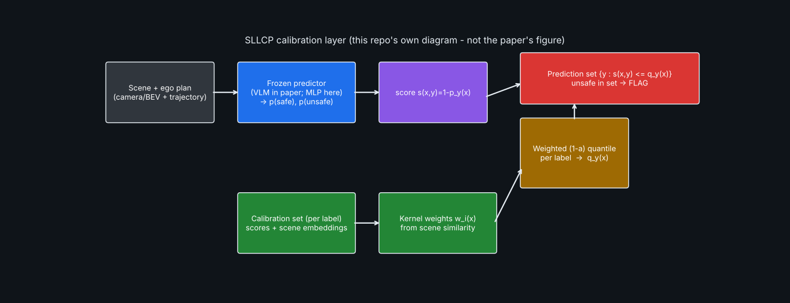
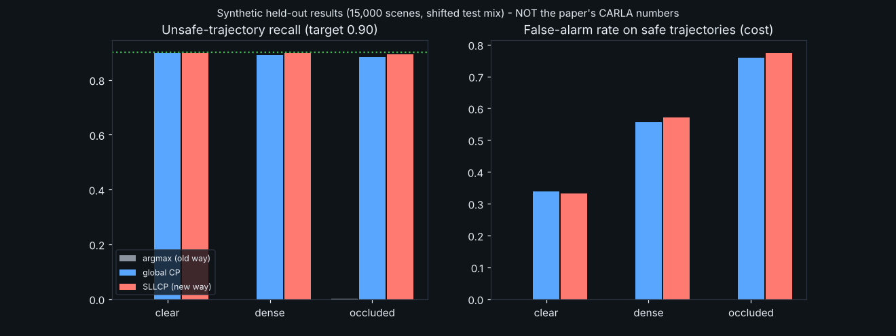

# Day 31 — SLLCP: Split Label-Localized Conformal Safety Monitoring

Reconstruction of the calibration layer from *Localized Conformal Safety Monitoring with Vision-Language Models for Autonomous Driving* (arXiv:2610.02765, Univ. of Michigan, Oct 2026). Read `SOURCING.md` first: only abstract-level facts are paper-sourced; the predictor, data and all reported numbers are this repo's own.



## Structure
```
day-31-sllcp/
├── sllcp/{conformal.py, models.py, data.py}   # core layer, stand-in predictor, scenario simulator
├── tests/test_all.py                          # 6 tests incl. coverage guarantee + core claim
├── train.py  evaluate.py  simulate.py  make_assets.py
├── config.yaml  requirements.txt  SOURCING.md  LINKEDIN_POST.md
└── assets/{sllcp_simulation.gif, architecture.png, results.png}
```
## Run
```
pip install -r requirements.txt
pytest tests -v        # 6 passed
python train.py        # train predictor, calibrate, evaluate
python simulate.py     # renders assets/sllcp_simulation.gif
```
## Core idea
For label y, score s(x,y)=1−p_y(x). Per-label calibration sets give class-conditional coverage (crucial: collisions are rare). Localization weights calibration points by scene similarity w_i=exp(−‖z−z_i‖²/2h²) and takes the weighted (1−α) quantile with the test point's unit mass at +∞. A trajectory is flagged unsafe if "unsafe" is in the prediction set. See `sllcp/conformal.py`.

## Results (synthetic, held-out 15,000 scenes, shifted to mostly-occluded)
| method | unsafe recall | false alarm |
|---|---|---|
| argmax (old way) | 0.001 | 0.000 |
| global label-conditional CP | 0.889 | 0.633 |
| SLLCP | 0.895 | 0.646 |


