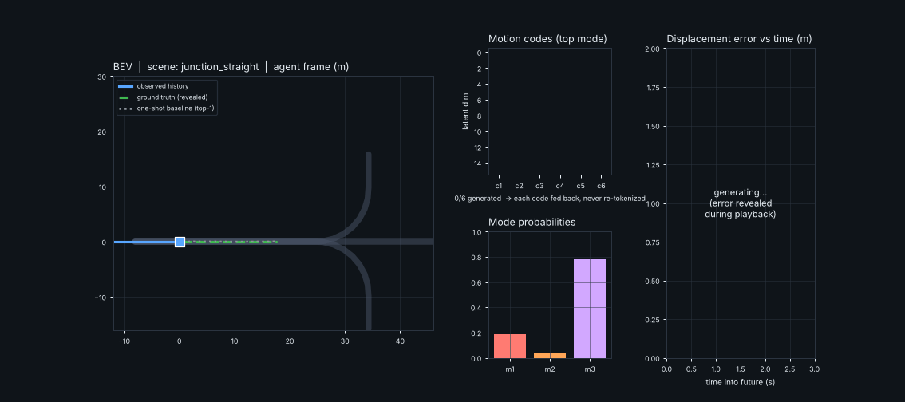

# Day 32 — MoCAR: trajectory forecasting as next-motion-code prediction (PyTorch reconstruction)

> Reconstruction from an abstract-level summary of arXiv:2610.06210 — see [SOURCING.md](SOURCING.md) for exactly what is paper-sourced vs. this repo's own defaults and an honest results table (the paper's advantage is **not** reproduced on this small synthetic task).



## Structure
```
day-32-mocar/
├── mocar/model.py     # MotionCodeTokenizer, PoseEmbed, SceneEncoder, MoCAR, OneShotBaseline
├── mocar/data.py      # synthetic junction (straight/left/right) + curved-road scenes
├── train.py           # trains one-shot, MoCAR, MoCAR-no-coord; writes results.json + checkpoints
├── simulate.py        # real-checkpoint GIF: code-by-code generation + GT playback + error telemetry
├── make_assets.py     # architecture.png / results.png
├── tests/test_model.py  # 8 tests (geometry round-trip, causality, no GT leakage, grads, overfit)
├── config.yaml  requirements.txt  SOURCING.md  LINKEDIN_POST.md
```
## Run
```
pip install -r requirements.txt
pytest tests -q
python train.py        # ~40 min on 2 CPU cores (40 epochs x 3 models)
python make_assets.py && python simulate.py
```
## Core idea in code
* `segment()` splits a polyline into endpoint-sharing segments expressed in their own start frame; `compose()` chains decoded segments back into a trajectory by composing poses (differentiable).
* `MotionCodeTokenizer`: segment geometry + heading change ⇄ continuous code z (weak KL).
* `MoCAR.forward(teacher_forcing=False)`: history codes are the prefix; each predicted code is appended **as-is** (latent memory) and the pose it induces (re-derived from decoded codes) is embedded into the next token (*coordinate-aware*).
* Training mixes teacher-forced and free-running passes to limit exposure bias.

Verified: `pytest` 8/8; `train.py` 40 epochs per model; results in `results.json`.
