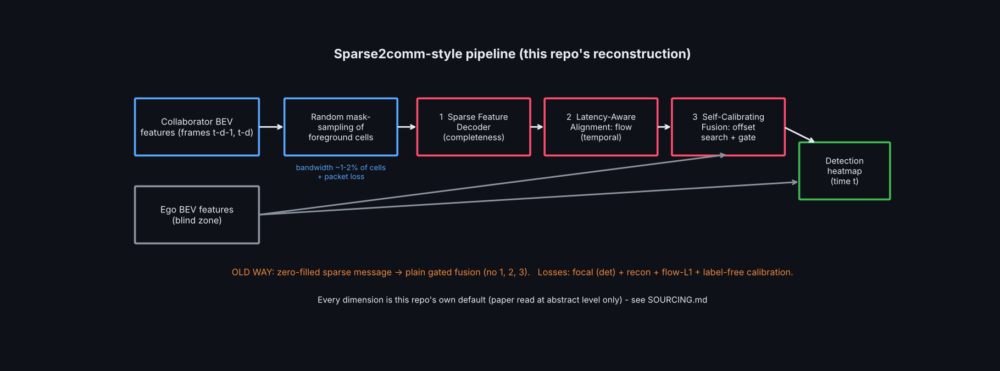
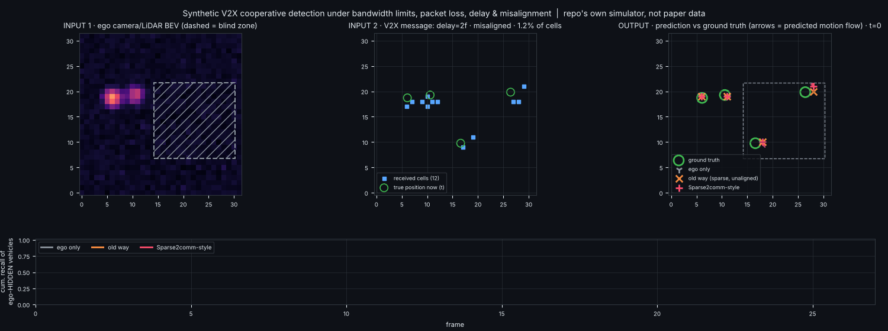
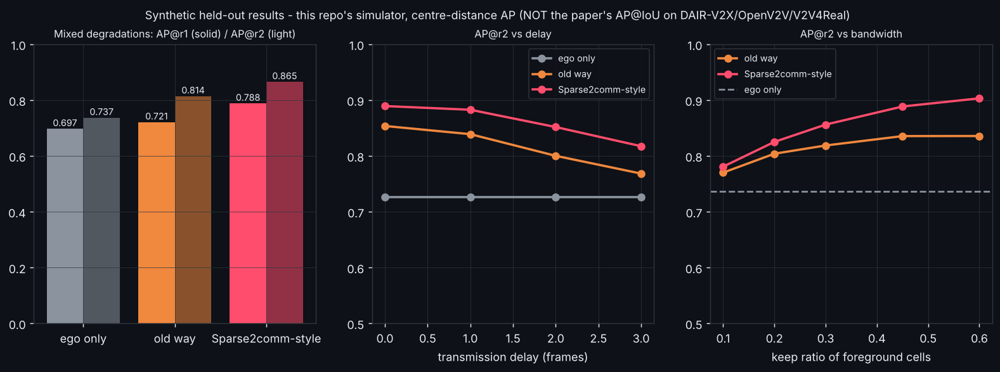

# Day 33 — Sparse2comm-style Robust Cooperative Detection (V2X)

PyTorch reconstruction of the pipeline in *Sparse2comm: Towards Robust Cooperative 3D Object Detection* (arXiv:2610.08573): sparse mask-sampled messages → dense feature reconstruction → latency-aware motion-flow alignment → self-calibrating fusion → detection. **Read `SOURCING.md` first**: the paper was read at abstract level only; every dimension/loss is this repo's own default and all numbers are from a synthetic simulator.





## Structure
```
day-33-sparse2comm/
├── sparse2comm/
│   ├── model.py      # SparseFeatureDecoder, LatencyAwareAlignment, SelfCalibratingFusion, Sparse2comm
│   ├── data.py       # synthetic occluded-ego / degraded-collaborator BEV scenes
│   ├── losses.py     # focal + recon + flow + label-free calibration losses
│   └── metrics.py    # peak extraction, centre-distance AP
├── tests/test_sparse2comm.py   # 13 tests
├── train.py          # trains ego_only / old_way / sparse2comm
├── eval_sweeps.py    # delay / bandwidth / inference ablations
├── simulate.py       # input vs ground truth vs prediction overlay GIF
├── make_assets.py  config.yaml  SOURCING.md  LINKEDIN_POST.md
```
## Run
```bash
pip install -r requirements.txt
pytest tests -q            # 13 passed
python train.py            # ~35 min on 2 CPU cores
python eval_sweeps.py && python make_assets.py
python simulate.py --out assets/simulation.gif --frames 28
```
## Core idea in 15 lines
```python
r0, r1 = decoder(sparse[:,0], mask[:,0]), decoder(sparse[:,1], mask[:,1])   # 1 completeness: keep received cells, fill the rest
r1, flow = align(r0, r1, delay)                                              # 2 temporal: predict flow over d frames, warp message forward
off = estimate_offset(ego, r1)                                               # 3 spatial: soft-argmax over shift correlation volume (no labels)
fused = ego_emb + gate([ego_emb, emb(shift(r1, -off))]) * emb(shift(r1, -off))
heatmap = head(fused)                                                        # CenterNet-style, centre pixel forced to 1.0
```
## Results (synthetic; see SOURCING.md)
Ego-only 0.737 → old way 0.814 → Sparse2comm-style 0.865 AP@r2 (0.697 → 0.721 → 0.788 AP@r1). Paper's real-data gains (+12–20 AP@0.5 vs Where2comm) are **not** reproduced or compared here.
