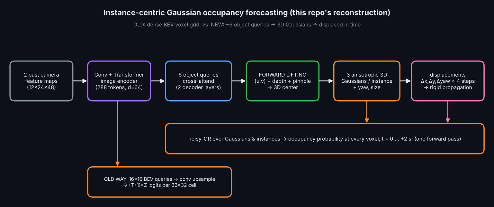
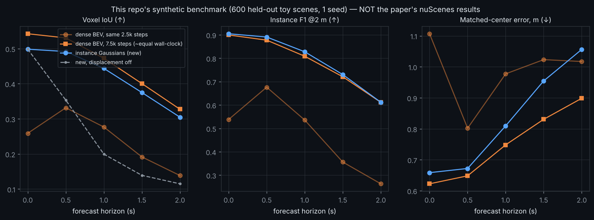
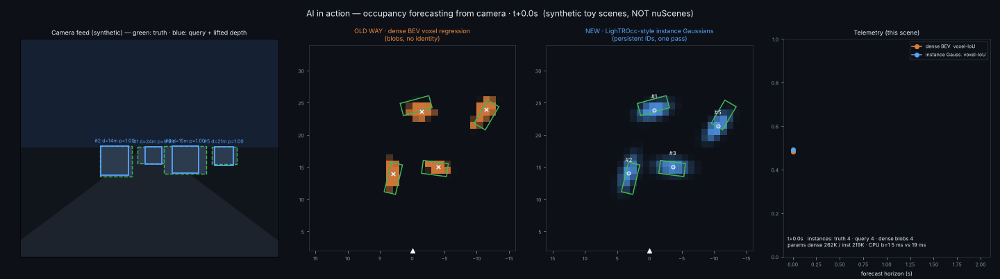

# Day 34 — LighTROcc: instance-centric 3D-Gaussian occupancy forecasting (PyTorch reconstruction)

Paper: *LighTROcc: Lightweight 4D Occupancy Forecasting via Instance-Centric 3D Gaussians*, arXiv:2610.09444. **Abstract-level reconstruction on synthetic data — read `SOURCING.md` first.** This is not the authors' code and not their numbers.





## Folder structure
```
day-34-lightrocc/
├── config.yaml                 # all hyper-parameters (decimal floats only: PyYAML safe_load)
├── train.py                    # trains LighTROcc + dense-BEV baseline, evaluates, writes checkpoints/results.json
├── simulate.py                 # real-time-style overlay: dashcam + GT vs dense vs instance Gaussians + telemetry (GIF/MP4/--live)
├── eval_efficiency.py          # params / FLOPs / CPU latency
├── make_assets.py              # architecture.png + results.png
├── src/lightrocc/
│   ├── geometry.py             # pinhole project/unproject, voxel grid, 2D rotations
│   ├── data.py                 # synthetic camera-feature scenes + GT voxel occupancy
│   ├── model.py                # ImageEncoder, gaussians_to_occupancy, LighTROcc   <-- core
│   ├── baseline.py             # DenseBEVOccForecaster ("old way")
│   ├── losses.py               # Hungarian matching + occupancy / instance losses
│   └── metrics.py              # voxel IoU, instance F1 / centre error
├── tests/test_lightrocc.py     # 12 tests (geometry, rendering, gradients, overfit, metrics)
├── checkpoints/ (results.json, efficiency.json, *.pt)
├── SOURCING.md  LINKEDIN_POST.md
```

## Quick start
```bash
pip install torch scipy matplotlib pillow pyyaml opencv-python-headless pytest
python -m pytest tests -q                       # 12 passed
python train.py --config config.yaml            # ~30 min on 2 CPU cores
python train.py --dense-long 7500               # fairness check: dense baseline with 3x steps
python simulate.py --mp4                        # assets/lightrocc_simulation.gif/.mp4  (add --live for an OpenCV window)
```

## Core idea in 25 lines (see `src/lightrocc/model.py` for the full, commented implementation)
```python
# 1) Encode 2 past camera feature maps -> tokens  [B, 288, 64]
mem = encoder(img)
# 2) Object queries cross-attend to the tokens     [B, Q=6, 64]
q = decoder(queries.expand(B, -1, -1), mem)
o = head(norm(q))
# 3) FORWARD LIFTING: pixel (u,v) + query-specific depth + pinhole geometry -> 3D centre
u = sigmoid(o[...,1] + ref_u) * W; v = sigmoid(o[...,2] + ref_v) * H
depth = exp(o[...,3])
c0 = unproject(u, v, depth)                    # x=d, y=-(u-cx)d/f, z=h_cam-(v-cy)d/f   [B,Q,3]
# 4) Each instance = K=3 anisotropic Gaussians in the object frame (offset, sigma, amplitude) + yaw + size
# 5) Predicted per-step displacements (dx, dy, dyaw) -> cumulative rigid motion of the whole instance
steps = cumsum(disp * [3, 3, 0.3], dim=T)      # [B,T,Q,3];  centre_t = c0 + steps[:2];  yaw_t = yaw0 + steps[2]
# 6) Render: Mahalanobis distance of every voxel to every Gaussian, noisy-OR over Gaussians then instances
g   = amp * exp(-0.5 * ((lx/sx)**2 + (ly/sy)**2 + (dz/sz)**2))        # lx,ly = voxel in the instance's rotated frame
occ = 1 - prod_q(1 - exist_q * (1 - prod_k(1 - g_qk)))                # [B, T+1, 4096 voxels]
```
Shapes: image `[B,12,24,48]` → tokens `[B,288,64]` → queries `[B,6,64]` → head `[B,6,39]` → centres `[B,5,6,3]` → occupancy `[B,5,4096]` (32×32×4 voxels, 1 m × 1 m × 0.5 m, t = 0…+2 s).

## Results (synthetic toy, 1 seed — see `SOURCING.md` for the full honest table)
Same 2,500 steps: instance Gaussians beat the dense baseline (mean IoU 0.40 vs 0.24). With 3× steps (≈equal wall-clock) the dense baseline catches up and edges ahead (0.43). The instance model is cheaper in FLOPs but slower on CPU here. The paper's own nuScenes numbers were not retrievable.

## Known limitations
Rigid propagation only; ≤4 objects; static ego; deterministic single future; Hungarian match uses t=0 centres only; GIF demo scenes are chosen by a non-outcome rule.
