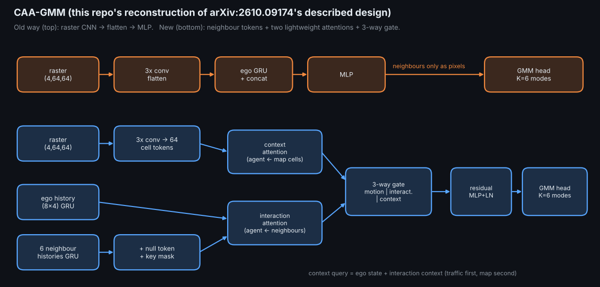
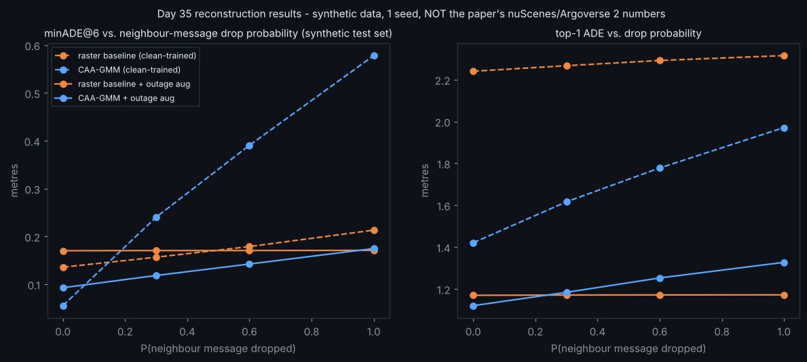

# Day 35 — CAA-GMM: Context-Aware Attention-Based Gaussian Mixtures for Trajectory Prediction

Reconstruction of the design described in arXiv:2610.09174 (abstract level only — see `SOURCING.md`) on a synthetic junction-approach dataset. **Not the paper's code or numbers.**



## Layout
```
config.yaml  train.py  simulate.py  make_assets.py  requirements.txt
src/caa_gmm/{data.py, model.py, losses.py}
tests/test_caa_gmm.py        # 14 tests (geometry, shapes, masking, NaN-safety, permutation invariance, grads, overfit)
assets/{architecture.png, results.png, simulation.gif, simulation_aug.gif}
```
## Run
```
pip install -r requirements.txt
pytest tests -q
python train.py --config config.yaml                       # clean comms        -> results.json
python train.py --config config.yaml --comm-aug --tag _aug # outage-augmented  -> results_aug.json
python simulate.py --tag _aug --out assets/simulation_aug.gif
python make_assets.py
```
## Core idea (model.py)
`CAAGMM`: raster CNN → 64 cell tokens; ego GRU → query; neighbour GRU tokens + always-valid null token; **interaction attention** (query←neighbours), **context attention** (query+interaction←map cells); a **3-way softmax gate** over [motion | interaction | context]; a shared per-mode head emits K=6 Gaussians (`mu`, `log_sigma`, mixture logits). Loss: relaxed winner-takes-all NLL + mode classification.

## Results (synthetic, 1 seed) — see `SOURCING.md` for the full table
Clean-trained: minADE@6 0.055 vs 0.136 m (raster baseline). Under full message outage the clean-trained CAA-GMM collapses (0.578 vs 0.213 m, overconfident). With outage augmentation it degrades gracefully (0.142 vs 0.171 at 60% drop) but only ties the baseline at 100% drop.


