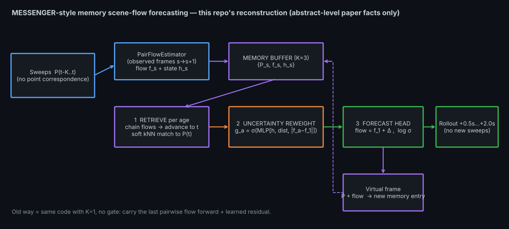
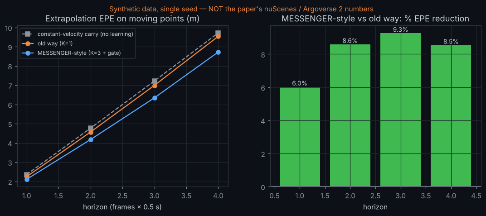

# Day 36 — MESSENGER-style memory scene-flow forecasting (PyTorch reconstruction)

Memory buffer of past flows + latent states → retrieve → uncertainty-gate → forecast next-frame flow, rolled out autoregressively with **no new sweeps**. Reconstruction of the idea in arXiv:2610.10759 from its **abstract only** — read `SOURCING.md` first; every number here is from this repo's synthetic simulator, not nuScenes/Argoverse 2.



## Layout
```
messenger/model.py   PairFlowEstimator, MemoryForecaster (retrieve → reweight → forecast), rollout
messenger/data.py    synthetic vehicle sequences (accelerating/turning boxes, resampled points)
train.py             trains old way (K=1) and MESSENGER-style (K=3, gate) on identical data; evaluates EPE@h
simulate.py          renders assets/messenger_simulation.gif from the real checkpoints
make_assets.py       architecture.png / results.png
tests/               9 tests (retrieval-chain alignment, permutation equivariance, memory-influence, overfit…)
config.yaml  results.json  SOURCING.md  LINKEDIN_POST.md
```
## Run
```
pip install -r requirements.txt
pytest tests -q                       # 9 passed
python train.py --config config.yaml  # ~25 min CPU for both variants -> results.json, *.pt
python simulate.py                    # -> assets/messenger_simulation.gif
python make_assets.py all
```
## Results (synthetic, 1 seed) — moving-point EPE, metres
| +0.5 s | +1.0 s | +1.5 s | +2.0 s |
|---|---|---|---|
| 2.24 → 2.11 | 4.57 → 4.17 | 6.99 → 6.34 | 9.54 → 8.72 |

(old way → K=3). 6–9% better; worse on static points; the gate does not discriminate. See `SOURCING.md`.

