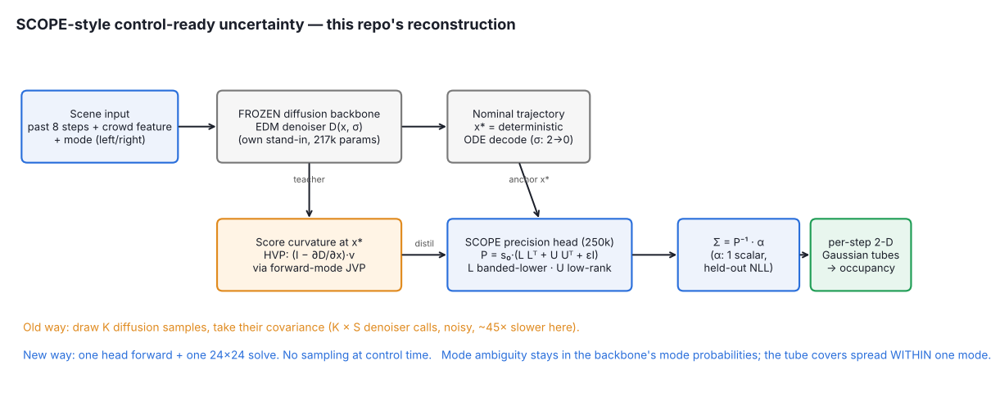
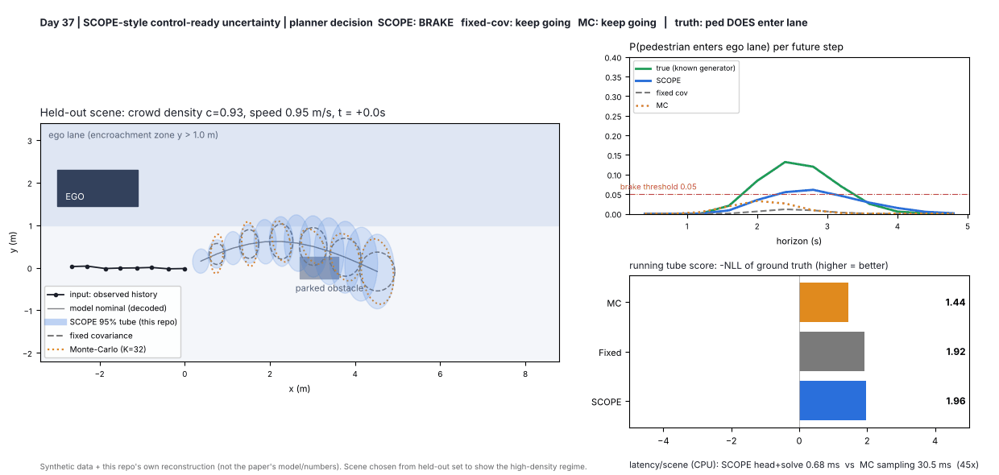
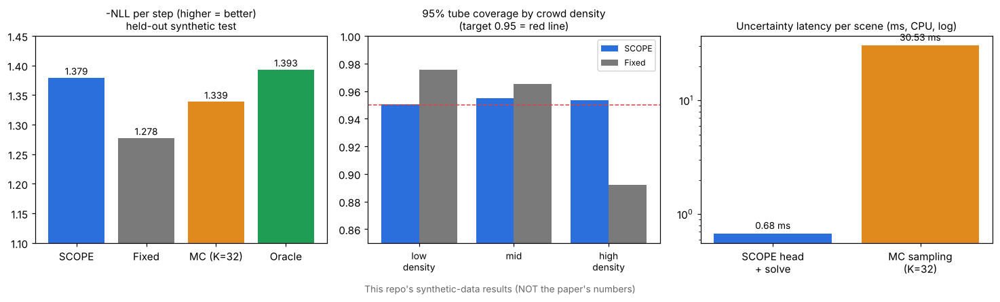

# Day 37 — SCOPE: control-ready uncertainty for trajectory diffusion (PyTorch reconstruction)

Paper: *Control-Ready Uncertainty for Trajectory Diffusion* (arXiv:2610.12431, CoRL 2026 Spotlight). **Read `SOURCING.md` first** — this is a disclosed from-scratch reconstruction on synthetic pedestrian data, not the authors' code or numbers.





## Idea
Diffusion forecasters are multimodal but give no cheap uncertainty. SCOPE freezes the diffusion model, decodes a nominal trajectory, and trains a small head to predict a **banded + low-rank precision matrix** that matches the diffusion model's own **score curvature** (Hessian of −log p, probed with JVPs). Invert it → per-timestep Gaussian tubes, no sampling.

## Structure
```
config.yaml            all hyper-parameters (decimal floats only: PyYAML 1.1 reads 1e-3 as a string)
scope/data.py          synthetic mode-conditioned pedestrian data with KNOWN heteroscedastic noise
scope/backbone.py      EDM-style denoiser, EDM loss, Heun ODE sampler (nominal = zero-noise decode)
scope/precision.py     PrecisionHead (P = s0(LLᵀ+UUᵀ+εI)), JVP curvature targets, distillation loss, marginals
scope/evaluate.py      closed-form scalar calibration + per-timestep 2-D tube metrics
scope/io.py            checkpoint loader
train.py               backbone -> distil head -> calibrate -> baselines -> latency -> results.json
analyze.py             density buckets + brake-decision test -> results_buckets.json
simulate.py            renders the real-time-style overlay GIF from the trained checkpoint
make_assets.py         architecture.png + results.png
tests/test_scope.py    9 tests (incl. exact Gaussian-case curvature identity)
```

## Run
```bash
pip install -r requirements.txt
python train.py            # ~7 min on 2 CPU cores
python analyze.py && python simulate.py && python make_assets.py
pytest tests -q            # 9 passed
```

## Results (synthetic held-out test, this repo — not the paper)
| method | −NLL / step ↑ | 95% cov | latency (CPU, 1 scene) |
|---|---|---|---|
| **SCOPE (distilled)** | **1.379** | 0.953 | 0.68 ms |
| Monte-Carlo, K=32 | 1.339 | 0.957 | 30.5 ms |
| Fixed covariance | 1.278 | 0.944 | ~0 |
| Oracle (true noise cov) | 1.393 | 0.957 | — |

By crowd density, 95% coverage: SCOPE 0.951 / 0.955 / 0.953 vs fixed 0.975 / 0.965 / **0.892** (low / mid / high). Brake-decision agreement with the oracle: 64% vs 29% (see `SOURCING.md` for misses and false alarms).

## Honest limitations of this reconstruction
Dense 24×24 solve (no structured solver); the KL term uses the dense target; 2-D tubes only; nominal bias caps downstream decisions; synthetic Gaussian noise is the easiest case for a Gaussian tube.
