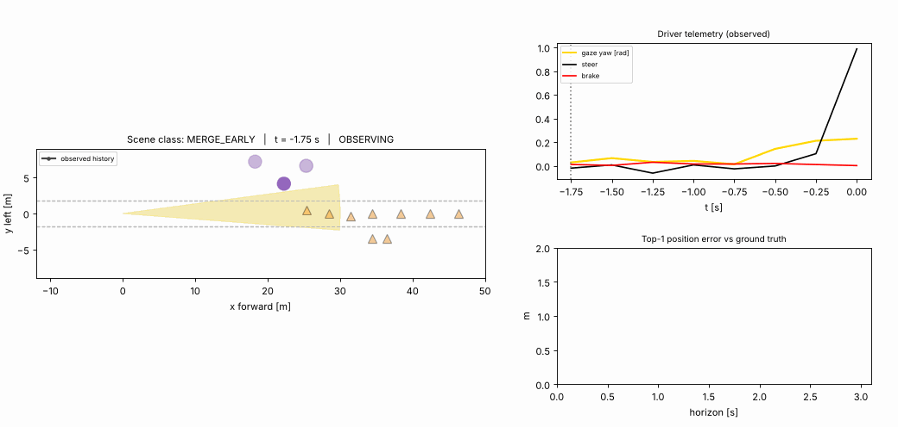

# Day 38 — WZDrive: gaze- and control-aware ego-trajectory prediction in road work zones

Reconstruction of the idea in arXiv:2610.12747 (see `SOURCING.md` for what is and is not paper-sourced). Synthetic data only.



## Folder structure
```
day-38-wzdrive/
├── config.yaml            # all hyperparameters (decimal floats only - PyYAML 1.1 trap)
├── train.py               # trains baseline (kin+scene) and WZDrive (+control +gaze) separately
├── simulate.py            # renders assets/wzdrive_simulation.gif from the trained checkpoints
├── src/wzdrive/
│   ├── model.py           # WZDrive + GazeConditionedSceneAttention
│   ├── data.py            # synthetic work-zone generator (KEEP/MERGE_EARLY/MERGE_LATE/YIELD)
│   └── losses.py          # relaxed winner-take-all loss, minADE/minFDE, ranked top-k ADE
├── tests/test_wzdrive.py  # 9 tests incl. a falsifiable core-claim regression
├── checkpoints/  assets/  results.json  SOURCING.md  LINKEDIN_POST.md
```

## Run
```bash
pip install -r requirements.txt
python -m pytest tests -q      # 9 tests
python train.py                # ~7 min CPU; writes checkpoints/ + results.json
python simulate.py             # ~25 s; writes assets/wzdrive_simulation.gif
```

## Core layer
`GazeConditionedSceneAttention` (src/wzdrive/model.py): a driver-state query attends over scene tokens;
attention logits get an additive Gaussian penalty `-gate * (bearing_obj - gaze_yaw)^2 / (2 sigma^2)` (per head, learnable sigma and gate), so objects along the driver's line of sight get more weight. Tensor shapes are commented through `forward`.

## Results (synthetic, held-out 1,200 scenes; NOT the paper's numbers)
| metric | baseline (kin+scene) | WZDrive (+gaze+control) |
|---|---|---|
| top-1 ADE (m) | 0.855 | **0.430** (−49.6%) |
| minADE@6 (m) | **0.311** | 0.335 |
| minFDE@6 (m) | 0.414 | 0.410 |
| MERGE_LATE top-1 ADE (m) | 2.020 | 0.379 |

Paper (WZDrive-Data): minADE@6 1.09 m, minFDE@6 2.12 m. Gaze/control help *choosing* the intent here; they do not improve coverage with K=6. Details and caveats in `SOURCING.md`.
