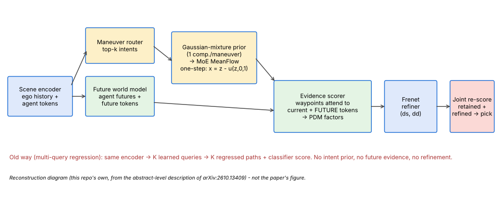
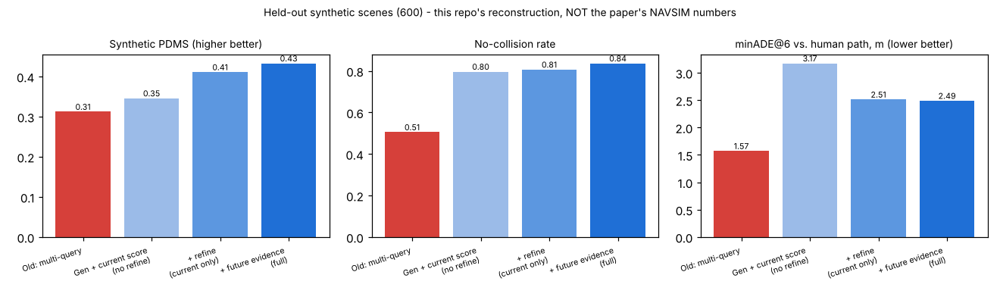
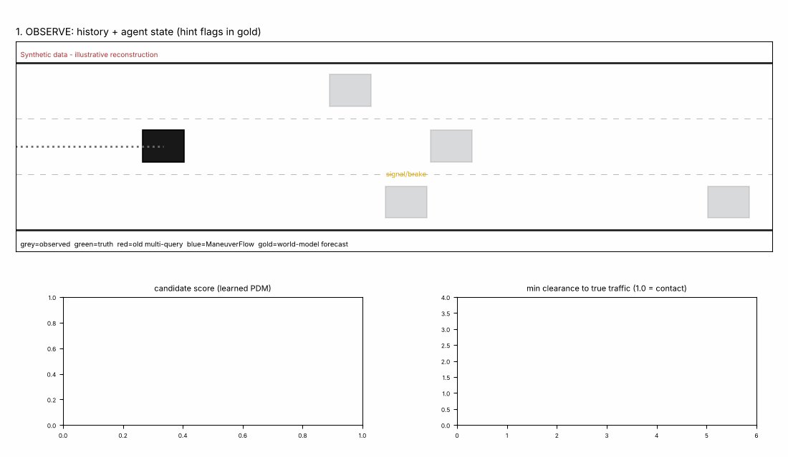

# Day 39 — ManeuverFlow: one-step intent-diverse planning with future evidence

Reconstruction of the abstract-level design of **arXiv:2610.13409** (Chongqing Univ. + Geely). Read `SOURCING.md` first: only the abstract was retrievable, so architecture, data and every reported number here are this repo's own, on a synthetic 3-lane world.





## Folder structure
```
day-39-maneuverflow/
├── maneuverflow/
│   ├── model.py      # SceneEncoder, FutureWorldModel, MeanFlowMoE, EvidenceScorer, FrenetRefiner, ManeuverFlow
│   ├── baseline.py   # "old way": multi-query regression planner
│   ├── data.py       # synthetic scenes (latent driver style, cut-ins, hard-braking leads)
│   └── scoring.py    # PDM-style factors (NC, DAC, EP, comfort) used for targets and evaluation
├── tests/test_maneuverflow.py   # 9 tests
├── train.py   simulate.py   make_assets.py   config.yaml
├── LINKEDIN_POST.md   SOURCING.md   results.json
└── assets/
```

## Run
```
pip install -r requirements.txt
pytest tests -q          # 9 tests (the last needs a trained checkpoint)
python train.py          # ~3 min on 2 CPU cores; writes maneuverflow.pt, baseline.pt, results.json
python simulate.py       # renders assets/maneuverflow_simulation.gif from the trained checkpoint
python make_assets.py
```

## Core idea in code (`maneuverflow/model.py`)
- **Router + Gaussian-mixture prior:** one prior component per maneuver; top-k intents sampled, `per_man` samples each.
- **MeanFlow, one step:** `u` is the *average* velocity over [r, t]. Training uses the MeanFlow identity `u = v - (t - r) * du/dt` (via `torch.func.jvp`, stop-gradient target). Sampling is `x = z1 - u(z1, 0, 1)`.
- **Maneuver-routed MoE:** shared trunk + a hard-routed expert head per maneuver.
- **Evidence:** every waypoint attends over current agent tokens and over predicted-future tokens at its own timestep; pooled features predict `[NC, DAC, EP, comfort]`; score = NC·DAC·(0.8·EP + 0.2·comfort).
- **Refiner:** bounded Frenet residuals; refined + retained candidates are jointly re-scored.

## Results (synthetic, single seed — not the paper's numbers)
See the table in `SOURCING.md`. Headline: no-collision 0.505 → 0.837 and PDMS 0.312 → 0.433 vs. the multi-query baseline, while the baseline has lower imitation error (minADE@6 1.57 vs 2.49 m).
