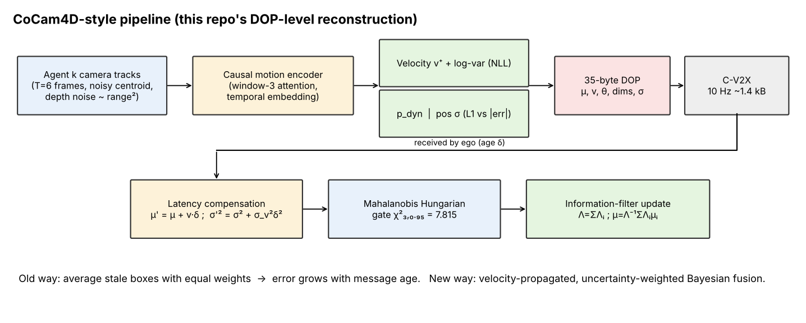
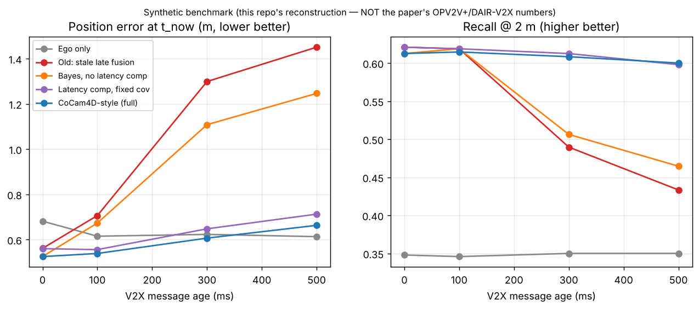

# Day 40 — CoCam4D: Geometry-Aware Cooperative 4D Perception for Camera-Only Driving

Paper: [arXiv:2610.11577](https://arxiv.org/abs/2610.11577) (submitted 2026-10-08; Pahari, Das, Das, Bhattacharya — ISI Kolkata / Valeo Brain anSWer India).
**This repo is a DOP-level reconstruction, not the paper's code.** The paper's VGGT backbone, 3D-Gaussian renderer and OPV2V+/DAIR-V2X-C pipeline are not reproduced. Read `SOURCING.md` before quoting any number.



## What it implements
* `MotionUncertaintyNet` — causal (frame-adjacent window) motion encoder + heads for velocity (with learned variance), dynamic probability and positional sigma (L1 against stop-grad |error|, the analogue of the paper's Eq. 7).
* 35-byte **Dynamic Object Primitive** (`pack_dop`/`unpack_dop`) — exact byte budget from the paper; field layout of the last 9 bytes is our own.
* Latency compensation, Mahalanobis Hungarian association (chi2(3, 0.95) = 7.815 gate) and additive information-filter fusion.
* `simulate.py` — GIF with BEV, ego-camera overlay and live telemetry (error, latency, C-V2X bytes).

## Folder structure
```
day-40-cocam4d/
├── config.yaml            # decimal floats only (PyYAML)
├── requirements.txt
├── train.py               # train + velocity/uncertainty metrics + fusion ablation -> results.json
├── simulate.py            # synthetic real-time overlay simulation -> GIF
├── make_assets.py         # assets/architecture.png, assets/results.png
├── src/cocam4d/{model,fusion,data,evaluate}.py
├── tests/test_core.py     # 11 tests (causality, DOP bytes, info-filter math, gating, claim regression)
├── assets/  checkpoints/  SOURCING.md  LINKEDIN_POST.md
```

## Run
```
pip install -r requirements.txt
python -m pytest tests -q
python train.py            # ~1 min CPU
python simulate.py         # -> cocam4d_simulation.gif
python make_assets.py
```

## Results (synthetic data — NOT the paper's numbers)
Held-out: velocity RMSE 0.82 m/s (learned) vs 1.03 m/s (least-squares baseline); dynamic-vs-static accuracy 94.8%; positional-sigma 1.96-sigma coverage 88.1% (under-confident-calibrated: nominal 95%).

Mean position error at t_now / recall@2 m vs. message age (60 scenes, 3 agents, 8 objects):

| Method | 0 ms | 100 ms | 300 ms | 500 ms |
|---|---|---|---|---|
| ego_only | 0.68 m / 0.35 | 0.62 m / 0.35 | 0.62 m / 0.35 | 0.61 m / 0.35 |
| late_fusion_stale | 0.56 m / 0.62 | 0.71 m / 0.62 | 1.30 m / 0.49 | 1.45 m / 0.43 |
| bayes_learned_no_latcomp | 0.52 m / 0.61 | 0.67 m / 0.62 | 1.11 m / 0.51 | 1.25 m / 0.46 |
| bayes_fixed_cov_latcomp | 0.56 m / 0.62 | 0.56 m / 0.62 | 0.65 m / 0.61 | 0.71 m / 0.60 |
| cocam4d_full | 0.52 m / 0.61 | 0.54 m / 0.61 | 0.61 m / 0.61 | 0.66 m / 0.60 |



Honest reading: latency compensation does most of the work; learned uncertainty adds only a small extra gain over a fixed covariance here. Recall is capped near 0.61 by the 45 m sensor range.

## Core model code (`src/cocam4d/model.py`)
```python
"""Uncertainty + causal-motion heads of CoCam4D, reconstructed at DOP level.

The paper builds per-pixel depth/uncertainty/motion heads on a frozen VGGT backbone
and renders 3D Gaussians. We cannot reproduce VGGT or 3DGS here, so this module
implements the *same head logic* on one tracked object cluster:

  input  : T frames of a cluster centroid (noisy, depth-axis noise ~ range^2)
  output : velocity v+ (3), velocity log-variance (3), dynamic prob p_dyn (1),
           positional sigma (3)  <- analogue of the paper's uncertainty head
"""
from __future__ import annotations
from dataclasses import dataclass
import torch
import torch.nn as nn
import torch.nn.functional as F


@dataclass
class ModelConfig:
    in_dim: int = 7          # rel centroid (3) + range/50 (1) + line-of-sight unit vec (3)
    d_model: int = 64
    n_heads: int = 4
    n_layers: int = 3
    attn_window: int = 3     # frame-adjacent causal window (self + previous frames)
    max_len: int = 16
    dropout: float = 0.0


def adjacent_causal_mask(T: int, window: int, device=None) -> torch.Tensor:
    """Bool mask [T,T]; True = BLOCKED (torch convention).
    Token t may attend to frames t-window+1 .. t only (causal AND frame-adjacent)."""
    i = torch.arange(T, device=device).unsqueeze(1)   # query
    j = torch.arange(T, device=device).unsqueeze(0)   # key
    allowed = (j <= i) & (j > i - window)
    return ~allowed


class MotionUncertaintyNet(nn.Module):
    def __init__(self, cfg: ModelConfig = ModelConfig()):
        super().__init__()
        self.cfg = cfg
        self.inp = nn.Linear(cfg.in_dim, cfg.d_model)
        self.temb = nn.Embedding(cfg.max_len, cfg.d_model)       # temporal embedding
        layer = nn.TransformerEncoderLayer(
            d_model=cfg.d_model, nhead=cfg.n_heads, dim_feedforward=cfg.d_model * 2,
            dropout=cfg.dropout, batch_first=True, norm_first=True)
        self.enc = nn.TransformerEncoder(layer, cfg.n_layers, enable_nested_tensor=False)
        self.norm = nn.LayerNorm(cfg.d_model)
        # heads (all read the same shared per-frame features, as in the paper's 6-head design)
        self.vel_head = nn.Linear(cfg.d_model, 3)     # v+ (forward velocity, m/s)
        self.vel_logvar = nn.Linear(cfg.d_model, 3)   # velocity uncertainty (learned, NLL)
        self.dyn_head = nn.Linear(cfg.d_model, 1)     # p_dyn logit
        self.unc_head = nn.Linear(cfg.d_model, 3)     # positional sigma (softplus) — L_unc
        nn.init.zeros_(self.vel_logvar.weight); nn.init.constant_(self.vel_logvar.bias, 1.0)

    def encode(self, x: torch.Tensor) -> torch.Tensor:
        """x: [B,T,in_dim] -> per-frame features [B,T,d]. Causal: out[:,k] depends on x[:,:k+1] only."""
        B, T, _ = x.shape
        h = self.inp(x) + self.temb(torch.arange(T, device=x.device))[None]      # [B,T,d]
        mask = adjacent_causal_mask(T, self.cfg.attn_window, x.device)           # [T,T]
        h = self.enc(h, mask=mask)                                               # [B,T,d]
        return self.norm(h)

    def forward(self, x: torch.Tensor) -> dict:
        f = self.encode(x)[:, -1]                                                # [B,d] last frame
        return {
            "vel": self.vel_head(f),                                             # [B,3]
            "vel_logvar": self.vel_logvar(f).clamp(-6.0, 6.0),                   # [B,3]
            "dyn_logit": self.dyn_head(f).squeeze(-1),                           # [B]
            "pos_sigma": F.softplus(self.unc_head(f)) + 1e-3,                    # [B,3] meters
        }


def compute_loss(out: dict, tgt: dict, w_vel=1.0, w_nll=0.3, w_dyn=0.5, w_unc=1.0):
    """Loss: velocity MSE + Gaussian NLL (variance head only, mean detached) + BCE(dyn)
    + L1(pos_sigma, stop-grad |position error|)  [analogue of paper Eq. 7]."""
    l_vel = F.mse_loss(out["vel"], tgt["vel"])
    err2 = (tgt["vel"] - out["vel"].detach()) ** 2
    l_nll = 0.5 * (out["vel_logvar"] + err2 * torch.exp(-out["vel_logvar"])).mean()
    l_dyn = F.binary_cross_entropy_with_logits(out["dyn_logit"], tgt["dyn"])
    l_unc = F.l1_loss(out["pos_sigma"], tgt["pos_err"].abs().detach())
    total = w_vel * l_vel + w_nll * l_nll + w_dyn * l_dyn + w_unc * l_unc
    return total, {"vel": l_vel.item(), "nll": l_nll.item(), "dyn": l_dyn.item(), "unc": l_unc.item()}
```
