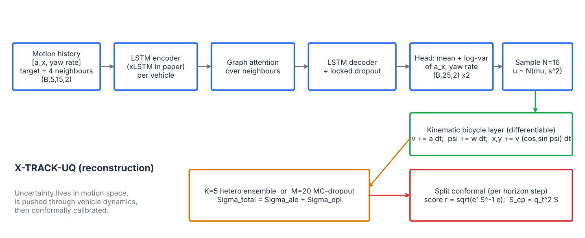
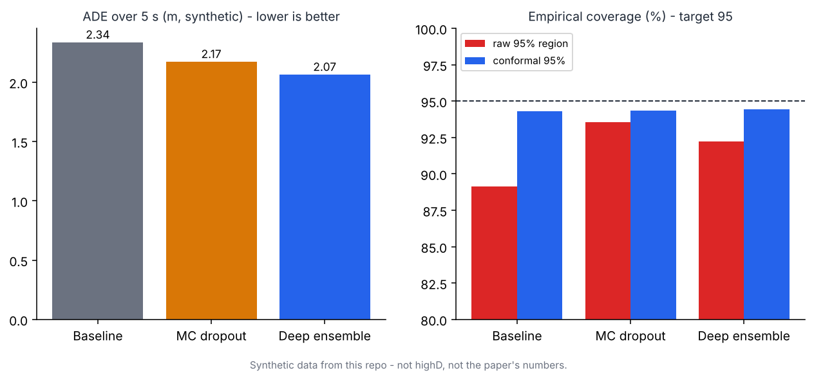
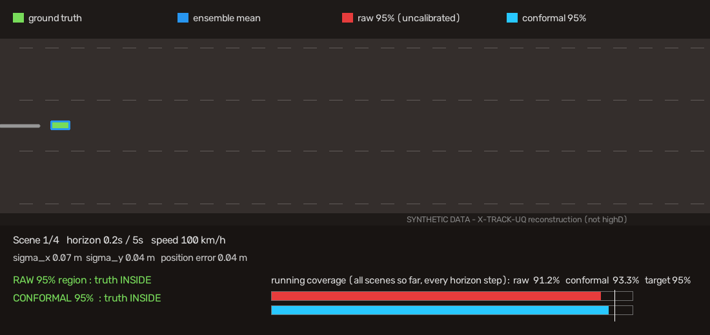

# Day 41 — X-TRACK-UQ: Physics-Aware Trajectory Prediction with Conformally Calibrated Uncertainty
Reconstruction of arXiv:2610.11580 (see SOURCING.md for what is paper vs. my own). Synthetic highway data, CPU-only.

 


## Structure
```
config.yaml  train.py  evaluate.py  simulate.py  make_assets.py
src/xtrack_uq/{data,model,uncertainty,inference}.py
tests/test_core.py   assets/   SOURCING.md   LINKEDIN_POST.md
```
## Run
```
pip install -r requirements.txt
pytest -q                 # 11 tests
python train.py           # ~4 min CPU: baseline, MC-dropout, 5-member ensemble, conformal eval -> metrics.json
python simulate.py --mp4  # assets/simulation.gif
python make_assets.py
```
## Core idea (model.py / uncertainty.py)
1. Encoder (LSTM per vehicle) -> GAT over neighbours -> LSTM decoder -> mean/log-var of [a_x, yaw rate] per step.
2. `KinematicBicycle` integrates sampled motion variables to positions (differentiable, dynamics-feasible).
3. `propagate_samples`: Sigma_total = Sigma_aleatoric (sample spread) + Sigma_epistemic (spread of pass/member means).
4. `ConformalCalibrator`: score r = sqrt(e' (S+eps I)^-1 e), per-step quantile at rank ceil((n+1)(1-delta)); S_cp = q^2 S.

## Results (synthetic, 1500 test scenes, target 95%)
| Model | ADE m | FDE m | raw cov | conformal cov |
|---|---|---|---|---|
| Baseline | 2.34 | 5.65 | 89.1% | 94.3% |
| MC dropout | 2.17 | 5.33 | 93.6% | 94.3% |
| Deep ensemble | 2.07 | 5.08 | 92.2% | 94.4% |
