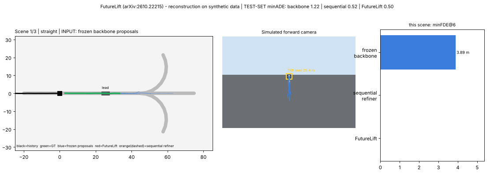

# Day 43 — FutureLift: Lifting Trajectory Proposals into Bidirectional Future Graphs

Reconstruction of the refiner from [arXiv:2610.22215](https://arxiv.org/abs/2610.22215) (Grimm & Zöllner, FZI) with a runnable synthetic simulation.
Read **SOURCING.md** first: which parts are paper-sourced vs. this repo's own defaults.



## Folder structure
```
day-43-futurelift/
├── futurelift/
│   ├── data.py       # synthetic junction world (map, histories, braking-before-turn dynamics)
│   ├── backbone.py   # frozen map-blind K-proposal stand-in backbone
│   ├── model.py      # EdgeAttention, SceneEncoder, Lifter, FutureLiftLayer, FutureLift  <- core
│   ├── losses.py     # Laplace NLL (WTA) + endpoint mixture NLL
│   └── metrics.py    # minADE/minFDE/MR@K
├── train.py          # backbone -> 3 refiner variants (bidirectional / causal / none)
├── simulate.py       # BEV + synthetic dashcam + telemetry GIF from the real checkpoints
├── make_assets.py    # architecture.png, results.png
├── tests/            # 11 tests incl. information-flow & stop-gradient checks
├── config.yaml  requirements.txt  SOURCING.md  LINKEDIN_POST.md
└── assets/  checkpoints/
```
## Run
```bash
pip install -r requirements.txt
pytest tests -q                 # 11 passed
python train.py                 # ~15 min CPU
python make_assets.py && python simulate.py    # -> assets/simulation.gif
```
## Core idea in code (`futurelift/model.py`)
```python
# 1) LIFT: (B,K,T,2) proposals -> (B,K,R,d) temporal nodes (GRU over each segment in a local frame)
h, pos, dirv = self.lift(prop, logits)
# 2) one graph, built once; every layer updates ALL segments at once
for layer in self.layers:
    h = layer(h, pos, dirv, ctx)     # history -> map -> TEMPORAL -> modal -> FFN, all residual + pre-LN
# FutureLiftLayer temporal edges (R intervals of one proposal):
#   "bidirectional": mask=None            -> late evidence can fix early segments in one pass
#   "causal":        mask=tril(R,R)       -> the 'sequential' old-way: segment r only sees <= r
# 3) heads: per-interval residual (x,y), Laplace scale = ELU+1+0.1, confidence residual
refined = prop + res; logits_new = logits + pooled_conf_residual
```
`EdgeAttention` adds an MLP of `[dx, dy, dist, cosΔθ, sinΔθ]` (in the query node's heading frame) to both keys and values.

## Results (synthetic held-out test, 800 scenes, single seed — NOT the paper's numbers)
| Model | minADE@6 | minFDE@6 | MR@2m |
|---|---|---|---|
| Frozen map-blind backbone | 1.218 | 3.188 | 0.571 |
| + refiner, no temporal edges | 0.517 | 2.017 | 0.320 |
| + refiner, causal (sequential) temporal | 0.519 | 2.011 | 0.324 |
| **+ FutureLift (bidirectional)** | **0.503** | **1.999** | **0.316** |

Honest reading: the refiner (map + history graph) cuts minADE by 58.7 % vs. this deliberately weak backbone — mostly because the backbone cannot see the map. The paper's headline mechanism, **bidirectional** temporal edges, is only ~3 % better than causal/none here, a gap we did not test for significance (one seed) and should be treated as unproven in this reconstruction. In the demo, scene 2 shows FutureLift (1.67 m) *worse* than the sequential refiner (1.40 m) — kept in the GIF on purpose.
Params: 310,673 (bidirectional/causal), 259,985 (none).
