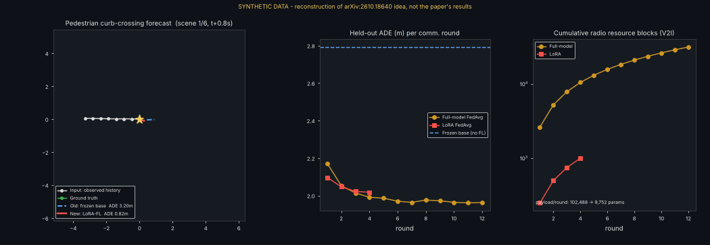

# Day 44 — LoRA Federated Training for Pedestrian Trajectory Prediction
Reconstruction of the idea in arXiv:2610.18640 (see `SOURCING.md` — only the abstract was accessible; all numbers below are from synthetic data).



## Structure
```
config.yaml  train.py  simulate.py  LINKEDIN_POST.md  SOURCING.md
src/{lora.py, model.py, data.py, federated.py}   tests/test_lora_fed.py   assets/   runs/
```
## Run
```
pip install torch pyyaml pytest matplotlib pillow
pytest tests -q          # 6 tests: LoRA identity at init, frozen base, FedAvg, comm accounting, learning
python train.py          # pretrain -> full FedAvg vs LoRA FedAvg (~20 s CPU)
python simulate.py       # assets/simulation.gif from the trained checkpoint
```
## Core layer (`src/lora.py`)
`y = x Wᵀ + b + (α/r)·x Aᵀ Bᵀ` with W frozen, A:(r,in), B:(out,r), B=0 at init so the adapted model equals the base. Only A, B (+ output head) are transmitted/aggregated (`trainable_state`, `fedavg`).
## Results (synthetic, seed 0)
| Method | ADE (m) | FDE (m) | Payload params | Rounds | Resource blocks |
|---|---|---|---|---|---|
| Frozen base | 2.792 | – | – | – | – |
| Full FedAvg | 1.963 | 4.475 | 102,488 | 12 | 31,484 |
| LoRA FedAvg | 2.018 | 4.517 | 9,752 | 4 | 999 |
Limits: naive A/B averaging, single seed, toy data, no packet loss/stragglers, baseline worse than constant-velocity.
