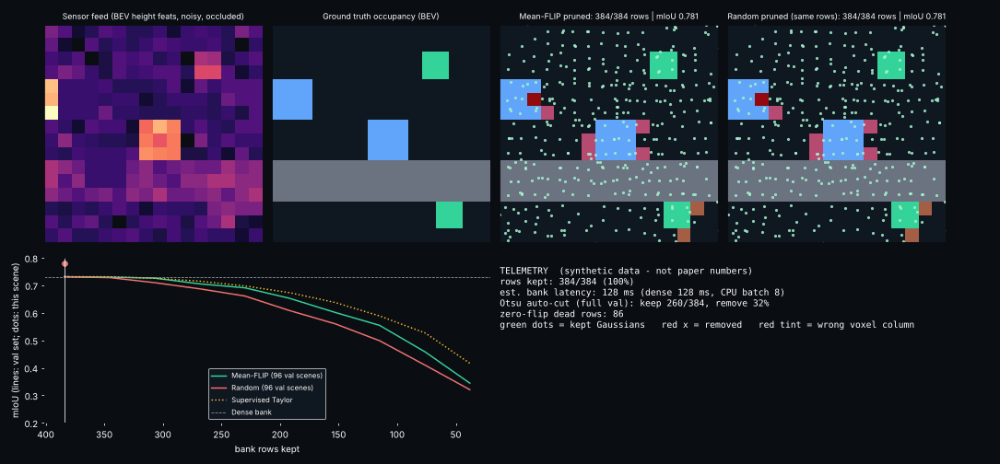

# Day 45 — Decision-FLIP: label-free pruning of Gaussian occupancy models (PyTorch reconstruction)
Paper: arXiv:2610.20917 (see `SOURCING.md` for exactly what is paper-sourced vs. reconstructed).



## Idea
Persistent Gaussian banks (GaussianFormer-style) have hand-picked sizes. Opacity/magnitude says little about whether a row changes any prediction.
**Mean-FLIP** scores each row by how many voxel argmax decisions flip when it is removed (calibration *inputs* only), then a guarded Otsu split picks how many survive and the bank is physically recompiled smaller.
Because the splat readout is additive, leave-one-out is an exact subtract+argmax (verified against brute-force deletion in tests).

## Structure
```
configs/config.yaml        decision_flip/{model,flip,data,metrics}.py
train.py  prune.py  simulate.py  make_assets.py  tests/  assets/  checkpoints/
```
## Run
```
pip install torch pyyaml matplotlib pillow pytest
python train.py && python prune.py && python simulate.py && python make_assets.py && pytest tests -q
```
## Measured results (synthetic data, single seed, CPU — NOT paper numbers)
| | rows | val mIoU (no recovery) | +120-step finetune |
|---|---|---|---|
| Dense | 384 | 0.731 | – |
| **Mean-FLIP (auto Otsu cut)** | **260 (-32%)** | **0.705** | 0.701 |
| Opacity | 260 | 0.689 | 0.708 |
| Supervised Taylor (uses labels) | 260 | 0.714 | 0.708 |
| Random | 260 | 0.686 | 0.701 |

86 of 384 rows have exactly zero flip score (dead). Bank forward latency 128 ms -> 85 ms (-34%, CPU, batch 8); params 5,530 -> 4,042.
**Honest read:** Mean-FLIP beats random/opacity without recovery (+1.9 / +1.6 pts) but the supervised Taylor baseline is slightly better here, and after a short finetune all methods converge (~0.70-0.71). Random removal does *not* collapse in this small synthetic bank (the paper reports collapse on real models). Tests: 6/6.
