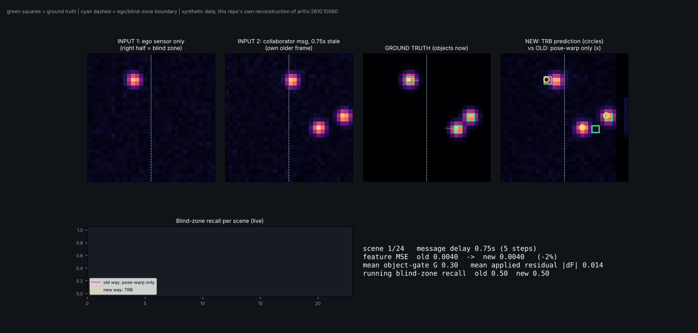

# Day 47 — Temporal Residual Bottleneck (TRB) for Asynchronous V2X Collaborative Perception
Reconstruction of arXiv:2610.10090 (FZI / KIT). **Read `SOURCING.md` first** — it separates paper-sourced facts from this repo's own defaults and reports a negative result honestly.



## Idea in one equation
`F̂ = B + G ⊙ δF` — `B` = pose-warped stale collaborator feature (anchor), `δF` = bounded residual from a Δt-conditioned xLSTM + bottleneck (zero-initialised), `G` = object gate from detector objectness (detached, floor 0.05).

## Structure
```
day-47-trb/
├── src/trb/{warp,data,xlstm,model,losses,metrics}.py
├── tests/test_trb.py      # 12 tests (geometry, xLSTM stability, zero-init, gate, gradients, overfit)
├── train.py  config.yaml  # trains stale / warp / trb_nogate / trb on identical data, writes results.json
├── simulate.py            # GIF: ego-only | stale msg | ground truth | old-vs-new overlay + telemetry
└── assets/ (trb_simulation.gif, results.png)
```
## Run
```
pip install -r requirements.txt
pytest tests -q                 # 12 passed
python train.py                 # ~25 min on 2 CPU cores
python simulate.py --delay 5    # uses checkpoints/trb.pt and warp.pt
```
## Core forward pass (src/trb/model.py, abridged)
```python
warped = warp_history(hist, rel)                    # [B,K,C,H,W] all history frames -> NOW frame
S, Bw = hist[:, 0], warped[:, 0]                    # raw stale / pose-warped anchor
seq = enc(warped[:, i]) * (1+gamma) + beta + pose(rel[:, i])   # FiLM on Fourier(delay) + pose token
h = xlstm(seq.permute(0,3,4,1,2).reshape(B*H*W, K, d))         # per-cell m-s-m recurrence over k=4 frames
E = evid(h.view(B,H,W,d).permute(0,3,1,2)); P = pred(E)       # temporal evidence / predicted feature
z = cat([E, S - Bw, Bw - P, sigmoid(conf(E))], 1)              # evidence + discrepancy + agreement + confidence
dF = scale * bn_out(bn_mid(bn_in(z)))                          # bn_out zero-initialised => F_hat == B at init
F_hat = Bw + gate(S, Bw) * dF                                  # gate: max(obj(S),obj(Bw)) -> maxpool(9) -> floor 0.05, no grad
```
## Results (synthetic, 1 seed — not the paper's benchmarks)
See `SOURCING.md` table and `assets/results.png`: pose-warp ≈ full TRB (F1 0.883 vs 0.881); gate cuts feature MSE 55%.
