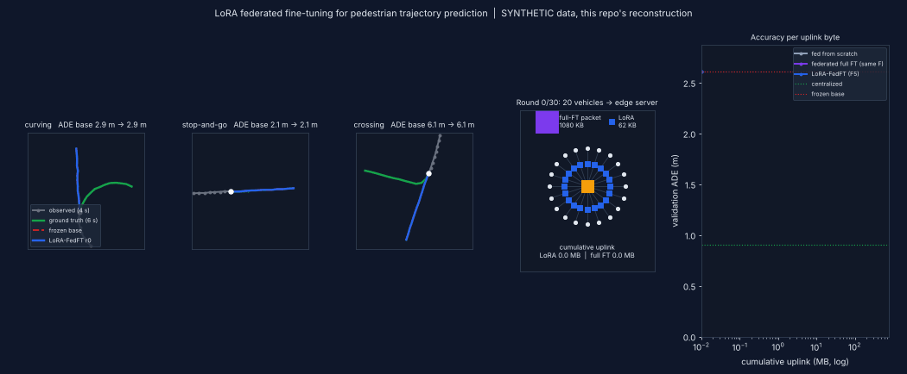

# Day 48: LoRA-FedFT — federated LoRA fine-tuning for pedestrian trajectory prediction

Reconstruction of the idea in *Pedestrian Trajectory Prediction through LoRA Federated Training* (arXiv:2610.18640). **Synthetic data, small stand-in model, single seed; not the paper's numbers. Read `SOURCING.md` first.**



## Folder structure
```
day-48-lora-fedft/
├── config.yaml              # all hyper-parameters (decimal-only floats for yaml.safe_load)
├── train.py                 # pretrain base -> zero-shot / centralized / 4 federated variants
├── simulate.py              # renders assets/simulation.gif from the real trained run
├── src/lora_fedft/
│   ├── lora.py              # LoRALinear, apply_lora, trainable_state, payload accounting (CORE)
│   ├── model.py             # encoder-only transformer (Chronos-2 stand-in)
│   ├── federated.py         # local training, sample-weighted FedAvg, round loop, uplink time
│   ├── data.py              # 4 synthetic behaviour styles, 20 non-IID clients, canonical frame
│   └── metrics.py           # ADE / FDE / miss rate
├── tests/test_core.py       # 10 tests (identity at init, frozen base, payload, FedAvg, core claim)
├── results/                 # results.json, demo_trace.npz, adapters, train.log
├── LINKEDIN_POST.md  SIMULATION_PROMPT.md  SOURCING.md
```

## Run
```bash
pip install -r requirements.txt
python -m pytest tests -q        # 10 passed
python train.py --config config.yaml   # ~7 min on 2 CPU cores
python simulate.py               # -> assets/simulation.gif
```

## Core layer
```python
class LoRALinear(nn.Module):
    """y = W0 x + b + (alpha/r) * B(A x);  W0 frozen, A:(r,in), B:(out,r) trainable, B=0 at init."""
    def __init__(self, base: nn.Linear, r=8, alpha=16.0):
        super().__init__()
        self.base, self.scaling = base, alpha / r
        self.lora_A = nn.Parameter(torch.empty(r, base.in_features))
        self.lora_B = nn.Parameter(torch.zeros(base.out_features, r))   # zero => identical to pretrained at round 0
        nn.init.kaiming_uniform_(self.lora_A, a=math.sqrt(5))
        for p in self.base.parameters(): p.requires_grad_(False)

    def forward(self, x):                                   # x: (..., in)
        low_rank = (x @ self.lora_A.t()) @ self.lora_B.t()  # (..., r) -> (..., out)
        return self.base(x) + self.scaling * low_rank
```
Federated round: server sends the trainable tensors, each vehicle trains `F` local epochs, uploads only `trainable_state(model)` (A/B for LoRA; every weight for full FT), server takes the sample-weighted mean.

## Results (synthetic, seed 7)
| | ADE m | upload/vehicle | uplink to reach ADE<=1.49 m |
|---|---|---|---|
| frozen base | 2.61 | - | - |
| centralized | 0.90 | - | - |
| LoRA-FedFT F=5 | 1.03 | 62 KB | 8.7 MB |
| full FT F=5 | 0.99 | 1,080 KB | 86 MB |
| LoRA-FedFT F=1 | 1.47 | 62 KB | 29.7 MB (24 rounds) |
| full FT F=1 | 1.45 | 1,080 KB | 432 MB (20 rounds) |

LoRA saves bytes, not accuracy or rounds, in this reconstruction. Details and caveats in `SOURCING.md`.
