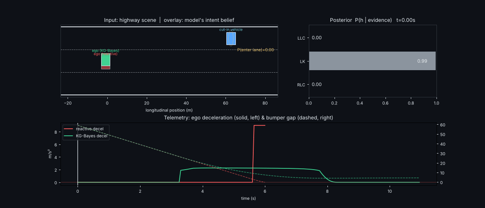

# Day 49 — Lane-Change Prediction with Knowledge-Graph Embeddings + Bayesian Inference

PyTorch reconstruction of the predictor family in *Decision Making and Ride Comfort Evaluation Based on Lane-Change Prediction for Autonomous Vehicles* (Manzour et al., arXiv:2610.30528) plus a closed-loop cut-in simulation. **Synthetic data only — read `SOURCING.md` before quoting any number.**



## Structure
```
config.yaml  train.py  evaluate.py  simulate.py  make_assets.py
src/kglc/data.py      synthetic highway generator + symbolic discretiser (KG facts)
src/kglc/model.py     TransE, Bayesian posterior head, explanations, MLP baseline
src/kglc/decision.py  1-D cut-in simulator: reactive vs predictive ego, Monte Carlo, false-alarm test
tests/test_core.py    9 tests     assets/  checkpoints/
```
## Run
```
pip install -r requirements.txt
python train.py && python evaluate.py && python simulate.py && python make_assets.py
pytest tests -q
```
## Core math
Facts `(maneuver, relation, value)`; TransE distance `d(h,r,t)=‖h+r−t‖₂`; likelihood `P(e_k|h)=softmax_v(−d(h,r_k,v)/τ)`; posterior `P(h|e)∝P(h)ΠₖP(e_k|h)`; missing cue ⇒ factor omitted. See `src/kglc/model.py` for tensor shapes.

## Results (this repo, synthetic)
| horizon | 1 s | 2 s | 3 s | 4 s |
|---|---|---|---|---|
| KG-Bayes macro-F1 | 0.952 | 0.949 | 0.848 | 0.508 |
| MLP macro-F1 | 0.924 | 0.919 | 0.916 | 0.712 |

Closed loop @7 m crossing gap: reactive 100% collisions / peak decel 9.0 (cap); predictive 0% / 2.46 m/s². Not the paper's numbers; not CARLA.
