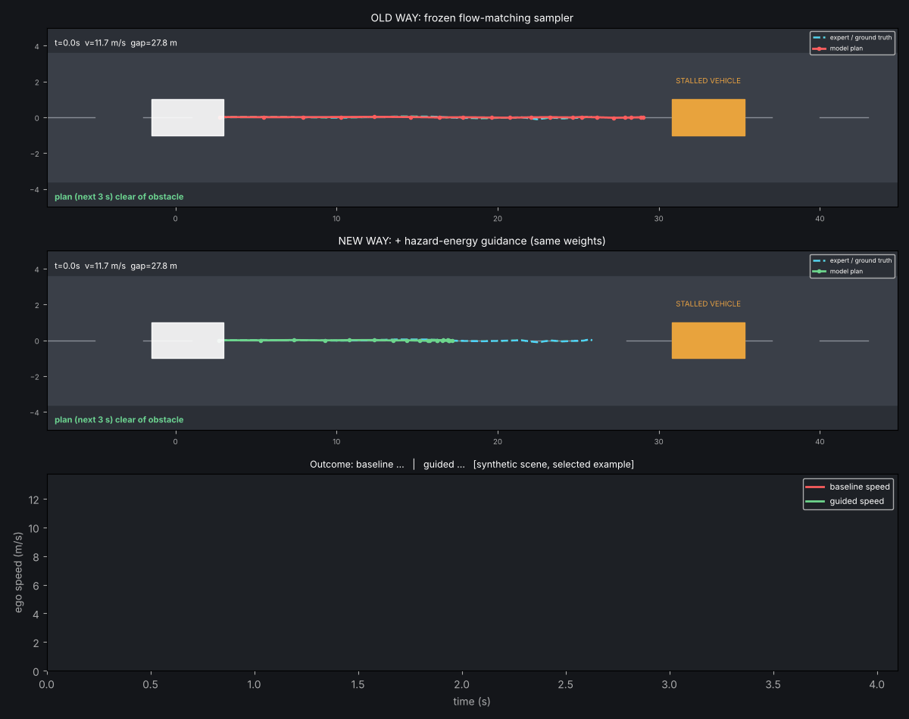

# Day 50 — Hazard-Energy Guidance for Flow-Matching Driving Planners
Reconstruction of the idea in arXiv:2610.28184 ("Perceives but Doesn't Brake", Cercola, Luo, Formentin, Pavone). See `SOURCING.md` for what is and isn't paper-sourced.



## Structure
```
config.yaml           hyper-parameters (decimal floats only)
models/flow_model.py  FlowNet, flow-matching loss, hazard_energy, guided Euler sampler
src/scene.py          scene geometry, SDF, synthetic expert demos
src/data.py  src/closed_loop.py
train.py  evaluate.py  simulate.py
tests/test_flow.py    8 tests
assets/               simulation.gif, results.json
```
## Core idea (models/flow_model.py)
Flow matching: `x_t=(1-t)x_0+t x_1`, net predicts `v≈x_1-x_0`. Guided step (weights frozen):
`x1_hat = x_t + (1-t)·v;  v' = v − w(t)·∇_{x_t} E(x1_hat)`, with `E(τ)=Σ_k relu(m − sdf_k)²` over waypoints and `sdf` the signed distance to the ego-inflated obstacle box.
## Run
```
pip install torch pytest matplotlib pillow numpy pyyaml
python train.py && python evaluate.py 60 && python simulate.py && pytest tests -q
```
## Results (synthetic; seed 0; NOT paper numbers)
| | baseline | guided |
|---|---|---|
| open-loop plan intrusion (n=200) | 47.0% | 0.5% |
| closed-loop collisions (n=60) | 95.0% | 1.7% |
| far-hazard mean plan length (m) | 58.2 | 57.7 |
| mean plan length, needs-braking scenes (m) | 23.8 | 15.3 |

Limitations: exact geometry assumed; margin/λ hand-tuned; binding-gap probe did not reproduce the paper's pattern (see SOURCING.md).
