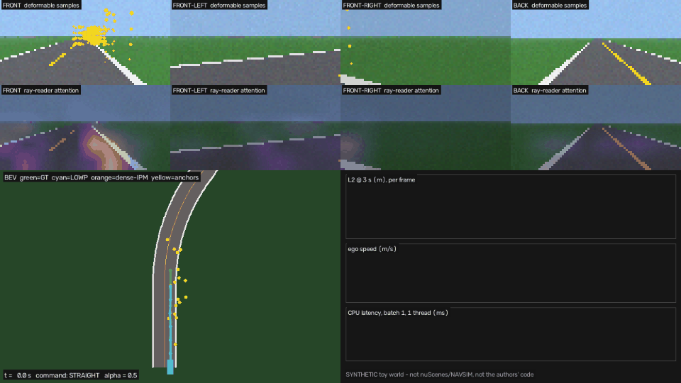

# Day 68 — LOWP: *Look Only Where You Plan* (toy PyTorch re-implementation)

> Paper: **Look Only Where You Plan for Real-Time End-to-End Urban Driving** — Que, Zhu, Wu, Bao, Yao.
> arXiv [2611.10264](https://arxiv.org/abs/2611.10264) (cs.RO), submitted 2026-11-06. No official code linked.
>
> **This repo is a SYNTHETIC toy.** It re-implements the paper's two sparse "readers" on a ray-cast 4-camera
> world so the mechanism can be studied on a laptop CPU. It does not use nuScenes / NAVSIM / Bench2Drive and
> it is not the authors' code. See `SOURCING.md` for what came from the paper and what is my choice.



## The idea in one paragraph
Most camera planners first build a dense bird's-eye-view (BEV) grid, then plan on it. LOWP skips the grid.
Two small sets of 16 learnable queries read camera features directly through the calibration:
**Expert 1 (deformable / anchor reader)** gives every query a metric 3D anchor ahead of the car, lifts it to
4 heights × 8 ring points = 32 candidates, projects them with `K R^T (p - t)`, samples bilinearly and
attends over them (plus a learned *null* candidate). **Expert 2 (global / ray reader)** lets 16 latents
cross-attend to every feature cell, each cell labelled with the 3D points its viewing ray passes at 8 depths
(1–60 m). Each expert has its own planning head; at inference the trajectories are mixed
`τ = α·τ_def + (1−α)·τ_glob` with α = 0.5 straight, 0.8 on turns. No object or map labels.

## Folder structure
```
day-68-lowp/
├── README.md                 # this file
├── SOURCING.md               # paper facts vs my choices, numbers quoted in the post
├── config.yaml               # hyper-parameters (paper values marked)
├── requirements.txt
├── lowp/
│   ├── geometry.py           # project_points (K R^T (p - t)), ray_points (8-depth ray labels)
│   ├── model.py              # Trunk, DeformableAnchorReader, GlobalRayReader, PlanningHead, LOWP,
│   │                         # DenseIPMPlanner (dense baseline), EgoStatusMLP (blind baseline)
│   ├── world.py              # synthetic road + IDM traffic + 4-camera ray-cast renderer
│   └── data.py               # dataset generation / torch Dataset
├── train.py                  # python train.py --model {lowp,lowp_s,dense,ego_mlp} --seed 0
├── evaluate.py               # L2@1/2/3 s, collision %, per-command L2, params, CPU latency, alpha sweep
├── simulate.py               # OpenCV "AI in action" video: samples, attention, BEV, telemetry
├── tests/test_lowp.py        # 10 unit tests (geometry, bounded steps, re-seeding, null token, mixing)
├── checkpoints/              # trained weights + metrics JSON
└── assets/                   # lowp_simulation.gif / .mp4
```

## Quick start
```bash
pip install -r requirements.txt
python -c "import numpy as np; from lowp.data import generate; \
  [np.savez_compressed(f'data/{n}.npz', **generate(k, s)) for n, k, s in [('train',6000,1),('val',800,2),('test',1500,3)]]"
python train.py --model lowp      # ~10 min on 1 CPU thread
python train.py --model dense     # ~25 min (the dense BEV sampling is the slow part)
python train.py --model lowp_s; python train.py --model ego_mlp
python evaluate.py
python simulate.py --seed 5000 --frames 150 --out assets/lowp_simulation.gif --mp4 assets/lowp_simulation.mp4
pytest -q tests
```

## Toy results (synthetic test split, 1,500 frames, seed 0, 1,200 steps each)
| Model | L2@1s | L2@2s | L2@3s | Avg L2 (m) | Straight | Turns | Collision % | Params | CPU ms (b1) |
|---|---|---|---|---|---|---|---|---|---|
| Ego-status MLP (no cameras) | 0.497 | 1.540 | 2.890 | **1.642** | 0.352 | 2.909 | 1.07 | 2316 | 0.0 |
| Dense IPM-BEV baseline | 0.156 | 0.316 | 0.797 | **0.423** | 0.190 | 0.652 | 1.07 | 349836 | 12.5 |
| LOWP-S (global reader only) | 0.137 | 0.313 | 0.762 | **0.404** | 0.189 | 0.615 | 1.07 | 318092 | 3.2 |
| LOWP (both experts, mixed) | 0.109 | 0.257 | 0.687 | **0.351** | 0.169 | 0.529 | 0.93 | 566672 | 11.8 |
|   LOWP deformable head only | 0.115 | 0.259 | 0.686 | **0.353** | 0.173 | 0.530 | 1.00 | - | - |
|   LOWP global head only | 0.155 | 0.325 | 0.780 | **0.420** | 0.189 | 0.646 | 0.93 | - | - |
| Constant velocity, straight | 0.760 | 2.737 | 5.771 | **3.090** | 1.014 | 5.127 | 9.40 | - | - |

Seed-1 re-run (avg L2): LOWP 0.355 (seed 0: 0.351), dense 0.467 (seed 0: 0.423). Ground truth itself trips the collision checker on 0.20% of frames. Alpha sweep (avg L2, alpha on the deformable head): 0.0: 0.420, 0.2: 0.393, 0.4: 0.371, 0.6: 0.357, 0.8: 0.351, 1.0: 0.353. CPU latency: 1 thread, batch 1, median of 50.

Reading the toy honestly:
* **Vision matters here:** the blind ego-status MLP is 4.7× worse (1.64 m avg L2), mostly on turns.
* **Sparse beat my dense baseline on accuracy:** LOWP 0.351 m vs dense-IPM 0.423 m (−17%), turns 0.529 vs 0.652; seed 1 repeats it (0.355 vs 0.467).
* **But not on size/speed:** my toy LOWP has *more* parameters (567 K vs 350 K) and similar CPU latency
  (11.8 vs 12.5 ms). The paper's 53%-params / 1.7× claim is against ResWorld, whose depth net + BEV encoder
  are 48.5 M of 80.8 M; my IPM baseline has neither, so the efficiency claim is **not** tested here.
  The global-only LOWP-S is the fast one (3.2 ms) and still beats dense-IPM (0.404 m).
* **The mix barely helps:** deformable expert alone 0.353 m vs mixed 0.351 m; the α sweep is flat from 0.6–1.0.
  Consistent with the paper's own caveat that complementarity vs. capacity/ensembling is not separated.
* **Collisions are noise-level:** 14 vs 16 of 1,500 frames (GT itself trips the checker in 3 frames).

## Core code (excerpt — full file in `lowp/model.py`)
```python
# ============================================================================ Expert 1
class DeformableAnchorReader(nn.Module):
    def __init__(self, d: int = 64, n_q: int = 16, n_layers: int = 3, heads: int = 4,
                 n_heights: int = 4, height_span: float = 3.0, n_ring: int = 8,
                 ring_radius: float = 1.5, max_step: float = 3.0, max_init_shift: float = 6.0):
        super().__init__()
        self.n_q, self.n_layers, self.max_step, self.max_init_shift = n_q, n_layers, max_step, max_init_shift
        self.ring_radius = ring_radius
        # --- initial anchor grid ahead of the car: 4 x 4 over x in [6, 30] m, y in [-6, 6] m
        gx, gy = torch.meshgrid(torch.linspace(6, 30, 4), torch.linspace(-6, 6, 4), indexing="ij")
        self.register_buffer("anchor_grid", torch.stack([gx, gy], -1).view(-1, 2))          # (Q, 2)
        self.register_buffer("heights", torch.linspace(0.0, height_span, n_heights))         # (4,)
        ang = torch.arange(n_ring) * 2 * math.pi / n_ring
        self.register_buffer("ring", torch.stack([ang.cos(), ang.sin()], -1) * ring_radius)  # (8, 2)

        self.query = nn.Embedding(n_q, d)
        self.scene_ctx = mlp(2 * d, d, d)          # pooled image feature + ego token -> scene content
        self.init_shift = nn.Linear(d, 2)          # per-scene initial anchor shift (bounded by tanh)
        self.anchor_emb = mlp(3, d, d)             # anchor position fed back as an embedding
        self.cand_emb = mlp(3, d, d)               # candidate offset (relative to anchor) embedding
        self.null = nn.Parameter(torch.zeros(1, 1, d))
        P = n_heights * n_ring
        self.P = P
        self.layers = nn.ModuleList()
        for _ in range(n_layers):
            self.layers.append(nn.ModuleDict(dict(
                step=nn.Linear(d, 2),                         # bounded anchor refinement
                ring_off=nn.Linear(d, n_ring * 2),            # query-dependent ring offsets
                self_attn=nn.MultiheadAttention(d, heads, batch_first=True),
                cand_attn=nn.MultiheadAttention(d, heads, batch_first=True),
                n1=nn.LayerNorm(d), n2=nn.LayerNorm(d), n3=nn.LayerNorm(d),
                ffn=mlp(d, 2 * d, d),
            )))
        for l in self.layers:                         # start with zero refinement / zero offsets
            nn.init.zeros_(l["step"].weight); nn.init.zeros_(l["step"].bias)
            nn.init.zeros_(l["ring_off"].weight); nn.init.zeros_(l["ring_off"].bias)
        nn.init.zeros_(self.init_shift.weight); nn.init.zeros_(self.init_shift.bias)

    def candidates(self, anchor: torch.Tensor, ring_off: torch.Tensor) -> torch.Tensor:
        """anchor (B, Q, 2), ring_off (B, Q, 8, 2) -> candidates (B, Q, P=32, 3) in the ego frame."""
        B, Q = anchor.shape[:2]
        ring_xy = anchor[:, :, None, :] + self.ring[None, None] + ring_off               # (B, Q, 8, 2)
        xy = ring_xy[:, :, None].expand(B, Q, len(self.heights), -1, 2)                   # (B, Q, 4, 8, 2)
        z = self.heights.view(1, 1, -1, 1, 1).expand(B, Q, -1, ring_xy.shape[2], 1)       # (B, Q, 4, 8, 1)
        return torch.cat([xy, z], -1).reshape(B, Q, -1, 3)                                # (B, Q, 32, 3)

    def forward(self, feat, K, R, t, img_hw, ego_tok):
        """feat (B, N, d, Hf, Wf); K, R (B, N, 3, 3); t (B, N, 3); ego_tok (B, d) -> tokens (B, Q, d) + diagnostics."""
        B, N, d = feat.shape[:3]
        Q, P = self.n_q, self.P
        pooled = feat.mean(dim=(1, 3, 4))                                                  # (B, d)
        q = self.query.weight[None].expand(B, -1, -1) + self.scene_ctx(torch.cat([pooled, ego_tok], -1))[:, None]
        # (1) per-scene initial shift of the anchor grid
        anchor = self.anchor_grid[None] + torch.tanh(self.init_shift(q)) * self.max_init_shift   # (B, Q, 2)
        # (2) re-seed anchors whose candidates are invisible in every camera at initialisation
        zero_off = torch.zeros(B, Q, self.ring.shape[0], 2, device=feat.device)
        _, vis, _ = project_points(self.candidates(anchor, zero_off).view(B, Q * P, 3), K, R, t, img_hw)
        seen = vis.any(1).view(B, Q, P).any(-1, keepdim=True)                              # (B, Q, 1)
        anchor = torch.where(seen, anchor, self.anchor_grid[None].expand(B, -1, -1))
        n_reseeded = (~seen).sum()

        diag = dict(anchors=[anchor], cands=[], cand_valid=[], attn=[])
        for l in self.layers:
            a3 = torch.cat([anchor, torch.zeros_like(anchor[..., :1])], -1)                # (B, Q, 3)
            qp = q + self.anchor_emb(a3 / 30.0)                                            # position fed back
            # bounded refinement of the anchor (tanh * max_step metres)
            anchor = anchor + torch.tanh(l["step"](qp)) * self.max_step
            ring_off = torch.tanh(l["ring_off"](qp)).view(B, Q, -1, 2) * self.ring_radius
            cands = self.candidates(anchor, ring_off)                                      # (B, Q, 32, 3)
            grid, valid, _ = project_points(cands.view(B, Q * P, 3), K, R, t, img_hw)      # (B, N, Q*P, 2)
            sampled, vis_any = sample_multicam(feat, grid, valid)                          # (B, Q*P, d), (B, Q*P)
            rel = cands - torch.cat([anchor, torch.zeros_like(anchor[..., :1])], -1)[:, :, None]
            keys = sampled.view(B, Q, P, d) + self.cand_emb(rel / 3.0)                     # (B, Q, 32, d)
            keys = torch.cat([self.null.expand(B * Q, 1, d), keys.view(B * Q, P, d)], 1)  # (B*Q, 33, d)
            mask = torch.cat([torch.zeros(B * Q, 1, dtype=torch.bool, device=feat.device),
                              ~vis_any.view(B * Q, P)], 1)                                 # True = ignore
            # queries talk to each other, then each query attends over its own 32 candidates + NULL
            x = l["n1"](qp)
            q = q + l["self_attn"](x, x, x, need_weights=False)[0]
            x = l["n2"](q + self.anchor_emb(torch.cat([anchor, torch.zeros_like(anchor[..., :1])], -1) / 30.0))
            out, w = l["cand_attn"](x.reshape(B * Q, 1, d), keys, keys, key_padding_mask=mask)
            q = q + out.view(B, Q, d)
            q = q + l["ffn"](l["n3"](q))
            diag["anchors"].append(anchor); diag["cands"].append(cands)
            diag["cand_valid"].append(vis_any.view(B, Q, P)); diag["attn"].append(w.view(B, Q, P + 1))
        diag["n_reseeded"] = n_reseeded
        return q, diag


# ============================================================================ Expert 2
class GlobalRayReader(nn.Module):
    def __init__(self, d: int = 64, n_q: int = 16, n_layers: int = 3, heads: int = 4,
                 n_depths: int = 8, d_min: float = 1.0, d_max: float = 60.0):
        super().__init__()
        # 8 log-spaced depths between 1 and 60 m (spacing is my choice; the paper says "8 depths from 1 to 60 m")
        self.register_buffer("depths", torch.logspace(math.log10(d_min), math.log10(d_max), n_depths))
        self.d_max = d_max
        self.ray_enc = mlp(n_depths * 3, d, d)
        self.latents = nn.Parameter(torch.randn(1, n_q, d) * 0.02)
        self.ego_in = nn.Linear(d, d)
        self.layers = nn.ModuleList([nn.ModuleDict(dict(
            cross=nn.MultiheadAttention(d, heads, batch_first=True),
            self_attn=nn.MultiheadAttention(d, heads, batch_first=True),
            n1=nn.LayerNorm(d), nkv=nn.LayerNorm(d), n2=nn.LayerNorm(d), n3=nn.LayerNorm(d),
            ffn=mlp(d, 2 * d, d))) for _ in range(n_layers)])
        self._ray_cache = None

    def forward(self, feat, K, R, t, img_hw, ego_tok):
        B, N, d, Hf, Wf = feat.shape
        pts = ray_points(K, R, t, img_hw, (Hf, Wf), self.depths)                          # (B, N, Hf, Wf, 8, 3)
        geo = self.ray_enc(pts.flatten(-2) / self.d_max)                                   # (B, N, Hf, Wf, d)
        mem = feat.permute(0, 1, 3, 4, 2) + geo                                            # geometry-labelled cells
        mem = mem.reshape(B, N * Hf * Wf, d)                                               # (B, N*Hf*Wf, d)
        q = self.latents.expand(B, -1, -1) + self.ego_in(ego_tok)[:, None]
        attn = None
        for l in self.layers:
            kv = l["nkv"](mem)
            out, attn = l["cross"](l["n1"](q), kv, kv)                                     # attn: (B, Q, N*Hf*Wf)
            q = q + out
            x = l["n2"](q)
            q = q + l["self_attn"](x, x, x, need_weights=False)[0]
            q = q + l["ffn"](l["n3"](q))
        return q, dict(attn=attn.view(B, -1, N, Hf, Wf))


# ============================================================================ full planner
class LOWP(nn.Module):
    """Two sparse experts over a shared trunk; no dense BEV. mode='both' (LOWP) or 'global' (LOWP-S)."""

    def __init__(self, d: int = 64, T: int = 6, img_hw=(40, 80), mode: str = "both",
                 alpha_straight: float = 0.5, alpha_turn: float = 0.8):
        super().__init__()
        self.img_hw, self.mode = tuple(img_hw), mode
        self.trunk = Trunk(d)
        self.ego = EgoToken(d)
        self.glob = GlobalRayReader(d)
        self.head_glob = PlanningHead(d, T)
        if mode == "both":
            self.defo = DeformableAnchorReader(d)
            self.head_def = PlanningHead(d, T)
        self.alpha_straight, self.alpha_turn = alpha_straight, alpha_turn

    def forward(self, img, K, R, t, status, cmd):
        """img (B, N, 3, H, W) in [0, 1]; returns dict with tau (mixed), tau_def, tau_glob: (B, T, 2)."""
        feat = self.trunk(img)
        ego = self.ego(status, cmd)
        g_tok, g_diag = self.glob(feat, K, R, t, self.img_hw, ego)
        out = dict(tau_glob=self.head_glob(g_tok, ego), glob_diag=g_diag)
        if self.mode == "global":
            out["tau"] = out["tau_glob"]
            return out
        d_tok, d_diag = self.defo(feat, K, R, t, self.img_hw, ego)
        out["tau_def"] = self.head_def(d_tok, ego)
        out["def_diag"] = d_diag
        # command-dependent mixing: alpha = 0.5 when going straight, 0.8 on turns (inference rule)
        alpha = torch.where(cmd == CMD_STRAIGHT, self.alpha_straight, self.alpha_turn).to(img.dtype)[:, None, None]
        out["tau"] = alpha * out["tau_def"] + (1 - alpha) * out["tau_glob"]
        return out

    def loss(self, out, gt):
        """L1 on each expert's own trajectory (the mix is inference-only)."""
        l = F.l1_loss(out["tau_glob"], gt)
        if "tau_def" in out:
            l = l + F.l1_loss(out["tau_def"], gt)
        return l
```

## Not implemented
LiDAR-supervised depth adapter (nuScenes only), GTRS 8,192 / 4,096-entry vocabulary scorers, Hydra-NeXt-style
control branch, reverse / brake-release rules, history frame, host-sync latency engineering.
