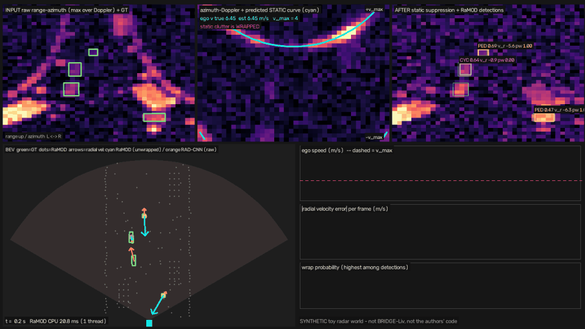

# Day 69 — RaMOD: moving-object detection from raw mmWave radar cubes under ego motion (toy re-implementation)

Paper: **RaMOD: Moving-Object Detection from Raw mmWave Radar Cubes under Ego Motion** — Fang, Zhuang, Xing, Wei,
Jiang, Shi, Julier, Chetty. arXiv [2611.13271](https://arxiv.org/abs/2611.13271) (cs.RO, 2026-11-09).
**Not the authors' code.** No official code was linked at the time of writing. See `SOURCING.md` for what comes
from the paper and what I chose myself.



## What the toy keeps from the paper
1. **Ego velocity per frame** from the unmasked cube (here: learned Hough voting along v_r = −v_e·cos θ).
2. **A global static-Doppler mask** that includes wrapped copies, built from that estimate. It is not a zero-Doppler cut.
3. **T = 3 suppressed cubes plus their differences from the target frame**, fed to a multi-scale encoder.
4. **Box + class heads**, plus **radial and forward velocity under raw and unwrapped hypotheses** and a
   wrapping probability. The unwrapped pair is used when p_wrap ≥ 0.5.

## Folder structure
```
day-69-ramod/
├── README.md                 # this file
├── SOURCING.md               # paper facts vs my choices, numbers quoted in the post
├── config.yaml               # radar / data / train hyper-parameters
├── requirements.txt
├── ramod/
│   ├── world.py              # synthetic street + ego + movers -> raw RAD cubes (wrapping, clutter, noise)
│   ├── data.py               # cached splits, CenterNet targets, torch Dataset
│   ├── model.py              # EgoMotionHough, StaticDopplerSuppression, TemporalMultiScale, RaMODHead, RaMOD
│   └── losses.py             # focal + box + two-hypothesis velocity + wrap BCE + ego losses; decoder
├── train.py                  # python train.py --model {ramod,ramod_noegosup,ramod_nowraploss,ramod_nosup,rad_cnn}
├── evaluate.py               # cube mAP@0.30, velocity MAE, wrap accuracy, static-band recall, params, CPU ms
├── simulate.py               # OpenCV "AI in action" clip: raw cube | static curve | suppressed + detections | BEV | telemetry
├── tests/test_ramod.py       # 9 unit tests (physics, mask geometry, Hough oracle, shapes, decoder rule)
├── checkpoints/              # trained weights, logs, metrics_s0.json / metrics_s1.json
└── assets/                   # ramod_simulation.gif / .mp4 / still.png
```

## Quick start
```bash
pip install -r requirements.txt
python -m pytest -q tests                                   # 9 passed
python train.py --model ramod --seed 0                      # ~7 min on 2 CPU threads (first run renders the dataset, ~1 min)
python train.py --model rad_cnn --seed 0
python evaluate.py --seed 0
python simulate.py --seed 5000 --frames 150 --out assets/ramod_simulation.gif --mp4 assets/ramod_simulation.mp4
```

## Toy results (synthetic test split: 25 episodes, 950 frames, 3 classes, v_max = 4 m/s, ego 0–8 m/s)
Seed 0 (1,500 steps each). Cube mAP uses 2-D range-azimuth boxes at IoU 0.30. Velocity metrics are on true positives.

| Model | mAP@0.30 | AP ped / cyc / car | Radial v MAE | …on wrapped objects | Wrap acc (all / wrapped) | Fwd v MAE | Ego MAE | Recall in static band / other | Params | CPU ms |
|---|---|---|---|---|---|---|---|---|---|---|
| **RaMOD (full)** | **0.910** | 0.929 / 0.903 / 0.899 | **0.573** | 0.921 | 0.968 / 0.948 | 0.998 | 0.017 | 0.538 / 0.909 | 937 K | 12.0 |
| no ego supervision | 0.919 | 0.939 / 0.932 / 0.885 | 0.570 | 0.906 | 0.970 / 0.952 | 0.963 | 0.022 | 0.556 / 0.944 | 937 K | 11.9 |
| no wrapping loss | 0.922 | 0.941 / 0.924 / 0.900 | 1.769 | 6.614 | 0.790 / **0.000** | 1.223 | 0.017 | 0.573 / 0.930 | 937 K | 11.7 |
| no suppression (T=3, wrap head) | 0.860 | 0.956 / 0.894 / 0.730 | 0.617 | 0.880 | 0.950 / 0.925 | 1.125 | – | 0.675 / 0.799 | 933 K | 9.2 |
| RAD-CNN (1 frame, raw Doppler only) | 0.858 | 0.944 / 0.912 / 0.720 | 1.830 | 7.537 | 0.798 / 0.000 | 2.025 | – | 0.714 / 0.797 | 545 K | 5.2 |

Seed-1 re-run (new init and data order, same data): RaMOD mAP 0.934 / v MAE 0.726; RAD-CNN 0.851 / 1.861;
no-suppression 0.848 / 0.609. CPU latency: batch 1, 1 thread, median of 30 runs. "Static band" means the mover's
measured Doppler is within 0.5 m/s of the static-clutter Doppler at its azimuth (234 of 1,659 test objects).

### Reading the toy honestly
* **Detection gain comes from suppression.** RaMOD beats both unsuppressed models by 5–9 mAP points across both seeds. Almost all of it comes from cars (0.90 vs 0.72), which sit next to walls and parked cars.
* **The velocity gain comes from the wrap head, not the mask.** The no-suppression model with two hypotheses is as good on velocity (0.62 m/s). The raw-only baseline misses every wrapped object by 6–8 m/s.
* **No-wrapping-loss ablation matches the paper's direction.** The wrap probability never fires (0% on wrapped objects, 79% overall vs the paper's 58.42%).
* **No-ego-supervision ablation does NOT match.** The paper loses 6.7 mAP points (80.85 → 74.16) and ego MAE rises to 2.755 m/s. In my toy, the physics-structured Hough estimator learned ego speed (0.022 m/s MAE) from the detection loss alone. A clean synthetic static curve probably makes this too easy.
* **The paper's stated mask cost is reproduced.** Recall on movers inside the static band drops to 0.54–0.59, from 0.68–0.74 without the mask. Those are slow, same-direction road users.
* **Not tested:** 3-D RAD IoU, four classes, the real AWR2243 cube size (192×256×255), the ±23 m/s velocity limit, Mamba-RODNet, and GFLOPs or FPS on real hardware.
