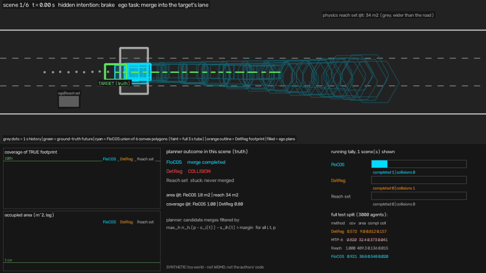

# Day 72 - FloCOS: compact forward occupancy sets via conditional flow matching (toy re-implementation)

Paper: **FloCOS: Predicting Compact Forward Occupancy Sets of Surrounding Vehicles via Conditional Flow Matching**
(Dong, Zhan, Li, Hou, Wang, Fan; arXiv [2611.15488](https://arxiv.org/abs/2611.15488), cs.RO, 11 Nov 2026).
**Not the authors' code.** I could read only the abstract (arXiv HTML/PDF were rate-limited all session), so every
architectural detail below is my own design that follows the abstract. See `SOURCING.md`.



## Idea in one picture
```
history + context ─► AgentEncoder ─► c
x0 ~ N(0, I)  (M = 6 draws) ─► Euler ODE  dx/dt = v_θ(x, t, c)  (4 steps) ─► θ_1..θ_6   (60 coefficients each)
θ_i ─► Bernstein basis ─► centre c_i(t), offsets s_ih(t) ─► P_i(t) = {p : n_h·(p − c_i(t)) ≤ s_ih(t)}, 8 normals
O(t) = ∪_i P_i(t)   compact, non-convex occupancy set, 3 s horizon, 12 steps
training: flow matching on tubes fitted to the realised future  ─►  + coverage loss + soft union-area loss
planning: candidate ego merges are kept only if  max_h n_h·(p − c_i(t)) − s_ih(t) > margin  for every i, t, p
```

## Folder structure
```
day-72-flocos/
├── README.md / SOURCING.md / config.yaml / requirements.txt
├── flocos/
│   ├── world.py      # synthetic 3-lane highway, hidden intentions (keep / hard brake / accel / lane change L / R)
│   ├── geometry.py   # half-space polygons, Bernstein temporal basis, tube fitting, coverage + MC union area, clipping
│   ├── data.py       # dataset + cache, ego-merge scenario per sample, physics reachable-set baseline
│   ├── model.py      # AgentEncoder, VelocityField (FiLM), FloCOS (fm_loss / sample / predict_set), set_losses, DetReg, MTP
│   └── planner.py    # ego merge planner with half-space collision constraints + true-collision check
├── train.py          # --stage fm | set | detreg | mtp
├── evaluate.py       # all methods + ablations -> checkpoints/metrics_*.json
├── simulate.py       # OpenCV "AI in action": input vs ground truth vs predicted sets vs 3 planned egos + telemetry
├── tests/test_flocos.py   # 9 tests
├── checkpoints/      # weights, logs, metrics_s0 / s1 / s0_la0.005 / s0_la0.08 .json
└── assets/           # flocos_simulation.gif / .mp4 / still.png
```
Run: `python train.py --stage fm && python train.py --stage set && python train.py --stage detreg && python train.py --stage mtp && python evaluate.py && python simulate.py --mp4 assets/flocos_simulation.mp4`
(2 CPUs: about 4 min FM, 7 min set stage, 2 min per baseline.)

## Toy results (3,000 synthetic test agents, 3 s horizon)
Coverage = share of the TRUE footprint (45-point grid) inside the set; "all 3 s" = agents covered at every step;
area = Monte-Carlo union area per step; merge = ego merged into the target's lane with no collision.

| Method | Coverage | Fully covered all 3 s | Area (m²) | Merge completed | Ego collision |
|---|---|---|---|---|---|
| Oracle (true footprint) | 1.000 | 100% | 9.1 | 93.4% | 0.7% |
| DetReg (1 predicted footprint) | 0.572 | 0.0% | 9.0 | 81.2% | **15.7%** |
| MTP-6 (6 predicted footprints) | 0.820 | 0.0% | 32.4 | 37.3% | 4.1% |
| Physics reachable set | 1.000 | 99.0% | **489.3** | **13.6%** | 1.5% |
| FloCOS, flow matching only (M = 6) | 0.804 | 0.3% | 18.4 | 75.5% | 8.0% |
| **FloCOS full, λ_area = 0.02 (seed 0 / 1)** | **0.921 / 0.919** | 18.7 / 16.9% | 38.8 / 39.1 | 54.8 / 54.8% | **2.0 / 2.2%** |
| FloCOS full, λ_area = 0.005 | 0.946 | 36.0% | 52.0 | 48.6% | 1.6% |
| FloCOS full, λ_area = 0.08 | 0.841 | 1.7% | 26.5 | 58.7% | 3.4% |

Ablations (seed 0, λ_area = 0.02): M = 1 / 3 / 12 components → coverage 0.56 / 0.83 / 0.96, area 15.5 / 29.2 / 47.3 m²,
collisions 19.5 / 5.2 / 1.0%. NFE = 1 / 2 / 8 → coverage 0.50 / 0.83 / **0.78** (vs 0.92 at the trained NFE = 4).
Another noise seed at test: identical (0.921, 38.8 m², 2.4% collisions).
Coverage by intention (FloCOS full vs DetReg): keep 0.98 vs 0.70, brake 0.89 vs 0.39, lane change 0.88 vs 0.57.
Parameters: FloCOS 1.87 M, DetReg 0.18 M, MTP-6 0.21 M. CPU latency (batch 1, 1 thread): FloCOS 5.8-6.9 ms
(6 sets x 4 NFE) vs 0.6-0.8 ms for DetReg / MTP-6.

### Reading it honestly
* **The set-level losses do the work.** Flow matching alone gives samples that look like single plausible futures
  (0.80 coverage, 8% collisions). Coverage + union-area training lifts coverage to 0.92 and cuts collisions 4x.
* **Compact vs. conservative is a real dial.** λ_area traces a frontier from 0.95 coverage / 52 m² to 0.84 / 26.5 m².
  At λ_area = 0.08 FloCOS beats MTP-6 on all four numbers (coverage, area, completion, collisions).
* **It is not free throughput.** The single-footprint planner merges more often (81%) because it ignores what it
  cannot see, and pays with 15.7% collisions. FloCOS completes 55%, the oracle 93%: there is plenty of headroom.
* **Coverage is statistical, not guaranteed.** Only 17-19% of agents are covered at every step of the 3 s horizon
  (36% at λ_area = 0.005). The reachable set is the only one with ~guaranteed coverage, and it blocks 86% of merges.
* **Training through the sampler binds you to the NFE.** 8 Euler steps is worse than 4 because the set losses were
  optimised for the 4-step discretisation.
* **The fixed 8-normal polygon is an over-approximation for rotated footprints** (+25% area at 6 deg yaw).
* **Not tested:** WOMD, maps, multi-agent interaction, the paper's real-vehicle setup, a true trajectory optimiser.
