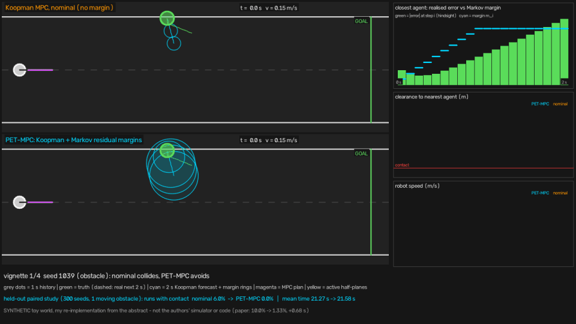

# Day 73 - PET-MPC: Prediction-Error-Tightened MPC (toy re-implementation)

**Paper:** Febbraro, Rollo, Farina, Bascetta, Kashiri. *Prediction-Error-Tightened MPC for Socially Compliant
Crowd Navigation.* [arXiv:2611.15781](https://arxiv.org/abs/2611.15781) (cs.RO, 11 Nov 2026, submitted to ECC 2027).
Politecnico di Milano + Leonardo Robotics Lab. No official code. **Read [SOURCING.md](SOURCING.md) first:** I could
read the abstract and sections I-II only, so the margin estimator and the whole world are my reconstruction.



## The idea in one line
Forecast each agent with an online Koopman model, **measure how wrong those forecasts turn out**, and inflate every
MPC collision constraint by a distribution-free Markov margin built from that measured error.

```
 track history ─► StructuredKoopman (sparse 7x7, re-fit every 0.1 s) ─► 2 s forecast p̂_{t+i|t}
                                                                           │
 realised p_t ─► ResidualMoments:  Σ_i ← (1-β)Σ_i + β‖p_t − p̂_{t|t−i}‖²    │
                    └─► Markov margin  m_i = √(Σ_i / δ)  (P(‖e_i‖ ≥ m_i) ≤ δ)│
                                                                           ▼
 groups of agents ─► collision-cone screening (radius + m_i) ─► ONE half-plane per group & step
                                                                           ▼
                      linear MPC on the look-ahead point (OSQP) ─► (v, ω) for the unicycle
```

## Folder structure
```
day-73-petmpc/
├── README.md / SOURCING.md / config.yaml / requirements.txt
├── petmpc/
│   ├── world.py       # corridor, non-reactive cart / pedestrians (OU turn rate, abrupt turns, stop-and-go)
│   ├── predictor.py   # StructuredKoopman, ResidualMoments, markov_margin, PETPredictor   (PyTorch core)
│   ├── planner.py     # look-ahead-point MPC, grouping, collision-cone screening, half-planes, soft personal space
│   └── episode.py     # closed-loop episode + metrics, open-loop prediction study
├── evaluate.py        # --study obstacle | crowd | prediction | report  -> results/*.json, RESULTS.md
├── simulate.py        # OpenCV "AI in action": nominal vs PET-MPC on the same seed + telemetry
├── tests/test_petmpc.py   # 10 tests
├── results/           # obstacle.json, crowd.json, prediction.json, RESULTS.md
└── assets/            # petmpc_simulation.gif / .mp4 / still.png
```
No `train.py`: like the paper, the Koopman operator is identified online from each track, so nothing is trained offline.

## Results (synthetic, held-out seeds ≥ 1000; seeds 0-119 were used for development)

**Moving generic obstacle, 300 paired seeds** (same obstacle motion for every controller)

| Controller | Runs with contact | Mean time to goal | 5th-pct min clearance |
|---|---|---|---|
| Constant velocity, no margin | 5.67% | 21.28 s | -0.01 m |
| Koopman, no margin (nominal) | 6.00% | 21.27 s | -0.08 m |
| Koopman + fixed 0.30 m margin | 3.00% | 21.45 s | 0.13 m |
| **PET-MPC (Markov residual margins)** | **0.00%** (0/300, 95% upper bound ~1.3%) | 21.58 s (+0.31 ± 0.10 s) | 0.26 m |

Paired: nominal had contact in 18 seeds where PET-MPC had none, and the reverse never happened.
Paper (abstract): 10.0% → 1.33%, +0.68 s.

**Crowd, 10 non-reactive pedestrians, 40 paired seeds**

| Controller | Runs with contact | Personal-space overlap (time) | Mean time | Success |
|---|---|---|---|---|
| Koopman, no margin | 25.0% | 6.9% | 29.1 s | 100% |
| Koopman + fixed 0.30 m | 22.5% | 4.6% | 31.3 s | 98% |
| **PET-MPC, pedestrian-aware** | 15.0% | **2.4%** | 32.8 s | 95% |
| PET-MPC, pedestrians as generic obstacles | **7.5%** | 11.8% | 28.1 s | 98% |

Paper (abstract, offline ablation): 2.11% overlap pedestrian-aware vs 22.84% generic.

**Open-loop prediction (20 seeds x 300 steps, 2 s horizon)**: ADE Koopman 0.553 m vs constant velocity 0.503 m
(obstacle), 0.396 vs 0.356 m (crowd). Empirical coverage of the Markov margins 79.5% / 85.8% (target ≥ 75%), but
only **60%** at the 2 s step for the obstacle because of my 1.0 m cap. Predictor: ~9 ms per step for 10 agents (CPU).

### Reading it honestly
* **The margin does the work, not the Koopman model.** In my world the online Koopman forecast is slightly *worse*
  than constant velocity. Contacts fall because the constraints grow with the measured error.
* **Adaptive beats fixed:** a hand-picked 0.30 m buffer halves contacts (3.0%); per-agent, per-step margins remove
  them (0/300) for only 0.13 s more travel time.
* **It needed two fixes the abstract doesn't mention.** The online operator diverged (km-scale 2 s errors) until I
  bounded its spectral radius. Large far-horizon margins made the QP infeasible, and PET-MPC was *worse* than nominal
  (6.7% vs 3.3% on dev seeds) until slack prices decayed along the horizon.
* **Crowds are harder.** 25% → 15% contact is not significant on 40 seeds (8 vs 4 paired flips), costs +2.8 s, and
  two runs timed out.
* **Personal space is a real trade-off.** Pedestrian-aware handling cuts overlap 5x (11.8% → 2.4%), but in my
  *non-reactive* crowd it doubles physical contacts (7.5% → 15%): a robot that waits politely gets walked into.
  Real pedestrians react, so this is partly an artefact, but it is worth testing.
* **Markov is conservative and the cap breaks it.** m = 2 x RMS error at δ = 0.25; at 2 s that is >1 m, so I capped
  it, and coverage at that step drops to 60%.
* **Not tested:** the authors' simulator, reactive pedestrians, real robots, sensing/tracking noise.

## Run it
```bash
pip install -r requirements.txt
python -m pytest -q tests                      # 10 tests
python evaluate.py --study obstacle            # ~19 min on 2 CPUs
python evaluate.py --study crowd               # ~11 min
python evaluate.py --study prediction && python evaluate.py --study report
python simulate.py --out assets/petmpc_simulation.gif --mp4 assets/petmpc_simulation.mp4
```
SYNTHETIC toy world - not the authors' code, simulator or numbers.
