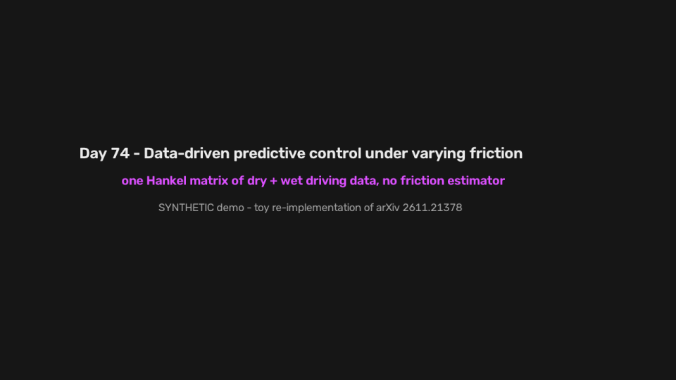

# Day 74 - Data-Driven Predictive Control under Varying Friction (toy re-implementation)

Paper: *Data-Driven Predictive Control for Autonomous Vehicle Racing under Varying Friction*, Beerwerth, Tischbein,
Alrifaee - [arXiv 2611.21378](https://arxiv.org/abs/2611.21378) (16 Nov 2026). Built from the **abstract only**; see
[SOURCING.md](SOURCING.md). Everything here is a synthetic 1:10-scale world, not the authors' simulator, cars or code.



## The idea in one paragraph
Data-driven predictive control (DPC/DeePC) needs no vehicle model: it stores recorded driving as a block-Hankel
matrix and predicts the next N outputs as a linear combination of recorded trajectories whose first T_ini samples
match what the car just did. That prediction is only as good as the data. Record on dry tyres, drive on wet ones,
and the predictor expects grip that is not there. The paper's fix is not to estimate friction at all. It pools
dry and wet recordings into one data set.

## Folder structure
```
day-74-dpc-friction/
├── README.md / SOURCING.md / config.yaml / requirements.txt
├── dpcf/
│   ├── vehicle.py     # 1:10 single-track car, Pacejka tyre (mu scales force + stiffness), track with wet sectors
│   ├── hankel.py      # PyTorch core: block_hankel, HankelData (mosaic pooling), DPCPredictor, multistep_rmse
│   ├── control.py     # condensed steering QP (OSQP), DPCController, linear model MPC with true mu (baseline)
│   └── episode.py     # excited data collection + closed-loop runs
├── evaluate.py        # --study prediction | closedloop | report  -> results/*.json, RESULTS.md
├── simulate.py        # OpenCV "AI in action": input vs ground truth vs three Hankel predictions + telemetry
├── tests/test_dpcf.py # 10 tests (incl. exact fundamental-lemma check on an LTI system)
├── results/           # prediction.json, closedloop.json, summary.json, RESULTS.md
└── assets/            # dpc_simulation.gif / .mp4 / still.png
```
No `train.py`: DPC has no trained weights. The "model" is the recorded data, and the predictor matrix is closed-form.

## Run
```bash
pip install -r requirements.txt
python -m pytest -q tests                       # 10 passed
python evaluate.py --study prediction           # ~25 s
python evaluate.py --study closedloop           # ~5 min (20 seeds x 3 tracks x 5 controllers x 2 laps)
python evaluate.py --study report
python simulate.py --out assets/dpc_simulation.gif --mp4 assets/dpc_simulation.mp4
```

## Results (held-out seeds 100-119; QP weights picked on seed 0)
See [results/RESULTS.md](results/RESULTS.md).

**Open-loop prediction, 0.75 s horizon, RMS lateral error (cm)**

| Test friction | matched | mismatched | pooled | mismatched/matched | pooled/matched |
|---|---|---|---|---|---|
| mu 1.0 (dry) | 0.93 | 3.64 | 1.90 | 3.9x | 2.05x |
| mu 0.5 (wet) | 1.79 | 4.82 | 2.40 | 2.7x | 1.34x |

Paper (abstract): pooled within 1.5x, mismatched 2.2x-3.4x.

**Closed-loop tracking, 2 laps, RMS |e_y| (cm), 0 off-track runs anywhere**

| Track | DPC dry-only | DPC wet-only | **DPC pooled** | DPC matched (oracle) | linear MPC, true mu |
|---|---|---|---|---|---|
| all dry | 0.68 | 1.89 | 1.09 | 0.68 | 0.38 |
| all wet | 4.38 | 2.06 | 3.15 | 2.06 | 2.74 |
| mixed (2 wet sectors) | 1.52 | 1.77 | **1.15** | 0.73 | 0.43 |

On the mixed track, pooled beats each single data set in 20/20 paired seeds.

### Reading it honestly
* **The mismatch effect reproduces.** Wrong-friction data cost 2.7-3.9x in prediction error, close to the paper's
  2.2-3.4x.
* **Pooling halves the penalty but is not "matched".** It gets 1.34x on wet but 2.05x on dry, so in my toy it meets
  the paper's 1.5x only on one side. In closed loop it is 1.5-1.6x worse than matched data on uniform tracks.
* **Where pooling really wins is mixed friction.** No single data set fits both sectors, and pooled is best of the
  non-oracle options in every seed.
* **It is a compromise, not friction sensing.** With l2 regularisation, the pooled predictor puts 52% of |g| on
  dry columns when it is dry and 48% when it is wet. It averages the two data sets instead of choosing between
  them. Sparser regularisation (l1) or longer, richer data may behave differently; I only tried l1 in a quick
  exploratory test, which was inconclusive.
* **The baseline is not the paper's NMPC.** It is a linear error-model MPC with the true friction and true state
  (an oracle). It is best on dry and mixed tracks, but worse than matched DPC on the all-wet track (2.74 vs
  2.06 cm), where the linear tyre model breaks down near the limit.
* **Not tested:** real vehicles, tyre wear or temperature, friction levels between the two recorded ones, speed
  changes beyond the fixed profile, data-set size and excitation design.
