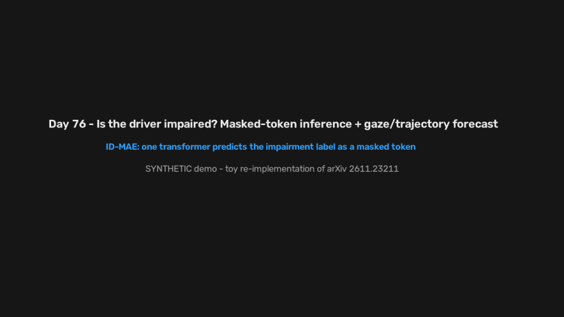

# Day 76 - ID-MAE: is the driver impaired? Masked-token inference with gaze and trajectory reconstruction

Toy re-implementation of **arXiv [2611.23211](https://arxiv.org/abs/2611.23211)**, *Multimodal Masked Diffusion
Autoencoder for Modeling Impaired Driving* (Gideon et al., Toyota Research Institute; listed 18 Nov 2026).
Built from the **abstract only**. The data is a synthetic simulator, not DIVERT. See [SOURCING.md](SOURCING.md).



## Idea in one paragraph
Driver-state labels such as "under cognitive load" or "distracted by the phone" are expensive. ID-MAE puts the
**impairment label in the token sequence**, next to gaze and vehicle-state patches. During training a random
fraction t of the tokens is masked, including the label. The transformer then classifies the masked label **and**
reconstructs the masked gaze and trajectory. Windows without a label still teach the model through the
reconstruction term. At inference, masking only the label gives a classifier. Masking the future patches gives a
gaze and trajectory forecaster.

## Folder structure
```
day-76-driver-idmae/
├── README.md / SOURCING.md / config.yaml / requirements.txt
├── idm/
│   ├── data.py        # synthetic simulator: 4 conditions, per-driver style + susceptibility, location-matched windows
│   ├── model.py       # PyTorch core: IDMAE (masked-diffusion objective, classify, iterative forecast) + GRU baseline
│   └── baselines.py   # constant-velocity / hold-gaze forecasts + forecast metrics
├── train.py           # idmae / norecon / gru  x  100% / 10% labels  x  3 seeds (18 runs)
├── evaluate.py        # Q1-Q4 + extensions -> results/summary.json, results/RESULTS.md
├── simulate.py        # OpenCV "AI in action": posterior, road view, driver's view, telemetry
├── tests/test_idm.py  # 9 tests
├── results/           # summary.json, RESULTS.md, train_log.json, ckpt/*.pt (data_*.npz regenerated on demand)
└── assets/            # idmae_simulation.gif / .mp4 / still.png
```

## Run
```bash
pip install -r requirements.txt
python train.py --all          # ~80 min on 2 CPU cores (18 runs x 1000 steps)
python evaluate.py             # ~3 min
python simulate.py --out assets/idmae_simulation.gif --mp4 assets/idmae_simulation.mp4
pytest -q tests
```

## Results (3,600 windows from 30 unseen drivers, mean of 3 seeds)
Full tables: [results/RESULTS.md](results/RESULTS.md).

| Question | Paper (abstract) | This toy |
|---|---|---|
| Q1 reconstruction loss -> paired AUC | 0.706 vs 0.590 (+0.116) | 100% labels: 0.808 vs 0.800 (+0.012, CI -0.000..+0.023); 10% labels: 0.788 vs 0.798 (-0.009, CI -0.023..+0.005) - **not reproduced** |
| Q2 vs supervised baseline | "improves over baselines" | vs GRU: tie at 100% (0.808 vs 0.800); **+0.047** at 10% labels (CI +0.027..+0.069), but the no-recon transformer gets the same gain |
| Q3 visual vs cognitive separable | yes | posterior AUC 0.884; linear probe on label token 0.903 - **reproduced (direction)** |
| Q4 gaze / trajectory prediction | "strong" | gaze 9.2 deg vs 12.8 deg hold-last; lateral 0.198 vs 0.211 m; **speed 0.52 vs 0.07 m/s -> position ADE 0.53 vs 0.23 m (worse)** |
| Ext: iterative vs one-shot unmasking | - | iterative worse on position (0.53 vs 0.48 m), equal on gaze |
| Ext: true label visible while forecasting | - | no change (gaze moves 0.1 deg): the decoder ignores the label |

### Reading it honestly
* **The headline effect did not show up.** In this toy, the reconstruction objective gives at most +0.01 paired
  AUC. That is inside the noise, and it is negative with 10% labels, where self-supervision should help most.
  The one place it helped was **cognitive load** (per-class paired AUC 0.779 vs 0.729 at 100% labels, though the no-recon seeds vary a lot: sd 0.06). Cognitive
  load is also the subtlest condition in my simulator. A likely reason for the small effect overall: my
  conditions leave strong, low-level fingerprints (phone glances, speed). Supervised learning finds them alone,
  so self-supervision has little left to add. DIVERT is harder (0.59-0.71), so the paper's setting may leave more room.
* **Label scarcity is where the transformer earns its keep.** At 10% labels both masked-token transformers beat
  the GRU by 0.04-0.05 paired AUC, but recon on/off makes no difference. Random masking is the regulariser that
  matters here.
* **Visual vs cognitive is easy to tell apart** (AUC 0.88-0.90). Phone glances move the gaze down and freeze
  steering. Cognitive load narrows the gaze and adds steering micro-corrections.
* **Susceptibility dominates.** Paired AUC is 0.70 for low-susceptibility drivers and 0.93 for high ones. The
  low group is roughly where the paper's DIVERT numbers sit.
* **Masked reconstruction is not a free forecaster.** The gaze forecast beats "hold the last gaze", mainly because
  it regresses to the mean: its spread over 2 s is 1.0 deg against 6.6 deg in reality. On the longitudinal axis
  it loses clearly to constant speed. Predicting residuals relative to the last observed value would likely fix
  that (not done).
* **The clip:** model seed 0, unseen driver #117, simulator seed 4243. The first seed I tried (4242) produced no
  phone glance at all in the 12 s "visual" segment, and the model correctly stayed on "none" (0.48). In the clip
  run, visual is caught right after the first glance (0.99). The cognitive segment is **mislabelled as emotional
  (0.85)**, and emotional is caught (0.99). Per-clip results are anecdotes. The table above is the evidence.
