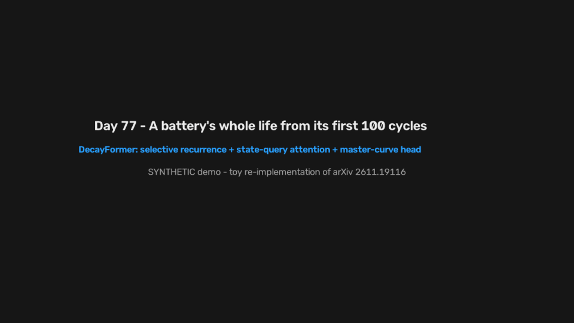

# Day 77 - DecayFormer: a battery's whole life from its first 100 cycles

Toy re-implementation of **"A Hybrid State Space-Attention Architecture for Forecasting the Trajectories of Battery
Degradation"** (Shrey Patel, Bhargav Srinivas Rao, Samet Ayhan), [arXiv 2611.19116](https://arxiv.org/abs/2611.19116),
listed 17 Nov 2026. I worked from the **abstract only** and used a **synthetic** aging simulator, not BatteryLife. See [SOURCING.md](SOURCING.md).



## What the paper claims (abstract)
DecayFormer is a compact hybrid model. It combines a cycle-level selective recurrence (one scalar state per channel),
attention with queries generated from the recurrent state, SOC-interval statistics as features, and a master-curve head that
jointly predicts a scalar lifetime and a monotone SOH profile in normalised lifetime. It is evaluated on BatteryLife with 22
aging-condition-exclusive folds, one run per fold and one fixed configuration. Mean test MAPE: Li-ion 2.25%, CALB 2.76%,
Na-ion 0.95%, Zn-ion 7.19%.

## Folder structure
```
day-77-battery-decayformer/
├── README.md / SOURCING.md / LINKEDIN_POST.md / SIMULATION_SCRIPT.md / config.yaml / requirements.txt
├── dfm/
│   ├── data.py        # synthetic aging simulator: SEI + LAM + plating knee, 48 conditions, SOC-interval features
│   ├── model.py       # PyTorch core: SelectiveRecurrence, StateQueryAttention, MasterCurveHead, DecayFormer + baselines
│   └── baselines.py   # sqrt-law capacity-fade fit
├── train.py           # 6 variants x 6 condition-exclusive folds, one fixed config
├── evaluate.py        # Q1-Q4 + extensions -> results/summary.json, results/RESULTS.md
├── simulate.py        # OpenCV "AI in action": cycler feed, SOH forecast overlay, master curve, attention
├── tests/test_dfm.py  # 9 tests
├── results/           # summary.json, RESULTS.md, predictions_k100.npz, logs/, ckpt/*.pt (data.npz regenerated on demand)
└── assets/            # decayformer_simulation.gif / .mp4 / still.png
```

## Run
```bash
pip install -r requirements.txt
python train.py --all          # ~100 CPU-min (36 runs x 1,500 steps); two processes in parallel on 2 cores
python evaluate.py             # ~2 min
python simulate.py --out assets/decayformer_simulation.gif --mp4 assets/decayformer_simulation.mp4
pytest -q tests
```

## Results (288 cells, 48 conditions, every cell forecast by the fold model that never saw its condition)
Full tables: [results/RESULTS.md](results/RESULTS.md). Forecasts use the first 100 cycles.

| Variant | params | traj MAPE % | lifetime MAPE % | non-monotone curves |
|---|---|---|---|---|
| **DecayFormer** | 120k | 1.06 | **16.8** | 0% |
| same encoder, free head | 126k | 0.88 | 33.0 | 49% |
| no SOC-interval features | 119k | 1.34 | 20.5 | 0% |
| no state-query attention | 54k | 0.98 | **16.4** | 0% |
| Transformer (3x128), free head | 680k | 0.88 | 41.8 | 47% |
| GRU, free head | 183k | **0.86** | 36.1 | 42% |
| sqrt-law fit | - | 0.99 | 68.8 | 0% |

| Question | Paper (abstract) | This toy |
|---|---|---|
| Q1 compact vs scaled | compact model, 2.25% MAPE, no per-fold tuning | On lifetime, DecayFormer beats a 5.6x Transformer by 24.9 pts (CI -32.2..-18.4). On **trajectory MAPE it is worse** (+0.19 pts, CI +0.11..+0.26) and no better than a 4-number sqrt fit. **Partly reproduced.** |
| Q2 master-curve head | joint lifetime + monotone profile | Lifetime 16.8% vs 33.0% for the free head, with 0% vs 49% non-monotone curves. Trajectory MAPE is worse (1.06 vs 0.88). |
| Q3 SOC-interval statistics | used as features | Help on both metrics: lifetime -3.6 pts (CI -5.9..-1.5), trajectory -0.28 pts. **But the simulator was built that way.** |
| Q4 state-query attention | part of the hybrid | **Adds nothing here:** dropping it ties on lifetime (+0.4, CI -0.6..+1.5) and is better on trajectory (0.98 vs 1.06). |
| Ext: fewer cycles | - | 25 / 50 / 100 cycles: lifetime 21.1 / 18.3 / 16.8%. The free-head models stay at 34-47%. |
| Ext: knee cells (n = 164) | - | Lifetime 21.5% vs 47.8-62.5% (free heads) and 109% (sqrt fit). Non-knee cells: 10.6% vs 12.7-14.4%. |

### Reading it honestly
* **The metric decides the winner.** Trajectory MAPE is averaged over the true pre-EOL cycles, so most of the points sit
  in the easy, near-linear early-to-mid life. A curve that stays too flat loses little. The unconstrained heads exploit this:
  they win trajectory MAPE but over-predict lifetime by +31 to +41% on average, and 16-17% of their forecasts never reach
  80% within 3,000 cycles (4% of cells truly don't). For a warranty or second-life decision, that optimistic bias is the
  dangerous direction. Report lifetime error next to trajectory MAPE.
* **The master curve is the active ingredient.** Tying the curve to L (SOH(L) = 0.8 by construction) is what fixes lifetime.
  Its cost: the learned curve tends to put a small "cliff" in the last knot just before EOL (visible in the clip), and that
  hurts trajectory MAPE.
* **Attention was dead weight in this toy.** A recurrence-only model with 54k params matched it. The paper may need
  attention for longer or messier histories than my 100 clean cycles.
* **Still optimistic.** DecayFormer's mean signed lifetime error is +9%, and only 42% of cells land within ±10%.
* **Clip:** median-error cells, not the best. On the knee cell, DecayFormer is late (+19%) but the others miss the knee
  entirely (+81%, +82%). On the easy cell, the simple baselines win (-7% vs +2% / -1%).
* **Not comparable to the paper's 2.25%.** My truth curves are noise-free, there is one chemistry, and there are 6 folds, not 22.
