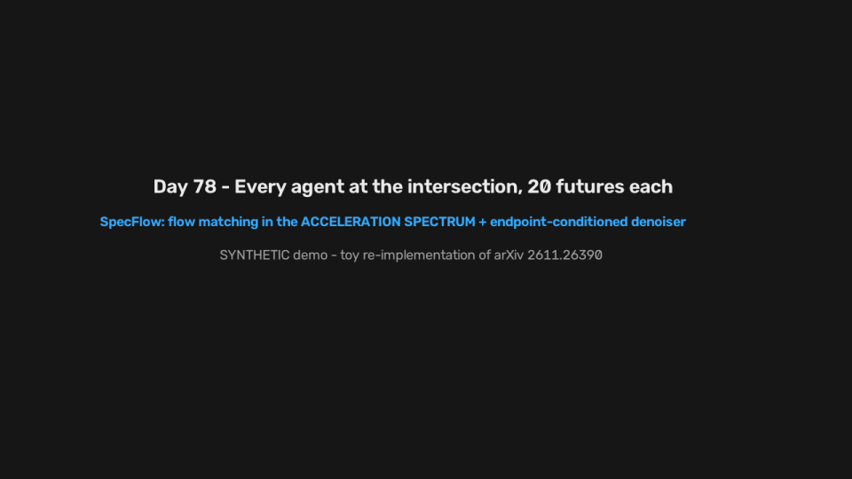

# Day 78 - SpecFlow: forecasting every agent as an acceleration spectrum

This is a toy re-implementation of **"SpecFlow: Flow Matching in the Acceleration Spectrum for Multi-Agent Trajectory
Forecasting"** (Ziyang Xu, Peng Han, Hai Zhou), [arXiv 2611.26390](https://arxiv.org/abs/2611.26390), listed 20 Nov 2026.
I worked from the **abstract only** and used a **synthetic** intersection simulator instead of ETH/UCY, SDD or NBA. See [SOURCING.md](SOURCING.md).



## What the paper claims (abstract)
SpecFlow's generative state is the DCT coefficients of future accelerations, not positions. Conditional flow matching
transports Gaussian noise to that spectrum. Velocity and position come from fixed analytical integration starting at the
last observed state, and a joint phase-space loss supervises all three. An endpoint predictor scores candidate
destinations, and the top one conditions the spectral denoiser. The denoiser alternates attention over hypotheses and agents.
Best-of-20 results: ETH/UCY 0.15/0.22 (best on all five scenes), NBA 0.69/0.86 at 4 s, SDD 7.38/11.57.

## Folder structure
```
day-78-prediction-specflow/
├── README.md / SOURCING.md / LINKEDIN_POST.md / SIMULATION_SCRIPT.md / config.yaml / requirements.txt
├── dsf/
│   ├── data.py        # synthetic intersection: vehicles (turns, red lights, car following) + pedestrians, agent frames
│   └── model.py       # PyTorch core: Kinematics (DCT + integration), ContextEncoder, EndpointHead,
│                      #   AlternatingBlock, SpectralDenoiser, SpecFlow (+ pos / acc-time / ablation variants)
├── train.py           # 5 variants x 2 seeds, one fixed config, 5,000 steps each
├── evaluate.py        # Q1-Q3 + extensions -> results/summary.json, results/RESULTS.md
├── simulate.py        # OpenCV "AI in action": BEV boxes, history, 20-hypothesis fans, denoising, spectrum, telemetry
├── tests/test_dsf.py  # 9 tests
├── results/           # summary.json, RESULTS.md, logs/, ckpt/*.pt (data.npz is regenerated on demand)
└── assets/            # specflow_simulation.gif / .mp4 / still.png
```

## Run
```bash
pip install -r requirements.txt
python train.py --all          # ~15 CPU-min per run, 10 runs; I ran two processes in parallel on 2 cores
python evaluate.py             # ~20 min on CPU (including the few-step study)
python simulate.py --out assets/specflow_simulation.gif --mp4 assets/specflow_simulation.mp4
pytest -q tests
```

## Results (4,000 held-out scenes, 17,429 agents, best-of-20, 4.8 s horizon, mean of 2 seeds)
Full tables are in [results/RESULTS.md](results/RESULTS.md). Errors are measured against the noise-free future.

| Variant | minADE (m) | minFDE (m) | veh RMS jerk (m/s³) | veh samples with \|a\| > 6 | endpoint spread (m) |
|---|---|---|---|---|---|
| **SpecFlow** (DCT accel, phase loss, top-1 endpoint) | 2.04 | 5.43 | 1.63 | 0.0% | 0.16 |
| position state (same net, x,y frame by frame) | 2.55 | 6.67 | 5.08 | 5.6% | 0.25 |
| acceleration in time, no DCT | **1.96** | **5.25** | 1.69 | 0.0% | 0.10 |
| no phase-space loss | 1.95 | 5.20 | 1.65 | 0.0% | 0.19 |
| no endpoint conditioning | 1.80 | 4.80 | 1.72 | 0.0% | 0.16 |
| SpecFlow + confidence-stratified endpoints (inference only) | **0.94** | **2.22** | 1.74 | 0.0% | 4.17 |
| constant velocity | 3.67 | 9.72 | - | - | 0 |
| truth (clean track) | | | 1.12 | 0.0% | |

| Question | Paper (abstract) | This toy |
|---|---|---|
| Q1 acceleration spectrum vs positions | the generative state is acceleration DCT | Acceleration + integration beats positions: −0.53 m minADE (CI −0.57..−0.49), −1.30 m minFDE, 3.1x less jerk, 0% vs 5.6% infeasible samples. **But the DCT adds nothing**: time-domain acceleration is 0.08 m better (CI +0.06..+0.10). **Partly reproduced.** |
| Q2 joint phase-space loss | supervises a, v and p | **Slightly hurts here**: +0.09 m minADE (CI +0.07..+0.10). |
| Q3 top-1 endpoint conditioning | the top candidate conditions the denoiser | **Hurts here**: +0.24 m minADE vs no endpoint. All 20 samples follow the one destination (0.16 m spread), so a wrong top-1 pick costs the whole best-of-20. Left turns: 14.0 m minFDE. |
| Ext: stratified endpoints | - | Spreading hypotheses over the 6 scored candidates, with no retraining: 2.04 → 0.94 m minADE; left turns 14.0 → 3.6 m minFDE. A few hypotheses go to junk candidates (some point backwards). |
| Ext: few-step sampling | - | 1 Euler step: SpecFlow jerk 0.8 and minADE 1.90 (better than 10 steps, see below). Position flow at 1 step: jerk 20.4. |

### Reading it honestly
* **The win is "generate acceleration and integrate", not "spectrum".** Integration guarantees kinematic consistency, and
  that alone gives the accuracy and smoothness gains. With a full, orthonormal 12-coefficient DCT the spectrum is just a
  rotation of the same signal. The paper may truncate high frequencies or use a different normalisation; the abstract doesn't say.
* **My flows are close to deterministic.** Every flow variant, including the one without endpoints, has a 0.10-0.25 m
  endpoint spread, and fewer Euler steps *improve* minADE. A 1-step rectified flow outputs the conditional mean, and
  more steps only add a small, mostly wrong deviation. This is probably undertraining (5,000 steps, 15 CPU-min), so treat
  the endpoint results as "with a near-deterministic denoiser". Best-of-20 diversity in this toy comes almost entirely from
  where the hypotheses are told to go.
* **The models underfit easy cases.** Constant velocity beats every model on straight-driving cars (0.40 m vs 0.61 m).
* **Clip:** scene 1 is the median-error scene. Scene 2 was picked as a top-1 failure to show the mechanism; it is not representative.
* **Not comparable to the paper's 0.15 m.** I use different data, a 4.8 s horizon with vehicles at up to 13 m/s, and no tuning.
