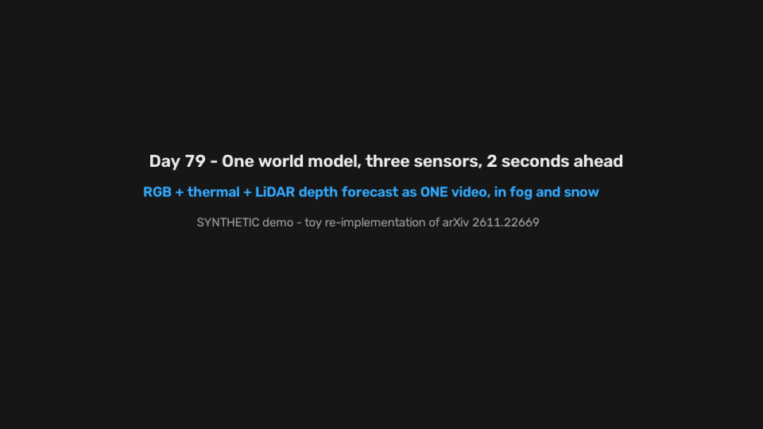
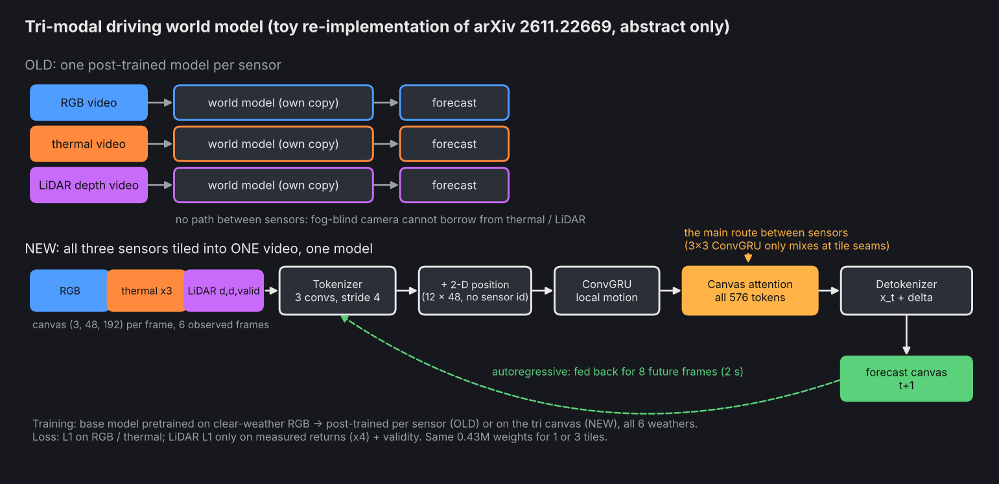

# Day 79 - A tri-modal driving world model: forecasting RGB, thermal and LiDAR as one video

A toy re-implementation of **"Beyond the Camera: A Tri-Modal Driving World Model for Future RGB, Thermal, and LiDAR
Forecasting in Adverse Weather"** (Chowdhury, Rahman, Hasan, Gupta, Haque, Shannon), [arXiv 2611.22669](https://arxiv.org/abs/2611.22669),
dated 18 Nov 2026. It was rebuilt from the **abstract only** and runs on a **synthetic** three-sensor simulator, not DSERT-RoLL.
See [SOURCING.md](SOURCING.md).





## What the paper claims (abstract)
The authors post-train a pretrained video world model for each sensor. LiDAR is represented as a depth video aligned
with the RGB camera, and the tri-sensor model sees all three sensors as one video. LiDAR is scored in metres against
measured returns, and forecasts are compared with persistence baselines run through the same tokenizer.

On DSERT-RoLL (58 validation sequences, six weathers) they report four findings:
* Post-trained RGB and thermal forecasts beat persistence.
* Joint training lowers LiDAR error at 2 s by 2.1 m, at a small cost in camera fidelity.
* Only the tri-sensor model's LiDAR beats persistence on mean error.
* Blanking one sensor degrades the others more in snow than in fog.

## Folder structure
```
day-79-perception-trimodalwm/
├── README.md / SOURCING.md / LINKEDIN_POST.md / SIMULATION_SCRIPT.md / config.yaml / requirements.txt
├── twm/
│   ├── data.py        # synthetic forward camera: RGB + thermal + 16-beam LiDAR depth, 6 weathers, GT boxes
│   └── model.py       # PyTorch core: Tokenizer, ConvGRUCell, CanvasAttention, Detokenizer, VideoWorldModel, tile_loss
├── train.py           # base (clear RGB) pretraining, then post-training: rgb / thermal / lidar / tri
├── evaluate.py        # Q1-Q4 -> results/summary.json, results/RESULTS.md, results/per_clip.npz
├── simulate.py        # OpenCV "AI in action": 4x3 sensor grid, GT boxes + tracks, forecast detections, telemetry
├── make_diagram.py    # assets/architecture.png
├── tests/test_twm.py  # 9 tests
├── results/           # summary.json, RESULTS.md, logs/, ckpt/*.pt
└── assets/            # trimodal_simulation.gif / .mp4 / still.png / architecture.png
```

## Run
```bash
pip install -r requirements.txt
python train.py --run base                  # ~14 CPU-min
python train.py --run tri                   # ~50 CPU-min (3x wider canvas)
python train.py --run rgb; python train.py --run thermal; python train.py --run lidar    # ~16 CPU-min each
python evaluate.py                          # ~5 min
python simulate.py --out assets/trimodal_simulation.gif --mp4 assets/trimodal_simulation.mp4
pytest -q tests
```

## Results (600 held-out clips, 100 per weather, 6 observed frames -> 8 forecast frames = 2 s, 1 seed)
Errors are at +2 s. RGB and thermal are in grey levels (0-255). LiDAR is in metres against measured returns. Full
tables are in [results/RESULTS.md](results/RESULTS.md).

| Model | RGB MAE | thermal MAE | LiDAR, all returns | LiDAR, common returns | LiDAR, object returns |
|---|---|---|---|---|---|
| **tri-sensor** (one canvas) | 8.55 | 4.59 | 0.46 | 0.36 | 5.25 |
| RGB-only (post-trained) | **7.74** | - | - | - | - |
| thermal-only (post-trained) | - | **4.27** | - | - | - |
| LiDAR-only (post-trained) | - | - | 0.46 | **0.35** | **5.23** |
| base (clear-RGB pretrained, not post-trained) | 15.07 | - | - | - | - |
| persistence (last frame) | 9.81 | 6.19 | 1.12* | 0.39 | 9.76 |

\* Persistence has no value where the last frame had no return. The "common returns" column is the fair comparison:
returns measured both in the target frame and in the last observed frame.

| Question | Paper (abstract) | This toy |
|---|---|---|
| Q1 post-trained cameras vs persistence | beat persistence | **Reproduced.** RGB −2.08 (CI −2.16..−1.99), thermal −1.92 (CI −2.02..−1.82). The base model without post-training is worse than persistence (15.1, averaged over all six weathers). |
| Q2 joint training and LiDAR at 2 s | −2.1 m, small camera cost | **Not reproduced.** Tri − LiDAR-only = +0.005 m on all returns (CI +0.004..+0.007) and +0.01 m on object returns (CI −0.01..+0.04). The camera cost **did** appear: RGB +0.81 (+10%), thermal +0.32. |
| Q3 only the tri model beats persistence | only tri | **Not reproduced.** Both beat persistence on common returns: tri −0.030 m, LiDAR-only −0.034 m. On object returns: 5.2 vs 9.8 m. |
| Q4 blanking hurts more in snow than fog | snow > fog | **1 of 6 sensor pairs** (RGB blanked → LiDAR: +3.2% snow vs +1.7% fog). Blanking LiDAR hurt the cameras far less in snow (+15% / +46%) than in fog (+50% / +103%). |

### Reading it honestly
* **The tri model learned to coexist, not to cooperate.** Its LiDAR forecasts match the LiDAR-only model in every
  weather: within 0.01 m on all returns and within 0.12 m on object returns. Blanking the RGB input moves its LiDAR
  error by only 0.7-3.2%. The cross-sensor path exists (a
  test checks it), but 1,000 CPU steps did not make the model use it for LiDAR. A large pretrained video model with long
  post-training, as in the paper, may behave very differently.
* **The cameras lean on the LiDAR tile, or the blank is out-of-distribution.** Zeroing the LiDAR tile raised camera error
  by 15-171%. Zeros are a frame the model never saw, so this mixes "it uses LiDAR" with "a black tile confuses it".
  Masking with learned tokens during training would separate the two; I did not do that.
* **Most LiDAR returns are road surface,** which is easy (0.35 m). Object returns are where forecasting matters (5.2 m).
  Snow is the hardest weather (0.88 m) because flake returns are random.
* **Forecasts are blurry means** (deterministic L1). In the clip, cars that close in or leave are smeared out.
* **Clip choice:** both scenes are the median tri-LiDAR clip of their weather. Persistence wins scene 1.
* **Not comparable to the paper:** different data, a ~0.43M-parameter model vs a large pretrained video model, raw
  persistence instead of tokenizer persistence, and 1 seed.
