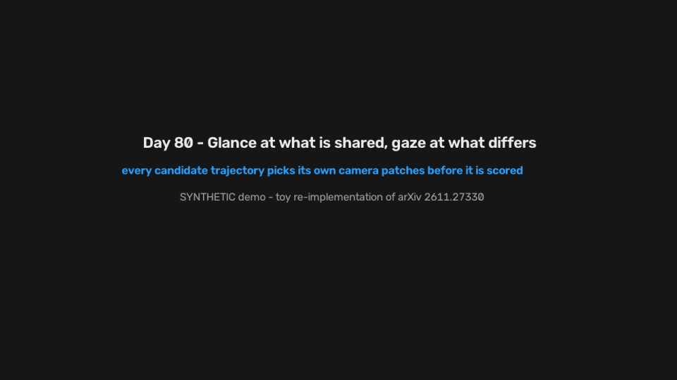
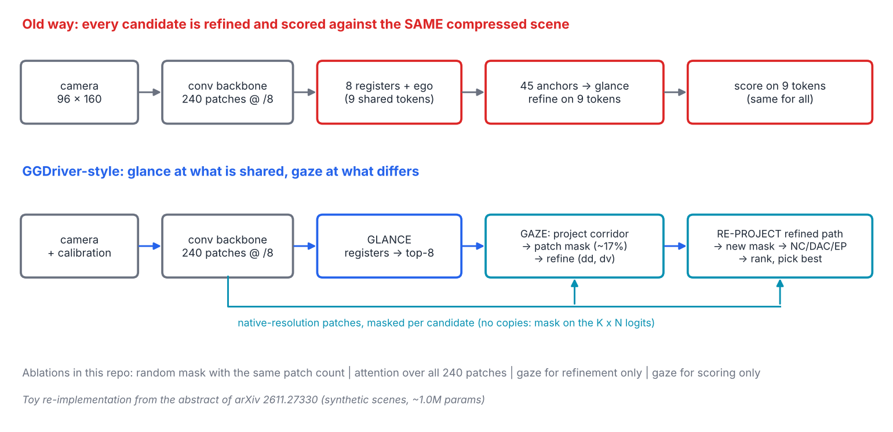

# Day 80 - GGDriver: glance at what is shared, gaze at what differs

A toy re-implementation of **"GGDriver: Glance at What Is Shared, Gaze at What Differs for Perception-Free Planning"**
(Sun, Li, Shi, Zheng, Hoe, Bai, Mi), [arXiv 2611.27330](https://arxiv.org/abs/2611.27330), listed 23 Nov 2026.
It was rebuilt from the **abstract only** and runs on a **synthetic** one-camera driving simulator, not on NAVSIM,
WOD-E2E or Bench2Drive. See [SOURCING.md](SOURCING.md).





## What the paper claims (abstract)
Many end-to-end planners score every candidate trajectory against the same compressed scene representation.
GGDriver works in three steps:
* A global **glance** proposes trajectory hypotheses from shared scene features.
* A **corridor** around each hypothesis is projected into the cameras. The mask selects patch features at the
  backbone's native resolution, using only the trajectory and the calibration.
* After refinement, the **scorer re-projects** each final proposal and ranks it on evidence along its own path.

The gaze step improves three planners with different scene representations. Ablations say that path-aligned patches
beat a matched number of random patches and beat attention over all patches, and that gazing for ranking helps more
than gazing for refinement only. Reported results (ViT-S, no perception labels): 8.110 RFS on WOD-E2E test, 94.2 PDMS
on NAVSIM-v1, 48.6 EPDMS on NAVSIM-v2, and 72.18 DS on Bench2Drive.

## Folder structure
```
day-80-planning-ggdriver/
├── README.md / SOURCING.md / LINKEDIN_POST.md / SIMULATION_SCRIPT.md / config.yaml / requirements.txt
├── ggd/
│   ├── scene.py       # synthetic forward camera + static objects, (d, v) trajectory vocabulary, PDMS-like rule score
│   └── model.py       # PyTorch core: corridor_mask, CrossAttn (per-query masks), Backbone, GlanceGazePlanner
├── train.py           # 6 variants: glance / gaze / gaze_refine / gaze_score / random / all
├── evaluate.py        # Q1-Q4 -> results/summary.json, results/RESULTS.md, results/per_clip.npz
├── simulate.py        # OpenCV "AI in action": two camera feeds, corridor patches, BEV, score bars, drive-out
├── make_diagram.py    # assets/architecture.png
├── tests/test_ggd.py  # 9 tests
├── results/           # summary.json, RESULTS.md, logs/, ckpt/*.pt
└── assets/            # ggdriver_simulation.gif / .mp4 / still.png / architecture.png
```

## Run
```bash
pip install -r requirements.txt
python train.py --run glance        # ~14 CPU-min (1 thread); data is generated on first use (~1 min)
python train.py --run gaze          # ~21 CPU-min
python train.py --run gaze_refine; python train.py --run gaze_score; python train.py --run random; python train.py --run all
python evaluate.py                  # ~1 min
python simulate.py --out assets/ggdriver_simulation.gif --mp4 assets/ggdriver_simulation.mp4
pytest -q tests
```

## The toy setup
* **Scenes:** one 96 x 160 forward camera (f = 110 px, 1.6 m high). Each scene has 2-4 lanes and only static objects:
  stalled cars, cones, low debris, barrels and pedestrians. There are three scene types: a small object blocks the ego
  lane (607 test scenes), a stalled car blocks it (440), or the ego lane is clear (453). Small hazards 22-62 m ahead
  are only a few pixels tall.
* **Candidates:** 45 anchors, combining 9 lateral targets (−7 … +7 m) with 5 target speeds (0 … 16 m/s), each turned
  into 16 waypoints over 4 s. Refinement adds ±0.875 m and ±2 m/s.
* **Rule score:** NC × DAC × (0.75 EP + 0.25 C), a toy cousin of PDMS. The terms are no-collision, drivable area,
  progress relative to the best safe anchor, and comfort.
* **Model:** about 1.03M parameters, identical in every variant.
  * A conv backbone produces 240 native patches at stride 8.
  * The glance uses 8 registers plus an ego-speed token.
  * Refinement and scoring each use 2 cross-attention blocks.
  * Variants change only **what evidence** refinement and scoring read.
* **Corridor:** the ego path from 6 m ahead, plus 4 m beyond its end, swept ±1.3 m laterally and 0-2 m vertically,
  projected with the calibration and dilated by one patch horizontally. It covers about 17% of the patches.
* **Selection:** keep the top 8 anchors by glance logit, refine them, re-score the refined proposals and pick the best.
* **Training:** 2,000 steps of batch 32 on CPU per variant, 1 seed. Glance-only also has a second seed.

## Results (1,500 held-out scenes)
Full tables are in [results/RESULTS.md](results/RESULTS.md).

| Planner | score | small hazard | stalled car | clear lane | collision | scorer reads |
|---|---|---|---|---|---|---|
| keep lane at current speed | 0.490 | 0.384 | 0.386 | 0.732 | 31.7% | - |
| **glance only** (shared tokens), seed 0 / seed 1 | 0.564 / 0.568 | 0.568 | 0.504 | 0.617 | 27.5% / 25.3% | 9 tokens |
| gaze for refinement only | 0.851 | 0.832 | 0.819 | 0.908 | 2.9% | 9 tokens |
| gaze for scoring only | 0.861 | 0.851 | 0.824 | 0.911 | 2.5% | 17% of patches |
| **gaze, refine + score (GGDriver-style)** | **0.869** | **0.853** | **0.847** | **0.912** | **2.2%** | 17% of patches |
| random patches, matched count | 0.649 | 0.630 | 0.592 | 0.729 | 18.9% | 18% of patches |
| attention over all 240 patches | 0.841 | 0.818 | 0.813 | 0.900 | 2.5% | 100% |
| oracle (best refined trajectory) | 0.916 | 0.914 | 0.908 | 0.926 | - | - |

Each question compares paired scenes; the CI is a 95% scene bootstrap.

| Question | Paper (abstract) | This toy |
|---|---|---|
| Q1 gaze vs glance only | gaze improves planning | **Reproduced.** +0.305 (CI +0.287..+0.324). Collisions fell from 27.5% to 2.2%. |
| Q2 path-aligned vs random, matched count | path-aligned wins | **Reproduced.** +0.220 (CI +0.204..+0.236). |
| Q3 path-aligned vs all patches | path-aligned wins | **Reproduced, but small.** +0.027 (CI +0.019..+0.036), and +0.034 on small-hazard scenes. |
| Q4 gaze for ranking vs refinement only | ranking gains more | **Reproduced, but small.** Score-only minus refine-only is +0.010 (CI +0.002..+0.019). |

Ranking quality, compared over the 8 refined proposals:

| | glance only | all patches | gaze |
|---|---|---|---|
| picks the truly best proposal | 13.5% | 44.1% | 65.5% |
| mean regret | 0.269 | 0.054 | 0.034 |
| rank correlation over all 45 | 0.54 | 0.77 | 0.80 |

### Reading it honestly
* **Most of the gap is native patches at all, not the path mask.** All-patch attention already reaches 0.841, while
  glance-only reaches 0.564. The corridor mask adds the last +0.027. It also ranks better: it picks the best proposal
  in 65.5% of scenes, against 44.1% for all-patch attention.
* **The glance-only failure is a training-signal effect, not a capacity limit.** Each model also has a glance head,
  which ranks the 45 anchors from the 9 shared tokens alone. In the gaze-trained model that head picks trajectories
  scoring 0.852; in the glance-only model it reaches 0.569 (two seeds agree: 0.564 / 0.568). So the compressed summary
  *can* encode a cone only a few pixels tall. The gaze model learned to, because the masked scorer sends sharp, local gradients into
  the backbone. The glance-only model never did in 2,000 steps. A longer schedule or perception supervision might
  narrow this gap a lot.
* **Random patches with a matched count are a strong negative control.** The same 17% budget placed at random scored
  only 0.649, so *where* the patches come from is what matters.
* **Gaze still fails.** It crashed in 2.2% of scenes, and in 14 of those the glance-only planner was safe (clip,
  scene 3: a nudge into a cone at 14 m/s).
* **Toy limits:** static scenes, one camera, perfect calibration (the corridor is only as good as the extrinsics), a
  hand-written score, and 1 seed per gaze variant. Moving agents would need the corridor to be swept in time, which
  this toy does not test. Not comparable to the paper's numbers.
* **Clip choice:** scene 1 is a random small-hazard scene (seed 80). Scenes 2 and 3 are selected, one win (161 such
  scenes) and one loss (14 such scenes), each the median of its group.
