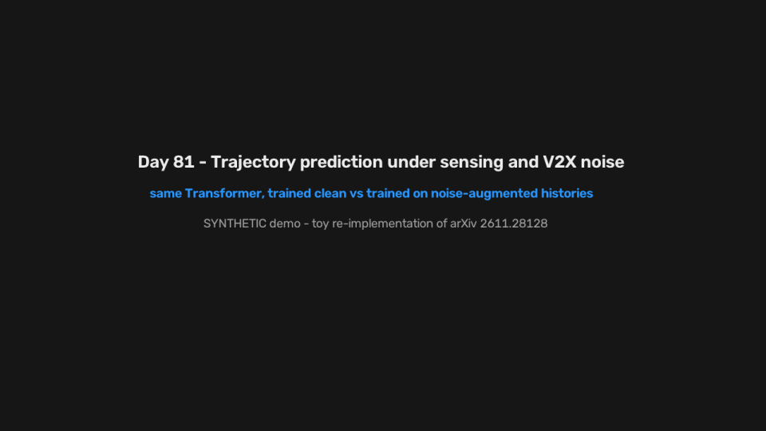
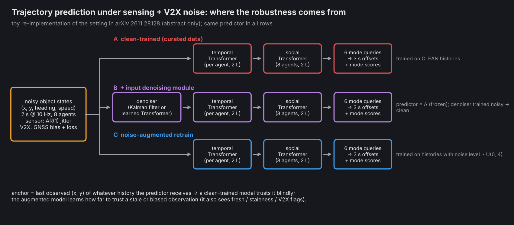

# Day 81 - Trajectory prediction under sensing and V2X noise: denoise the input, or retrain on noise?

A toy re-implementation of the setting in **"Robust Trajectory Prediction Under Sensing and V2X Noise: Evaluation and
Mitigation Strategies"** (Salehi, Lusvarghi, Sepulcre, Gozalvez), [arXiv 2611.28128](https://arxiv.org/abs/2611.28128),
listed 24 Nov 2026. It was rebuilt from the **abstract only**, with **synthetic** highway traffic and a **synthetic**
noise model. See [SOURCING.md](SOURCING.md).





## What the paper claims (abstract)
* Transformer-based, interaction-aware trajectory predictors are trained on curated data whose noise was filtered
  offline. Deployed, they get noisy position, heading and speed estimates, worse for V2X-received objects.
* Across five state-of-the-art models, accuracy degrades by **up to 6x** as the noise grows.
* **Retraining on a noise-augmented dataset** beats adding **input denoising modules**, and keeps degradation
  **below 1.5x**. The noise-augmented dataset is released.

## Folder structure
```
day-81-v2x-noisytraj/
├── README.md / SOURCING.md / LINKEDIN_POST.md / SIMULATION_SCRIPT.md / config.yaml / requirements.txt
├── nr/
│   ├── scene.py       # synthetic 3-lane highway: IDM car-following, gap-checked lane changes, sudden braking
│   ├── noise.py       # sensor AR(1) jitter, V2X GNSS-like bias + packet loss with held values, level 0-4
│   └── model.py       # PyTorch core: InteractionTransformer, HistoryDenoiser, kalman_cv, constant_velocity, WTA loss
├── train.py           # --run clean | aug | denoise
├── evaluate.py        # all pipelines x noise levels -> results/summary.json, RESULTS.md, per_clip.npz
├── simulate.py        # OpenCV "AI in action": two BEV panels, live error bars, held-out curves
├── make_diagram.py    # assets/architecture.png
├── tests/test_nr.py   # 9 tests
├── results/           # summary.json, RESULTS.md, per_clip.npz, logs/, ckpt/*.pt
└── assets/            # noisytraj_simulation.gif / .mp4 / still.png / architecture.png
```

## Run
```bash
pip install -r requirements.txt
python train.py --run clean --seed 0     # ~32 CPU-min (1 thread); data is generated on first use (~20 s)
python train.py --run aug --seed 0       # ~32 CPU-min
python train.py --run denoise --seed 0 --steps 4000   # ~16 CPU-min
# repeat with --seed 1
python evaluate.py                       # ~6 min
python simulate.py --out assets/noisytraj_simulation.gif --mp4 assets/noisytraj_simulation.mp4
pytest -q tests
```

## The toy setup
* **Traffic:** 3 lanes, 8 vehicles per scene, 10 Hz. IDM car-following, lane changes when the leader is slow and the
  gaps are safe, and in 35% of scenes one vehicle brakes suddenly. 2 s of history, 3 s to predict.
  40,000 training and 3,000 held-out scenes.
* **Noise (my construction), level s = 0 ... 4:**
  * Sensor-tracked vehicles: correlated AR(1) errors of 0.20·s m in position, 1.5·s° in heading and 0.25·s m/s in speed.
  * V2X-received vehicles (50% of the non-ego vehicles): a slowly drifting GNSS-like position bias (0.45·s m per axis)
    plus white noise, 3·s° heading, 0.35·s m/s speed. Each message is lost with probability min(0.1·s, 0.5), and the
    previous value is then held.
  * At level 4 the latest observed position is off by 1.9 m on average (1.0 m for sensor-tracked, 3.0 m for V2X).
* **Predictor (0.70M params, same in every pipeline):**
  * Per-step features: x, y, cos/sin heading, speed, a "fresh message" flag, staleness and a V2X flag.
  * A 2-layer temporal Transformer per agent, then a 2-layer social Transformer over the 8 agents.
  * 6 mode queries decode 30 step offsets from the last observed position, plus a mode score.
  * Winner-takes-all loss. 5,000 steps of batch 64, 2 seeds.
* **Pipelines:**
  * **clean:** trained on clean histories.
  * **clean + Kalman:** a causal constant-velocity Kalman filter in front of the clean model.
  * **clean + learned denoiser:** a 0.15M-param Transformer trained noisy → clean (levels U(0, 4)) in front of the
    frozen clean model.
  * **aug:** the same predictor retrained with a noise level drawn from U(0, 4) for every scene.
  * Constant velocity (raw and Kalman-filtered) as kinematic floors.

## Results (3,000 held-out scenes x 8 vehicles; learned pipelines averaged over 2 seeds)
Full tables are in [results/RESULTS.md](results/RESULTS.md). minADE6 in metres:

| Pipeline | level 0 | 0.5 | 1 | 2 | 3 | 4 | degradation at 4 |
|---|---|---|---|---|---|---|---|
| constant velocity (raw) | 0.888 | 1.290 | 1.787 | 2.878 | 4.001 | 5.178 | 5.8x |
| constant velocity + Kalman | 1.164 | 1.394 | 1.717 | 2.441 | 3.207 | 3.970 | 3.4x |
| **clean-trained** | **0.253** | 0.674 | 1.040 | 1.652 | 2.217 | 2.828 | **11.2x** |
| clean-trained + Kalman filter | 0.344 | 0.595 | 0.894 | 1.447 | 1.963 | 2.455 | 9.7x |
| clean-trained + learned denoiser | 0.425 | 0.470 | 0.570 | 0.871 | 1.227 | 1.596 | 6.3x |
| **noise-augmented retrain** | 0.329 | **0.370** | **0.436** | **0.618** | **0.849** | **1.068** | **3.2x** |

Degradation = error at that level / the same predictor's error on clean input. For the two denoiser pipelines the
reference is the clean-trained model on clean input, since that is the predictor inside them.

| Claim (abstract) | This toy |
|---|---|
| Accuracy degrades by up to 6x under noise | **Reproduced, and worse here.** The clean-trained model reaches 6.5x at level 2 and 11.2x at level 4. Where the factor lands depends entirely on the noise scale. |
| Noise-augmented retraining beats input denoising | **Reproduced at every level.** At level 4: -0.53 m vs the learned denoiser (CI -0.54..-0.52) and -1.39 m vs the Kalman filter. At level 4 it beat the clean-trained model in all 3,000 scenes. |
| Degradation stays below 1.5x | **Partly.** 1.12x at level 0.5 and 1.32x at level 1, but 1.88x at level 2 and 3.25x at level 4. Against the clean model's clean accuracy it is 1.7x at level 1 and 4.2x at level 4. |

### Reading it honestly
* **Robustness has a price on clean input.** On noise-free histories the augmented model scores 0.329 m against
  0.253 m (+0.076 m, CI +0.073..+0.080, +30%). The clean model only wins at very low noise: the curves cross between level 0 and 0.5 (around 0.1 by linear
  interpolation). If your inputs really
  are clean, curated training is better.
* **The learned denoiser is a strong second, a Kalman filter is not.** The learned denoiser cuts the latest-position
  error from 1.89 to 1.14 m at level 4, the Kalman filter only to 1.60 m. Both add error on clean input (0.425 and
  0.344 m) because they "correct" history that was already right.
* **Why retraining wins:** a denoiser has to output one best guess of the clean history, and the frozen predictor then
  trusts it fully. The retrained predictor can learn how much to trust each input (it also sees the fresh / staleness /
  V2X flags), and can hedge its 6 modes. Its top-1 ADE at level 4 (2.27 m) is much worse than its minADE6 (1.07 m),
  so a good part of the gain is hedging.
* **V2X is still the weak spot.** At level 4 the augmented model scores 0.70 m on sensor-tracked vehicles and 1.53 m
  on V2X-received ones. Retraining cannot remove a GNSS bias it cannot observe.
* **Toy limits:** one predictor architecture (the paper tests five), synthetic highway traffic, an invented noise model,
  train and test noise from the same family (no profile shift tested), 5,000 CPU steps, 2 seeds. The two clean seeds
  differ (0.217 vs 0.288 m on clean input), so the clean-input gap is not precise. Not comparable to the paper's numbers.
* **Clip choice:** scene 1 is random (seed 81). Scene 2 is the median of the 2,725 scenes where retraining wins by more
  than 1 m at level 4. Scene 3 is the median of the 96 scenes where retraining is worse by more than 0.3 m on clean
  input.

## Core layer (excerpt from `nr/model.py`)
```python
class InteractionTransformer(nn.Module):
    def forward(self, hist, fresh, v2x) -> dict:
        B, N, T, _ = hist.shape
        f = featurize(hist, fresh, v2x).reshape(B * N, T, -1)                     # (B N, T, 8)
        z = self.temporal(self.inp(f) + self.tpos)                                # (B N, T, D)
        a = self.pool(torch.cat([z[:, -1], z.mean(1)], -1)).view(B, N, -1)        # (B, N, D) agent tokens
        a = self.social(a)                                                        # (B, N, D) interaction
        q = a[:, :, None] + self.modes                                            # (B, N, K, D)
        off = self.dec(q).view(B, N, self.k, self.t_f, 2) * torch.tensor([3.0, 0.3])
        pred = hist[:, :, -1, :2][:, :, None, None] + off.cumsum(3)               # anchored at the LAST OBSERVATION
        return dict(pred=pred, logit=self.cls(q)[..., 0])
```
The noise-augmented variant changes no layer, only the training input: `add_noise(hist, v2x, level ~ U(0, 4))`.
