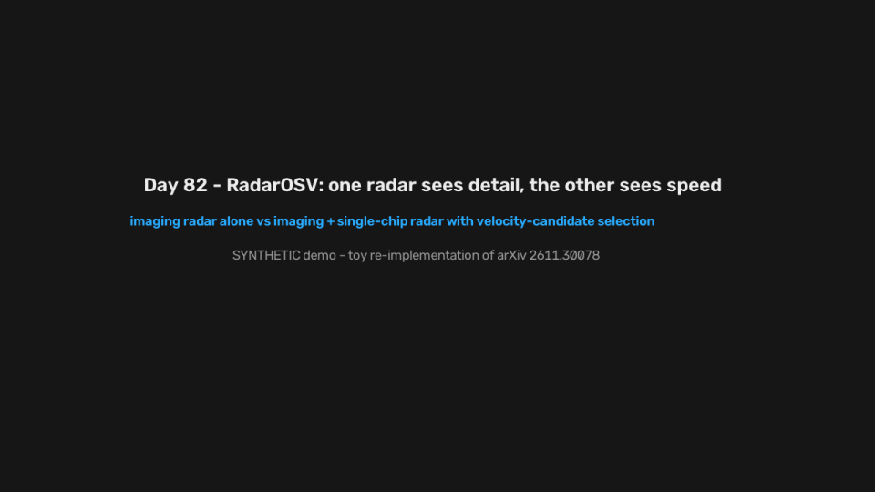
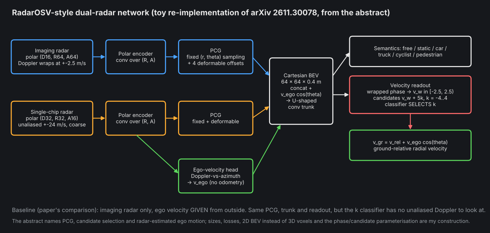

# Day 82 - RadarOSV: two radars, one voxel map (occupancy, class and true speed)

A toy re-implementation of the core ideas in **"RadarOSV: Unified 3D Scene and Motion Perception from mmWave Radars"**
(Yuan Fang, Long Zhuang, Xijia Wei, Jingqi Jiang, Fangzhan Shi, Simon Julier, Kevin Chetty),
[arXiv 2611.30078](https://arxiv.org/abs/2611.30078), listed 24 Nov 2026. It was rebuilt from the **abstract only**, with
**synthetic** street scenes and **two invented radar models**. See [SOURCING.md](SOURCING.md).





## What the paper claims (abstract)
* A radar-only framework jointly predicts 3D occupancy, dynamic-object semantics and ground-relative velocity in unified
  voxels. It uses a cascaded imaging radar (fine detail, small unambiguous velocity range) plus a single-chip radar
  (wide velocity range, coarse resolution).
* A **Polar-to-Cartesian Geometry (PCG)** backbone maps polar imaging-radar features into Cartesian voxels with fixed
  and deformable sampling.
* Single-chip detections give class evidence. Raw Doppler spectra give motion features and **radial-velocity
  candidates**, and the readout **selects** among them to resolve aliasing.
* Ego motion is compensated with **radar-estimated** velocity, so no odometry is needed at inference.
* K-Radar: 40.7% mIoU within 12.8 m (RadarOcc: 34.3%). BRIDGE-Liv, against a cascaded-radar baseline given external
  ego velocity: dynamic-class macro accuracy 63.1% → 75.5%, radial-velocity MAE 1.03 → 0.51 m/s, occupancy kept.

## Folder structure
```
day-82-radarosv/
├── README.md / SOURCING.md / LINKEDIN_POST.md / SIMULATION_SCRIPT.md / config.yaml / requirements.txt
├── osv/
│   ├── scene.py       # synthetic streets (walls, parked cars, poles, cars/trucks/cyclists/pedestrians), BEV ground truth
│   ├── radar.py       # imaging radar (64x64 polar, Doppler wraps at ±2.5 m/s) + single-chip radar (32x16, ±24 m/s)
│   └── model.py       # PyTorch core: PolarEncoder, PCG, EgoVelocityHead, VelocityReadout, RadarOSVNet, losses
├── train.py           # --run base | osv | osv_ext | osv_fixed
├── evaluate.py        # all configs -> results/summary.json, RESULTS.md (scene-bootstrap CIs)
├── simulate.py        # OpenCV "AI in action": 2 radar inputs, 2 predictions, ground truth, live telemetry
├── make_diagram.py    # assets/architecture.png
├── run_all.sh         # the training queue used here (2 parallel CPU queues)
├── tests/test_osv.py  # 9 tests
├── results/           # summary.json, RESULTS.md, clips.json, per_scene.npz, logs/, ckpt/*.pt
└── assets/            # radarosv_simulation.gif / .mp4 / still.png / architecture.png
```

## Run
```bash
pip install -r requirements.txt
python train.py --run base --seed 0      # ~19 CPU-min (1 thread); data is generated on first use (~1 min, 2.2 GB)
python train.py --run osv --seed 0       # ~25 CPU-min
python train.py --run osv_ext --seed 0   # ablation: external ego speed
python train.py --run osv_fixed --seed 0 # ablation: fixed-only PCG
# repeat base / osv with --seed 1
python evaluate.py                       # ~6 min
python simulate.py --out assets/radarosv_simulation.gif --mp4 assets/radarosv_simulation.mp4
pytest -q tests
```

## The toy setup
* **Scenes:** the ego drives along +x at 0-8 m/s through a street with two walls (with gaps), parked cars and poles, plus
  2-6 road users: car (0-12 m/s), truck (0-10), cyclist (2-7), pedestrian (0.3-2). 20% of vehicles cross. 10,000
  training and 1,500 held-out scenes.
* **Imaging radar (my construction):** 64 range bins x 0.4 m, 64 azimuth bins over ±60°, 16 Doppler bins over
  [-2.5, 2.5) m/s. Anything faster relative to the radar wraps. **73% of moving-object cells are aliased.**
* **Single-chip radar:** 32 x 0.8 m range, 16 azimuth bins (7.5°, extra blur), 32 Doppler bins over ±24 m/s, 40% of
  returns dropped. Pedestrians, cyclists and car wheels add micro-Doppler spread.
* **Ground truth:** 64 x 64 BEV grid, 0.4 m cells, classes free / static / car / truck / cyclist / pedestrian, and the
  ground-relative radial velocity per cell. Graded inside the ±60° field of view.
* **Network (`osv/model.py`):** polar encoders (Doppler bins as channels) → PCG (grid_sample at each cell's (r, θ) plus 4
  learned offsets) → fused BEV with a v_ego·cos θ compensation map → U-shaped conv trunk → semantics, wrapped phase,
  and a 9-way candidate classifier (v = v_w + 5k, k = -4..4). v_gr = v_rel + v_ego cos θ.
* **Configurations:** `base` = imaging radar only, true ego speed given (the paper's baseline; 0.37M params). `osv` =
  both radars, radar-estimated ego speed (0.66M). `osv_ext` = both radars, true ego speed. `osv_fixed` = `osv` without
  deformable offsets. 3,000 steps of batch 8, AdamW 1e-3 with cosine decay.

## Results (1,500 held-out scenes; base and osv averaged over 2 seeds)
Full tables are in [results/RESULTS.md](results/RESULTS.md).

| Configuration | occ mIoU ≤12.8 m | dyn class macro acc | radial-vel MAE (m/s) | aliased cells | unaliased | right candidate | ego MAE |
|---|---|---|---|---|---|---|---|
| imaging radar + external ego (baseline) | 0.796 | 0.760 | 4.007 | 4.237 | 3.373 | 42.7% | given |
| baseline with 0.5 m/s odometry noise | 0.796 | 0.759 | 4.110 | 4.337 | 3.482 | 42.6% | given |
| **imaging + single-chip, radar ego (RadarOSV-style)** | **0.802** | 0.767 | **0.592** | **0.599** | **0.573** | **93.7%** | 0.134 |
| imaging + single-chip, external ego (1 seed) | 0.805 | 0.772 | 0.506 | 0.515 | 0.478 | 94.0% | given |
| RadarOSV-style, fixed-only PCG (1 seed) | 0.805 | 0.782 | 0.584 | 0.598 | 0.546 | 93.9% | 0.139 |

| Claim (abstract) | This toy |
|---|---|
| Velocity MAE roughly halves (1.03 → 0.51 m/s) | **Reproduced, and larger here:** 4.01 → 0.59 m/s (-85%; seed 0 paired diff -3.49, CI -3.60..-3.38). The size depends on how many returns alias: 73% here. |
| Dynamic-class accuracy rises (63.1 → 75.5%) | **Not reproduced:** 76.0 → 76.7% (seed 0: +0.7 pts, CI -0.0..+1.4). Pedestrians gain (64.8 → 69.4%), cars and trucks lose about 1 pt. |
| Occupancy kept | **Reproduced:** 0.796 → 0.802 mIoU within 12.8 m. |
| No odometry needed | **Mostly:** radar ego speed error 0.13 m/s, but the same network given true ego speed is better (0.506 vs 0.572 m/s, seed 0, CI -0.086..-0.047). |
| Fixed + deformable PCG sampling | **Deformable did not help here:** fixed-only was equal on velocity and better on class accuracy (+1.2 pts) and occupancy (+0.8 pts), one seed. |

### Reading it honestly
* **Why the class claim failed in my toy:** my classes differ a lot in size, so geometry from the imaging radar already
  separates them. Micro-Doppler from the wide-range radar mainly helps the small classes (pedestrians +4.6 pts). The
  paper's real classes and annotation regions are surely harder; my result does not contradict it, it just does not
  confirm it.
* **The baseline is bad even on unaliased cells (3.37 m/s)** because its candidate classifier cannot tell whether a
  reading is wrapped, so it hedges toward wrong k on slow objects too.
* **Odometry noise barely hurts the baseline's moving objects** (+0.10 m/s) because they are already dominated by
  aliasing errors, but it triples the static-cell velocity error (0.14 → 0.41 m/s).
* **When the second radar does not matter:** a nearly stopped ego with slow pedestrians. In 2 of 120 clips the
  baseline was better over the first 0.8 s (simulation scene 3).
* **Toy limits:** invented radars, 2D BEV instead of 3D voxels, no occlusion, multipath or ghost targets, perfect
  time sync and extrinsics between radars, single frames, 3,000 CPU steps, 2 seeds for the main configs and 1 for the
  ablations. Not comparable to the paper's numbers.
* **Clip choice:** scene 1 is random (seed 82). Scene 2 is the median of the 107/120 pool scenes where RadarOSV wins by
  more than 1 m/s; scene 3 is the median of the 2/120 where it lost (scored over the first 0.8 s; over the full 6 s
  RadarOSV ends up ahead, 0.29 vs 0.49 m/s).

## Core layers (excerpt from `osv/model.py`)
```python
class PCG(nn.Module):
    def forward(self, f):                      # f (B, C, R, A) polar -> (B, C, G, G) Cartesian
        g = self.grid.expand(f.shape[0], -1, -1, -1)                              # each cell's (theta/FOV, 2r/Rmax-1)
        out = F.grid_sample(f, g, align_corners=False, padding_mode="zeros")    # fixed sampling
        if self.deformable:
            o = self.off(out)                                                     # (B, 3 n_s, G, G)
            d = torch.tanh(o[:, : 2 * self.n_s]) * self.max_off                   # learned offsets
            w = torch.softmax(o[:, 2 * self.n_s:], 1)                             # learned weights
            acc = sum(w[:, k:k + 1] * F.grid_sample(f, g + d[:, 2*k:2*k+2].permute(0, 2, 3, 1), align_corners=False)
                      for k in range(self.n_s))
            out = out + acc
        return out * self.valid

class VelocityReadout(nn.Module):
    @staticmethod
    def decode(ph, logit):
        v_w = VI * torch.atan2(ph[:, 1], ph[:, 0]) / math.pi                      # wrapped radial velocity
        k = logit.argmax(1) - K_CAND                                              # selected aliasing candidate
        return v_w + 2 * VI * k.float(), v_w, k                                   # v_rel = v_w + 5 k
```
